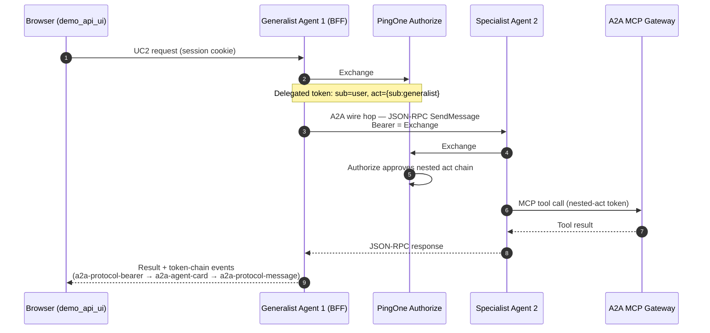
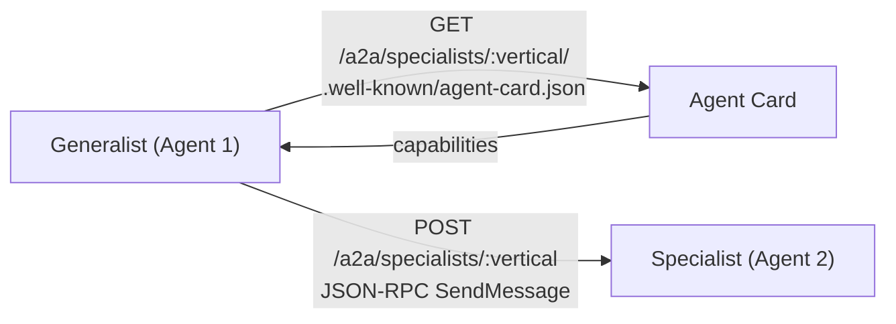

# A2A Architecture (UC2 / UC2.5)

> Source of truth: `demo_api_server/config/a2aSpecialists.js`, `a2aDelegationService.js`, `a2aProtocol*`.
> The A2A protocol runs **only** in UC2/UC2.5 — never on ordinary agent runs.

## Two layers that share the name "A2A"

1. **Identity (PingOne)** — nested RFC 8693 `act` chain approved by PingOne Authorize.
2. **Wire protocol (Linux Foundation A2A)** — Agent Card discovery + JSON-RPC `SendMessage` over a **separate** PingOne bearer.

## Delegation flow

Key distinction: the wire hop carries the **Exchange #1 delegated token** (proves the user), not a client_credentials token. The specialist performs Exchange #2 itself, after the hop arrives.

## Card discovery

## Specialist registry (single source of truth: `config/a2aSpecialists.js`)

| Vertical | Specialist | PingOne app | Tool(s) |
|---|---|---|---|
| banking | Investment Advisor | Super Banking Investment Advisor Agent | `get_portfolio_summary`, `get_investment_accounts`, `get_investment_balance`, `get_investment_transactions` |
| healthcare | Records Specialist | Super Banking Records Specialist Agent | `sensitive_patient_records` |
| retail | Purchase History Specialist | Super Banking Purchase Specialist Agent | `sensitive_order_history` |
| sporting-goods | Membership Specialist | Super Banking Membership Specialist Agent | `sensitive_membership_details` |
| workforce | Payroll Specialist | Super Banking Payroll Specialist Agent | `sensitive_payroll_details` |
| government | Tax Records Specialist | Super Banking Tax Records Specialist Agent | `sensitive_tax_record` |
| university | Financial Aid Specialist | Super Banking Financial Aid Specialist Agent | `sensitive_student_finance` |
| manufacturing | Supplier Contract Specialist | Super Banking Supplier Contract Specialist Agent | `sensitive_supplier_contract` |
| investment | Holdings Specialist | Super Banking Holdings Specialist Agent | `sensitive_holdings` |
| airlines | Passenger Records Specialist | Super Banking Passenger Records Specialist Agent | `sensitive_passenger_record` |
| admin | Identity Verification Specialist | Super Banking Identity Verification Specialist Agent | `sensitive_customer_identity` |
| abercrombie-fitch | *(alias → retail)* | shares Purchase Specialist | — |

Scopes are **not** declared in the registry — `scope-topology.json` is the scope source of truth; each specialist's requested scope is derived via `scopeTopology.toolScopes`.

## Local endpoints (UC2 runs)

- Card: `GET /a2a/specialists/:vertical/.well-known/agent-card.json`
- JSON-RPC: `POST /a2a/specialists/:vertical` — requires `Authorization: Bearer <PingOne access token>`, `A2A-Version: 1.0`
- Handoff defaults to in-process `@a2a-js/sdk` `sendMessage`; set `A2A_PROTOCOL_HTTP=1` (or pass `protocolBaseUrl`) to force the HTTP client path
- Card base URL uses `PUBLIC_APP_URL` (default `https://api.ping.demo:3001`)

## References

- Spec v1.0: https://a2a-protocol.org/v1.0.0/specification/
- JS SDK: https://github.com/a2aproject/a2a-js (`@a2a-js/sdk`)
- Security sample (bearer pattern): https://github.com/a2aproject/a2a-samples/tree/main/samples/java/agents/magic_8_ball_security
- Nested-act details: `docs/ACT_CLAIM_VERIFICATION.md`, `docs/ACTOR_TOKEN_TERMINOLOGY.md`
