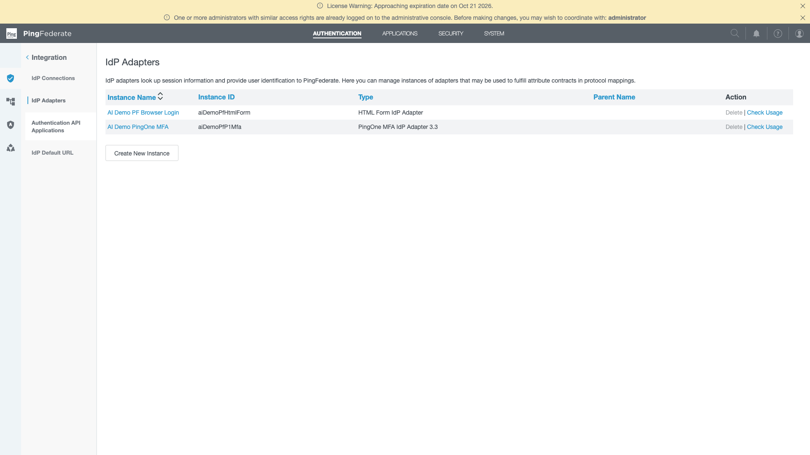
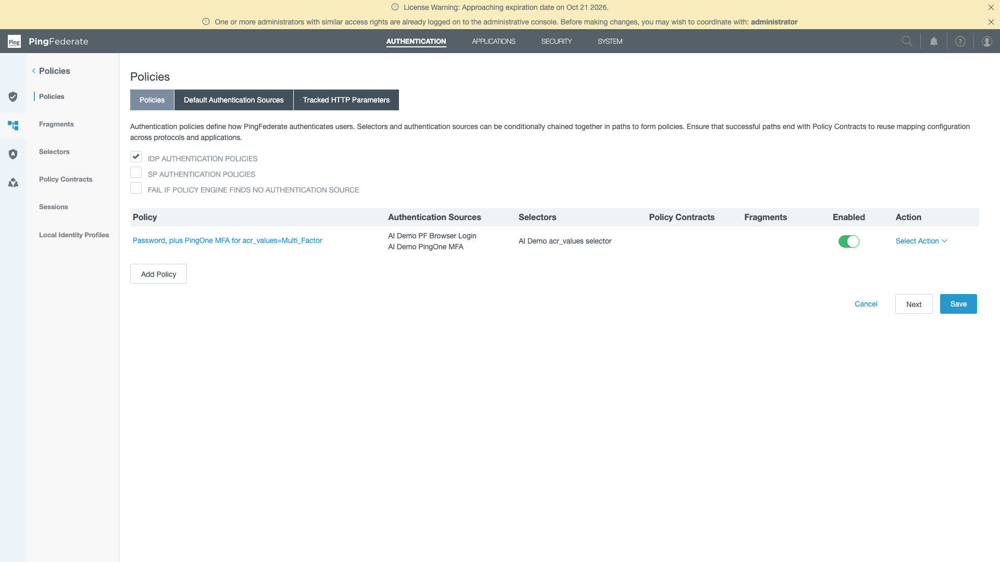
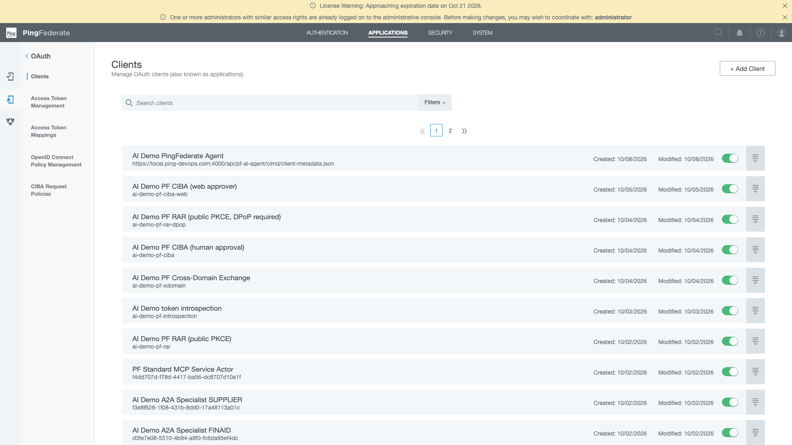

# PingFederate MFA in the AI demo: status and what is left

_Status as of 2 October 2026. Applies to the local Docker PingFederate (`ai-demo-pingfederate`, admin API on `https://local.ping-devops.com:9999`)._

## Summary

PingFederate can now challenge a user for MFA through PingOne, but only when the app asks for it. The configuration is in place and has been checked through the PingFederate admin API. Nobody has yet completed a real sign-in with a second factor, so the end-to-end flow is unproven.

## What is in place

| Piece | Id | What it does |
|---|---|---|
| PingOne connection | "AI Demo PingOne" | Links PingFederate to the PingOne environment `01d89b06-66d5-430e-9f28-65636843788b`. |
| MFA adapter | `aiDemoPfP1Mfa` ("AI Demo PingOne MFA") | Runs the PingOne MFA challenge. |
| Selector | `aiDemoPfAcrSelector` ("AI Demo acr_values selector") | Reads the `acr_values` parameter on the authorization request. |
| Policy | "Password, plus PingOne MFA for acr_values=Multi_Factor" (enabled) | Decides which sign-ins get MFA. |

### How the policy routes a sign-in

| `acr_values` on the request | What the user sees |
|---|---|
| `Multi_Factor` | Password form (`aiDemoPfHtmlForm`), then PingOne MFA |
| Any other value | Password form only |
| Not sent | Password form only |

### How the adapter is configured

- Population: "Sample Users" (`a7349e04-08ef-4225-8b75-7ec4bb4bc127`). PingFederate users are created here on their first MFA.
- Application: "Demo AI App - PKCE" (`160cc22f-ccc4-4fef-8470-c9094c8a9afa`).
- MFA policy used for registration: "Default MFA Policy" (`9e94e3ca-9536-06a9-016a-b2baa39b363f`).
- Users are prompted to set up MFA if they have none.
- Default method for provisioned users: SMS.
- Username attribute: `username`.

The adapter is created by `scripts/pingfederate/create-pingone-mfa-adapter.js`, which currently lives on the `signin-mfa-test-hook` branch. It does a dry run by default, creates the adapter with `--apply`, and does nothing if the adapter already exists.

## What has been checked

- The adapter, selector and policy all exist, and the policy references the adapter. Checked by reading the PingFederate admin API.
- The policy tree matches the routing table above.
- The app already sends `acr_values=Multi_Factor` in two places, so no app change is needed to reach the MFA branch:
  - Step-up: `GET /api/auth/oauth/user/stepup` sends `acr_values=Multi_Factor` and `max_age=0`.
  - Test hook: the modal (pi.flow) login adds `acr_values=Multi_Factor` when called with `mfa=1`.
- Ordinary sign-in sends no `acr_values`, so it stays password-only.

## What has not been checked

- No real sign-in has been driven through the MFA branch. That needs a test user's password and a second-factor device.
- Whether PingFederate puts `acr: Multi_Factor` in the ID token after a successful MFA (see item 1 below).

## Proposed rule for when to enforce MFA

Enforce MFA at the same moments the app already asks for it under PingOne, and not at every sign-in.

| When | MFA | State today |
|---|---|---|
| Ordinary sign-in | No | Already the case. |
| High-value or sensitive action (step-up) | Yes | The existing step-up route should reach the MFA branch with no app change. Unproven. |
| On-demand test of MFA at sign-in | Yes | Available through the `mfa=1` test hook. |
| Admin sign-in | Undecided | Not enforced. Enforcing it is a small change to the admin login route. |

## What is left

1. **Confirm the `acr` claim.** The step-up callback rejects the sign-in unless the ID token carries `acr` equal to the requested value (`Multi_Factor`). If PingFederate does not emit it, every step-up will fail after a successful MFA. This is the most likely break, and it may need an attribute mapping in PingFederate.
2. **Run a real sign-in with `mfa=1`.** Use a test user through PingFederate and confirm the MFA prompt appears and first-time enrolment completes.
3. **Run a real step-up.** Trigger a high-value action and confirm the callback accepts the token.
4. **Decide on admin sign-in.** Either leave it password-only or require MFA.
5. **Decide what "No Match" should do.** Today a request with any `acr_values` other than `Multi_Factor` gets password only, silently. If the step-up value (`STEP_UP_ACR_VALUE`) is ever changed in the app, the selector must be changed to match, or step-up stops requiring MFA.
6. **Plan for first-time users.** A user's first MFA is an enrolment flow with SMS as the default, not a quick challenge. Demo users should be enrolled ahead of a demo.
7. **Script the selector and policy.** Only the adapter has a script. The selector and policy exist in the running PingFederate but would have to be recreated by hand on a fresh install.
8. **Merge the adapter script.** It is on the `signin-mfa-test-hook` branch, not on `main`.

## How to re-check the configuration

Console (admin console at `https://local.ping-devops.com:9999`, or `https://localhost:9999` from the Docker host; sign in as `administrator`):

_Authentication → Integration → IdP Adapters: `aiDemoPfHtmlForm` (password-only sign-in) and `aiDemoPfP1Mfa` (PingOne MFA 3.3) — the adapter the MFA policy routes through._

_Authentication → Policies: the single IdP policy "Password, plus PingOne MFA for acr_values=Multi_Factor", driven by the `AI Demo acr_values` selector._

_Applications → OAuth → Clients: the demo's clients (PKCE, CBA, CIBA, RAR/DPoP, token introspection, MCP service actor, A2A specialists)._

API (basic auth as `administrator`, header `X-XSRF-Header: x`):

- `GET /pf-admin-api/v1/idp/adapters/aiDemoPfP1Mfa`
- `GET /pf-admin-api/v1/authenticationSelectors`
- `GET /pf-admin-api/v1/authenticationPolicies/default`
- `GET /pf-admin-api/v1/authenticationPolicies/settings`
