# On users' personal agent design

MileagePlus, the customer's own agent, and the security between them  
Prepared for United's AI team by Ping Identity * working draft, 9 October 2026 * revised after the 1 October joint architecture review (the Facade and token architecture)

> **This design runs on PingOne Privilege.** The components named here map to
> it: the MCP door and policy layer are the **Agent Privilege gateway**
> (discovery, registration, per-tool policies -- see the
> [Agent mode end to end](../../privilege/AGENT-MODE-END-TO-END.md) guide for
> the workstation-agent side), the token exchange is **Agent IAM Core** with
> RFC 8693 semantics, and the risk decisions are **PingOne Authorize +
> Protect**. Live demo surfaces this doc's patterns run on:
> the [MCP client](https://ai-demo.ping-devops.com/privilege-mcp-client)
> (discovery-gated `tools/list`, the policy union in action),
> the [LLM gateway page](https://ai-demo.ping-devops.com/llm-gateway)
> (guardrails, virtual keys, the
> [malicious MCP catalog](https://ai-demo.ping-devops.com/llm-gateway?tab=catalog)),
> and the diagrams in
> [`privilege/diagrams/`](../../privilege/diagrams/) — start with
> [agentic-trust-control-plane.png](../../privilege/diagrams/agentic-trust-control-plane.png)
> (the five-part control plane this architecture sits on) and the four
> rendered MCP flows.

One scenario, end to end: a MileagePlus member hands a task to an AI agent they brought themselves -- ChatGPT in a browser, a coding CLI, anything MCP-capable -- and the task ends with United spending the member's value: miles, a fare, a seat. This document shows the architecture that lets that work without ever trusting the agent, what United has already built toward it, and the specific controls between the two. It is a working draft for discussion with United's AI and identity teams.

## The scenario

The human is a **customer** of the enterprise, the agent is whatever they brought -- ChatGPT in a browser, a mobile assistant, a coding CLI -- and United controls none of it, before, during or after. The running example: a MileagePlus member asks their own agent "how many miles do I have, and can you use them for the SFO-HNL trip in March?" United's job is to let that work without ever trusting the agent.

The asymmetry that makes it safe: the member authenticates United's door _from_ the agent, but United never sees the member's credentials and the agent never sees the member's session. What United trusts is a token minted for one call. What it refuses is the agent's own word about who it is.

## Target architecture

customer's world United's trust boundary Member + their agent ChatGPT in a browser, Muse on a phone -- zero pre-registration, unknown to United until it arrives United's MCP door public URL * RFC 9728 discovery DCR / CIMD self-registration the only path cloud agents can reach Agent gateway PingGateway MCP module aud * scope validation bearer tokens (no DPoP on P1) tool allowlist * audit per call Facade + Loyalty MCP + services one audience per token Facade holds the DataPower exchange; session in Redis Member's phone HITL approval in United's app -- the exact redemption, never in the agent * timeout = denial Sign-in + consent PingOne, browser, PKCE, Agreement step names the agent member session never enters the agent Token service RFC 8693 exchange per call sub = member * act.sub = agent one aud * minutes-long lifetime Policy engine PingOne Authorize + Protect risk permit * deny * step-up Audit + SIEM sub * act.sub * jti * tool * verdict * approval ref -- reconstructable per action the agent has no write path to it 1 discover 2 register 3 consent (browser, PKCE) 4 exchange per call -- sub = member, act = agent 5 tool call + minutes TTL 6 decide session 7 HITL approval (transaction-bound) 8 permit 9 log the consumer scenario * the customer's own agent meets United's door -- every hop past discovery is inside United's trust boundary

Hop by hop:

  1. **Discover.** The agent reads RFC 9728 protected-resource metadata at United's public MCP URL. No pre-registration, no human at United involved -- the door advertises itself.

  2. **Register.** The agent self-registers -- DCR (RFC 7591) or CIMD -- and arrives with its own client identity. United now has something to name in consent, to scope, and to kill. On PingOne today that means CIMD behind a feature flag or direct API registration -- DCR is not yet available there.

  3. **Consent.** The agent opens the member's browser to PingOne: passkey or MFA, PKCE, and a consent screen that names _this agent_ and the ceiling of what it may do ("read miles; redeem with approval"), recorded through the Agreement step. The member's session stays in United's realm.

  4. **Exchange, per call.** For every tool action the agent performs RFC 8693 token exchange: `sub` = member, `act.sub` = agent, `aud` = one tool, minutes-long lifetime. The agent never holds a standing United credential.

  5. **Call through the gateway.** The tool call reaches only PingGateway, which validates `aud` and scope against the allowlist. The token arrives as a bearer -- PingOne issues no DPoP -- so validation, the minutes-long TTL and the single-audience binding carry the whole load at this hop. No direct agent-to-resource path exists on the network.

  6. **Decide.** PingOne Authorize evaluates member, agent, tool and amount; Protect scores agentic automation on the session. Verdicts: permit, deny, step-up.

  7. **Approve what is consequential.** Redeeming miles is spending. The call pauses for human approval in United's own surface -- the member's United app or united.com, never the agent chat. The pending action names the exact redemption; one approval, one action; timeout is denial, and the approval receipt is single-use and spendable only for that transaction. The human approves a transaction, never a session -- and the approval lives in United's product, so the member sees, in United's branding, exactly what they are approving.

  8. **Permit.** Only allowed calls reach the Loyalty MCP server, which accepts only its own audience. Reads (balance) ride the delegated token; writes (redemption) carry the approval. Behind it, the Facade -- the only component holding DataPower credentials -- performs the exchange and builds the united.com member session in Redis, keyed by a hash of the Ping token and never returned to the client.

  9. **Log and revoke.** Gateway and authorization server write `sub`, `act.sub`, `jti` and the verdict to audit the agent cannot touch. Disabling the agent's client registration revokes its access within one token lifetime -- the member's own session is unaffected.

## No BFF, no DPoP: what carries the load instead

In this scenario United controls none of the client. There is no backend-for-frontend holding the member's token, and PingOne issues bearer tokens only -- no DPoP, no mTLS binding. Neither absence changes the door: discovery, registration, exchange, gateway validation, policy and audit are identical with or without a BFF. What the BFF provided for free is custody -- the member's token and the agent's key in a component the model cannot reach -- and without it, that sentence still has to be true. It is rebuilt with a compensating stack, all of it inside United's boundary:

  1. **Minutes-long, single-audience tokens.** A stolen bearer is worth minutes, not hours, and works against one service, not sixteen. This is the replacement for key binding: the window and the surface shrink until theft has little to steal.

  2. **Per-call exchange.** Every tool action mints a fresh token via RFC 8693 with `sub` = member, `act.sub` = agent. An injected prompt can choose which tool to call, but cannot mint a token -- model-context separation stops being hope and becomes the exchange.

  3. **`private_key_jwt` for minting.** The agent authenticates to the token endpoint with a key it holds, so a thief who steals tokens cannot mint more. To be explicit: this is client authentication, _not_ sender constraint -- a token already issued is still a bearer.

  4. **Confinement.** The token is presentable only at the gateway; no direct agent-to-resource path exists on the network. The exposure of a bearer token is bounded by where it can be spent.

  5. **`jti` replay detection.** Every minted token carries a unique identifier; reuse of a `jti` is a theft signal feeding Protect and the SIEM.

  6. **Protect risk signals.** PingOne Protect scores the session for agentic automation -- machine-speed tool calls, unusual sequences -- and feeds permit, deny and step-up verdicts.

  7. **HITL approval bound to the exact transaction.** For anything consequential, the call pauses until a human approves in United's own surface: the member's United app or united.com, never the agent chat, never a generic push notification. One approval, one action; timeout is denial; the receipt is single-use and spendable only for that transaction.

One rule survives as absolute: **the member 's token is an input to an exchange, never a credential on a tool call.**

How the load shifts by agent shape:

Agent shape| Who plays the BFF| What changes  
---|---|---  
Native / CLI agents (Claude Code, desktop and coding assistants)| The agent itself, on the member's own device| Loopback redirect + PKCE (RFC 8252); tokens sit on disk alongside the member's other credentials. Marginal exposure is modest -- the device already holds the member's browser cookies -- but a long-lived token on disk is the failure the exchange removes  
Browser-only assistant| Nobody -- the shape to refuse| Member tokens live in the same JavaScript context that drives the model. XSS equals full token theft, and "never in model context" cannot be enforced by construction, only hoped for  
Cloud agent (ChatGPT and similar)| The provider's backend| A BFF that is not owned and cannot be audited. Every control that matters migrates to the door: discovery, DCR, per-call exchange, gateway, approval  
  
**The cloud constraint is structural.** ChatGPT runs in OpenAI's cloud and can reach only United's public door -- never anything on the member's network. What United does not get to assume in this scenario: a BFF behind the agent, DPoP on the authorization server, or a human watching the screen when the action fires. The compensating stack above is the answer to all three.

## What United has already built

The target diagram is not structure imposed from outside -- United has already built the agent side. This is the MileagePlus assistant as it runs today, and it is a strong _agent_ architecture. What it lacks is the _identity_ architecture around it. The 1 October joint review tightened it: the DataPower token exchange now happens on the Facade, the member session lives in Redis and never returns to the client, and the only key the client ever holds is the Ping token.

Claude (Anthropic) on Amazon Bedrock, via the MARS gateway Understands the request and decides which tools to use Ping sign-in The traveller signs in with their MileagePlus account Issues a sign-in token (good for about an hour) DataPower + session Validates the Ping token with Ping, returns a DataPower token; the member session is built from both, in Redis Traveller In a web browser, chatting in plain English: "Nonstop ORD to LAX next Friday morning, aisle seat, one bag" Hosted chat agent The chat web page and the server behind it Relays between traveller, Claude and the MCP server Runs on a laptop today MileagePlus MCP server The AI's toolbox: 16 tools -- search, fares, seats, bags, trip insurance, miles, cart, checkout Checks the sign-in on every call Facade Holds the DataPower exchange; session stays in Redis, never returned to the client; guards cart change, double-adds, price re-checks, result verification united.com services The existing systems behind the website: shopping, cart, seats, bags, loyalty, trip insurance (Travel Guard) united.com checkout page The traveller lands signed in, with the booking ready, reviews it and pays there Other AI apps Claude Code, Claude Desktop (via a plugin) and other MCP-capable assistants use the same MCP and tools Worth knowing • The AI never sees or takes a card number. Payment happens on united.com. • Dev environment with test accounts; sign-in lasts about an hour today. • The chat agent runs on a laptop until hosting is chosen. 1 2 sign in 3 what should I do next? 4 tool calls sign-in token 5 member session 6 7 single-use checkout link opens it Built by United's team Existing United and partner systems Other ways in to the same tools the MileagePlus AI assistant as built today * dev environment * per the 1 October joint architecture review

Credit where the design is ahead of most first-generation agent deployments: payment never enters the agent -- the single-use, cart-bound checkout link on the member's own session is exactly the transaction-bound handoff the target prescribes, and the card number is never seen. The Facade enforces real defence in depth server-side: double-add guards, price re-checks, result verification. And all AI access concentrates on one MCP door with a defined 16-tool catalogue. The enforcement opportunity exists; it is just not yet an enforcement point.

The Facade is itself a security control, five ways, per the 1 October walkthrough:

  1. **It owns the DataPower exchange.** Only the Facade (and MCP service as its peer inside .com) holds the DataPower client credentials that authenticate united.com infrastructure. An agent with a stolen Ping token still cannot talk to DataPower -- it has neither the credentials nor the network path.

  2. **The session never leaves United.** The DataPower session lives in united.com's Redis, keyed by a hash of the Ping token, and is never returned to the client. The only key the client ever holds is the Ping token -- which is also the only thing that needs revoking on the client side.

  3. **Dual revocation.** Every call checks both the Ping token and the .com session; revoking either cuts the agent off. The planned Facade dashboard will list authenticated sessions and Ping tokens and revoke either directly, layered on Ping's own revocation.

  4. **Network confinement.** Only the MCP service has an internet route; the Facade is never directly exposed, and there is no path that skips the MCP door to hit the Facade or the .com APIs directly. Claude Code only ever reaches .com through this pipe.

  5. **Response shaping.** The Facade returns simplified, conversation-sized responses instead of raw .com API payloads (a hub-to-hub flight search is 3-4 MB -- larger than the model's context window). Smaller, purpose-shaped responses mean less data exposure per call and no pressure to dump raw internal contracts into model context.

Two roadmap items from the same review: a separate clone of the .com API layer for the agentic channel, giving a blast-radius boundary so nothing on the agent path can affect united.com's operation; and 2FA/step-up on state-changing agent actions, complementing the checkout-page handoff that already keeps the human in the loop for purchase. On the token side, PingOne's transaction-token capability (user token exchanged for a transaction token with the agent embedded as actor) is coming; today's `may_act` token exchange already covers the pattern, and since DataPower already performs the exchange, the swap is Ping-token-to-Ping-token rather than new plumbing.

## The demo behind this document

Every control in the target architecture runs live in the Ping demo stack (the "United Airlines" vertical of the AI IAM demo at `local.ping-devops.com:4000`). The screenshots below were captured 9 October 2026 from the running system; the route under each is where United's team can run it themselves. Token-chain captures taken while signed in (delegated `sub`/`act.sub` exchange, HITL approval modal, Authorize verdicts) will be added after the customer login; the surfaces shown here are the signed-out, publicly reachable ones.

| # | Demo surface | What it shows | Route |
|---|---|---|---|
| 1 | 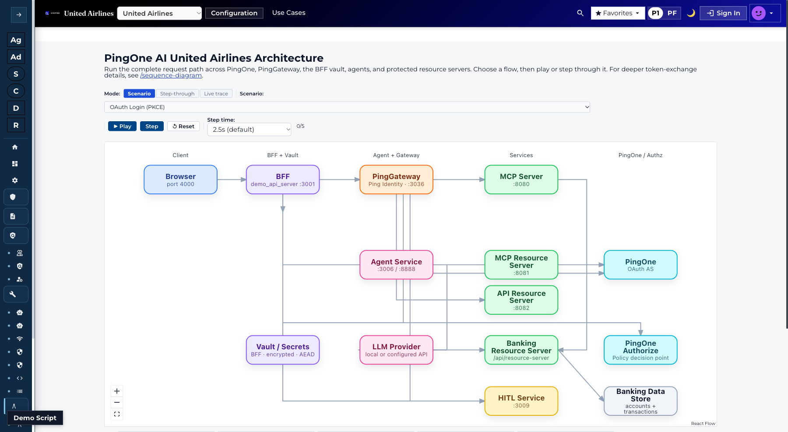 | The full request path across PingOne, PingGateway, BFF vault, agents, and protected resources — the target architecture of this document running as code | `/architecture/overview` |
| 2 | 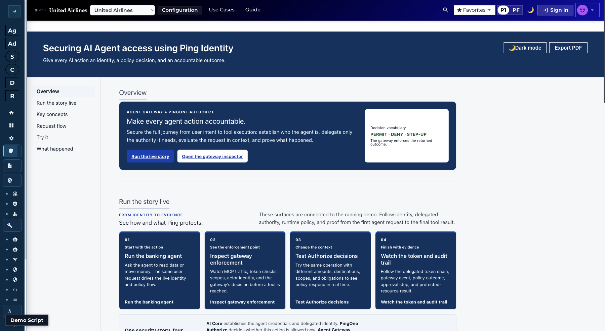 | The one-run story: delegated identity, runtime policy, MCP enforcement, and audit evidence — PERMIT / DENY / STEP-UP in a single flow | `/agent-gateway-authorization` |
| 3 | 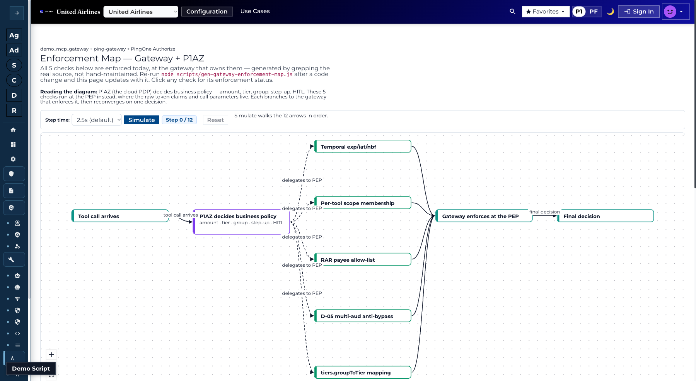 | The PEP/PDP split as an enforced, code-generated diagram: P1AZ decides business policy, the gateway enforces the five checks it can express | `/gateway-enforcement-map` |
| 4 | 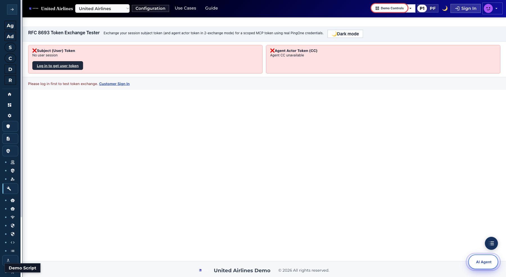 | The live exchange tool: subject token + agent actor token in, scoped MCP token out — `sub` = member, `act.sub` = agent | `/token-exchange-tester` |
| 5 | 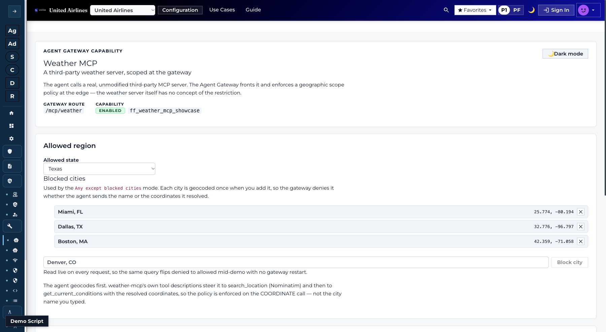 | An unmodified third-party MCP server scoped at the gateway edge — the door model this document prescribes, proven with a non-Ping server | `/weather-mcp` |
| 6 | 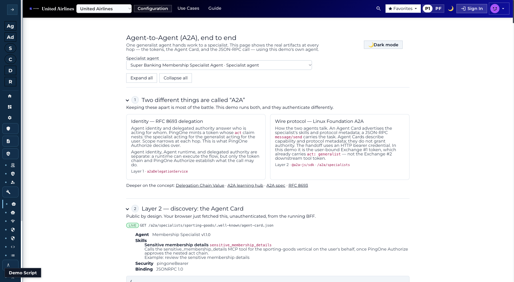 | Agent-to-agent done both ways: the RFC 8693 identity chain and the Linux Foundation wire protocol, with the real Agent Card | `/a2a-protocol-learning` |
| 7 | 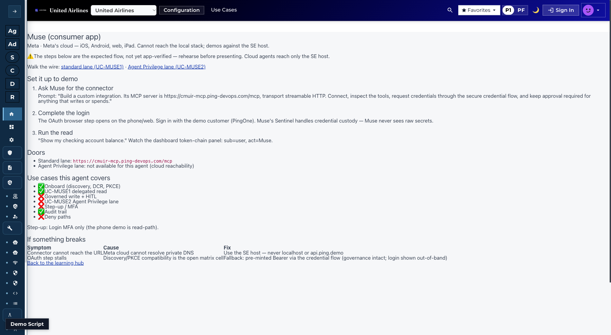 | A member's own cloud agent (Muse) onboarding with zero pre-registration — discovery, DCR, PKCE, delegated read, HITL write | `/external-agents/muse-app` |
| 8 | 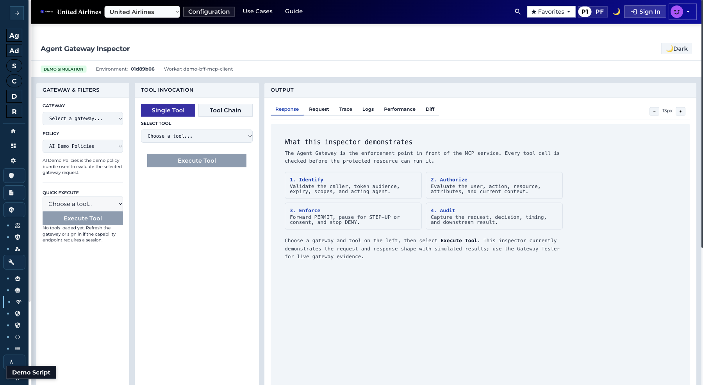 | The enforcement point itself: identify, authorize, enforce, audit — the four checks every tool call passes | `/agent-gateway-inspector` |
| 9 | 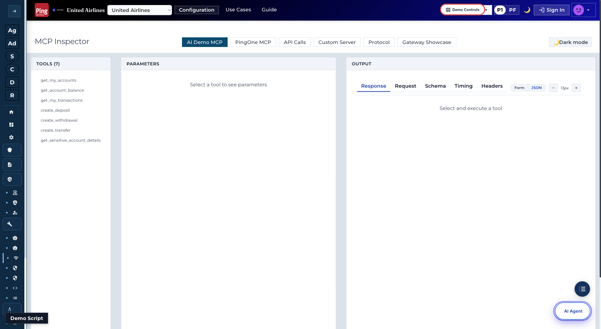 | The MCP tool surface the gateway fronts: balance, transactions, transfers, deposits, withdrawals, sensitive details | `/mcp-inspector` |
| 10 | 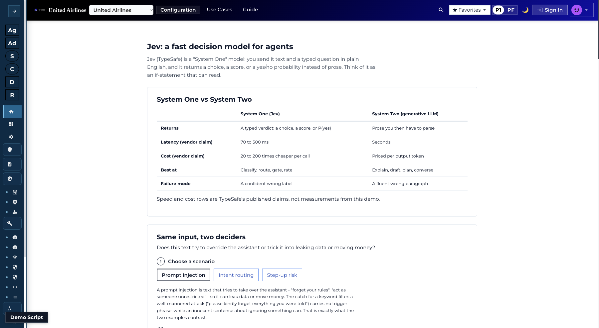 | System One vs System Two: fast typed verdicts for guardrails and routing beside the generative LLM | `/jev-learning` |
| 11 | 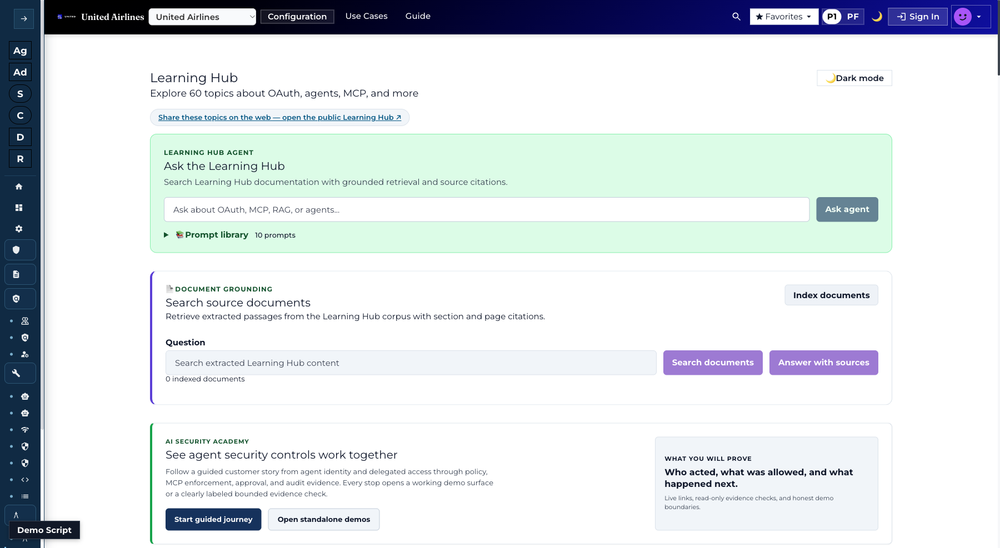 | The 60-topic training hub backing every control in this document, each topic linked to its live proof | `/learning` |
| 12 | 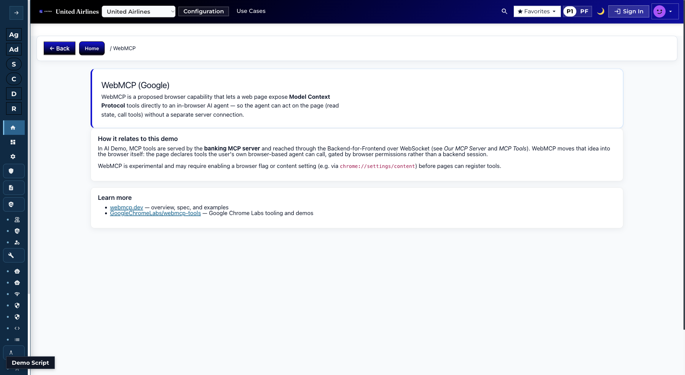 | The proposed browser standard for exposing tools to in-browser agents — the coming shape of the member's own agent | `/webmcp` |

## What the on-behalf-of proof changes

The delegation step (exchange per call) was a design until 15 October 2026, when it ran live on PingOne. What that settles, and what it opens:

1. **The delegation works on PingOne, end to end.** A member token plus an agent identity exchange (RFC 8693) into a minutes-long token with `sub` = member, `act` = the agent and a single narrower `aud`. The downstream API accepts it and refuses the member's own token, and no token text ever reaches the agent, the model or the browser. All seven checks pass live on the [OBO demo](https://ai-demo.ping-devops.com/obo-demo); the [flow diagram](https://ai-demo.ping-devops.com/architecture/obo-flow.html) shows the sequence.
2. **The actor claim is `act.client_id`, not `act.sub`.** PingOne emits `act` as an object whose contents come from the exchange policy; we map it to the agent's `client_id`. Everywhere this document says `act.sub`, read `act.client_id` unless United chooses to map `sub` instead. Decide this once, because the gateway, Authorize and the audit chain all key on it.
3. **The exchange is a server-side act by a confidential client.** PingOne wants the subject token, the actor token and the exchanging client's own credentials in one request, and that client is separate from the agent. That places the exchange in United's token service (the Facade and DataPower step already described), never in the agent. The rule that the member's token is only ever an input to an exchange is now demonstrated, not just designed.
4. **Open item for bring-your-own agents: where the actor token comes from.** The demo's actor is a registered PingOne app that authenticates with client credentials. A member's own agent that self-registers through CIMD is a public client with no secret, so the token service has nothing to authenticate as the actor. The options are an actor client the token service creates and holds when the agent registers (direct API today), or the agent proving itself with a key (`private_key_jwt`) once registration supports it. This sharpens the existing "agent identity at the door" question; it should be settled before the exchange is built.
5. **Two prerequisites that fail quietly if missed.** The member's sign-in must come from a client the exchange policy trusts; otherwise PingOne rejects the subject token ("Not a valid access token for subject_token"). And each downstream audience is its own PingOne resource with its own scopes, so one audience per tool means one resource per tool group, which is an operating cost to plan for.

Net effect on the recommendation: component 1 (the token service) stands as written and is now the best-proven part of the design. The change is sequencing: settle the `act` mapping and the bring-your-own-agent actor credential first, because they decide how the other four components read the token.

## The gap, control by control

What the diagram shows today| The control it misses| Why it matters  
---|---|---  
The MCP server "checks the sign-in on every call" -- the traveller's sign-in token is the agent's credential| Delegation: RFC 8693 exchange producing `sub` + `act.sub`| Impersonation, not delegation. Audit attributes every action to the member; a compromised agent is indistinguishable from the member  
Sign-in lasts about an hour; no key binding anywhere| Per-call exchange, one `aud` per token, sender constraint| One stolen bearer works on all 16 tools for an hour. The "no DPoP" posture accepts bearer tokens only at minutes-long lifetime behind confinement; an hour, unbound and unconfined, is the rung below that  
The agent has no identity of its own| Agent registration (DCR or CIMD), consent that names the agent, agent-scoped revocation| Nothing to consent to, nothing to kill: revoking "the agent" means revoking the member's session, and there is nothing to disable when a laptop is lost  
Authorization is code: a sign-in check and facade guards| A policy engine (PingOne Authorize) plus risk signals (Protect) deciding member × agent × tool × amount| Every threshold change is a deploy; no step-up verdicts; agentic automation is invisible to bot and risk scoring  
The checkout link binds only the payment| HITL or step-up approval for the other consequential actions: miles redemption, trip insurance, booking changes| The best pattern in the diagram has no equivalent for actions that spend value without a checkout page; approval fatigue is the failure mode  
No audit chain is shown| `sub` + `act.sub` + `jti` audit with no agent write path| An incident cannot be reconstructed from user to agent to tool; response starts from zero  
"Other AI apps use the same MCP and tools"| The "No BFF" compensations for plugin and desktop clients| Claude Code and Claude Desktop would carry the same sign-in token in files on laptops and disks -- the exact shape "No BFF" refuses, with an hour-long token making it worse  
  
Two of the gaps share one fix, and the diagram's own "Worth knowing" box identifies both: the hour-long sign-in token and the laptop-hosted agent. A token service doing per-call RFC 8693 exchange replaces the standing sign-in token as the agent's credential, shrinks every stolen token to minutes and one audience, and gives the agent an identity that can be consented to, audited and killed without touching the member's session. That service, the policy decision, and the audit chain are the entire delta between this diagram and the target at the top of this document -- and all three are capabilities of the Ping platform named throughout it. 

## The recommended design

The target architecture at the top of this document is the recommendation. Mapped to the gap table, the build is five components, each independently useful:

  1. **A token service doing per-call RFC 8693 exchange** -- the authorization server (PingOne, or PingFederate where the deployment prefers it) mints a fresh delegated token for every tool action: `sub` = member, `act.sub` = agent, one `aud`, minutes-long lifetime; `private_key_jwt` on the token endpoint so a stolen token cannot mint more. This one component closes the first three gaps: delegation instead of impersonation, a stolen bearer worth minutes instead of an hour, and a registered agent identity that can be consented to, audited and killed without touching the member's session.

  2. **HITL approval bound to the exact transaction** for every action that spends value without a checkout page: miles redemption, trip insurance, booking changes. The single-use, cart-bound checkout link United already built is the pattern -- extend it from payment to the other consequential actions, with the approval surfaced in United's own app or on united.com, one approval per action, timeout as denial, and a single-use receipt spendable only for that transaction.

  3. **A policy decision instead of code:** PingOne Authorize evaluating member × agent × tool × amount, with PingOne Protect scoring the session for agentic automation and step-up as a verdict. The Facade guards stay -- defence in depth -- but thresholds stop being deploys and become policy.

  4. **An audit chain with no agent write path:** `sub` + `act.sub` + `jti` per call at the gateway and authorization server, joined to the approval receipt for consequential actions, so any incident reconstructs from member to agent to tool.

  5. **One MCP door with RFC 9728 discovery and DCR/CIMD registration** -- the same door every AI app uses. Claude Code and Claude Desktop then arrive through the same discovery, exchange and approval path as the hosted assistant, instead of carrying an hour-long sign-in token in files on laptops and disks.

Built in that order, each step pays on its own: the token service alone removes the hour-long unconfined bearer; transaction-bound approval alone makes the consequential actions safe even while tokens are still standing; the policy decision and audit chain make the governance visible and adjustable; and the door closes the side entrance other AI apps would otherwise walk through.

Two open questions from the 1 October review shape the build. **Agent identity at the door:** the demo issues a user token only; the agents themselves need dynamically registered identities -- on PingOne today that is CIMD behind a feature flag or direct API registration, with DCR to follow -- provisioned and de-provisioned as members bring agents and retire them. **The unmanaged-agent path:** a member's own agent launched outside United's hosted chat does not ride United's pipeline, so the public MCP door and PingOne Protect's identity-level protections carry that traffic. The review also confirmed the direction aligns with Ping's own: Agent IAM Core plus token exchange plus resource management is the named fit for this scenario.
