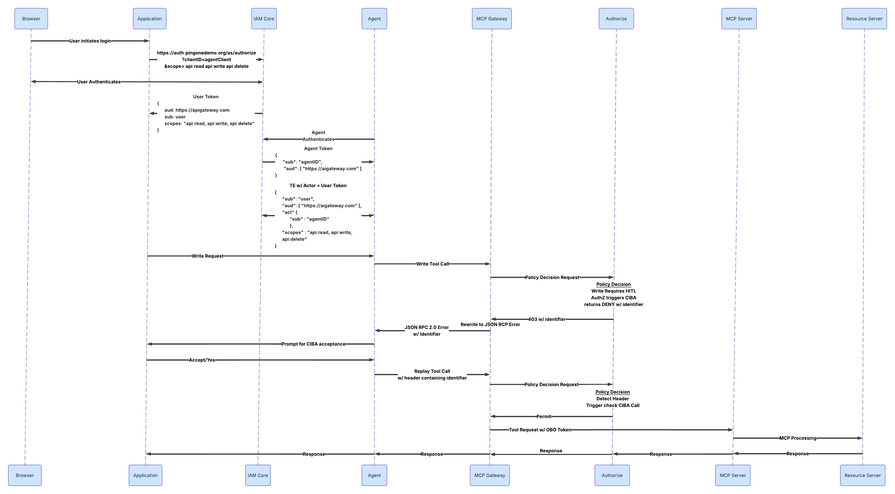
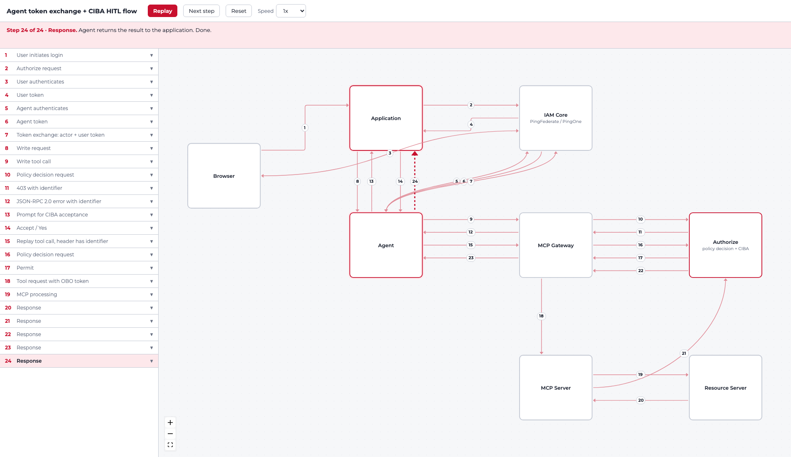

# Scope → Tool Mapping: Starting Pattern for Entergy and SWA POCs

Source: Slack thread, 2026-10-29 (CJ Muir, Chris Armstrong, Tarun Madiraju, Paul Brady, Matt Wendel, Curtis Muir), plus a short Zoom call.
For discussion on the Monday call.

---

## 1. TL;DR

- **The problem:** every POC path (our AI Gateway, or the customer's gateway with Authorize) maps scope → tool. Nobody has a settled answer for who swaps the scope between tool calls, and where HITL fits in.
- **The BofA-style answer is too heavy for POCs.** It works because an agent identity sidecar does all the token work: exchange, caching, accumulating scopes, and handling HITL and ID-JAG. Customers won't write a sidecar, and it only works if agents run in k8s.
- **The emerging direction is to keep the agent dumb.** Don't have the agent manage scopes. CJ's Entergy diagram shows the pattern: the user logs in once with the full scope set (`api:read api:write api:delete`), the agent does **one token exchange** (actor + user token) and gets an OBO token with `sub` = user and `act` = agent. After that, **Authorize decides per tool call** (for example, writes need HITL). There is no per-tool scope swapping and no sidecar.
- **HITL is the hard part, and the diagram answers it.** Authorize denies the write with an identifier and triggers CIBA. The gateway rewrites that 403 into a **JSON-RPC 2.0 error carrying the identifier**, so SDKs that treat a raw 403 as fatal (Google ADK, AWS Strands) keep the session alive. The agent asks the application for CIBA acceptance, then **replays the call with the identifier in a header**. Authorize checks the CIBA result and permits.
- **Caveat:** the diagram is still a proposal, backed by partial demos. Open: where the CIBA prompt runs (application per the diagram, versus start and complete in PAZ per Paul), and the exact error and header shapes.

---

## 2. The original question (CJ)

Both POC paths use scope → tool mapping. Authorize, through AAM, is adding the same concept: an MCP registry with policy defined by scope.

We say "downscope the token to only what the current tool call needs." The open questions:

1. After the first tool call succeeds with the right scope, how does the scope change for the second call?
2. Does the swap need a human? Does it need OIDC scope consent? If so, we'd have to restart a user-token flow. How does that happen?
3. Do we swap scope on every call, or let the agent **accumulate** scopes for a period (Tam did something like this)? What happens when the time is up: reset to a base scope?
4. How is HITL triggered? If it's a 403, we bug the user on every swap. If it's OIDC scope consent, does the user only consent once?
5. Constraint: the POC runs in the customer's environment. Any custom code in the agent or app must be tightly defined, ideally with code examples. We want the least custom code possible.

---

## 3. What the thread established

### 3.1 How BofA does it (Chris Armstrong)
- The agent starts with a least-privilege token. The first token exchange does **not** hand over every scope the agent could ever have.
- When a tool needs more (example: agent holds `expense:read`, calls `submit_report`), Authorize signals insufficient scope. The gateway sees that a CIBA or PF token exchange is required.
- **An agent identity sidecar** handled all of this: exchange, caching, retries.
- On the question "new token with `expense:submit`, or one with both?", Chris's recollection: **a new token with both scopes** (he said "IIRC"). So the sidecar effectively accumulates.
- Open design question in the thread: how do you pick the initial least-privilege set? Options Chris floated:
  - Try the TE before the agent knows which tool it needs.
  - Have the agent pass the OBO token on `tools/list`, so it only sees tools valid for that human-to-agent delegation.
  - Have PF ask Authorize/IDM which scopes are allowed between this agent and this user, limited to ones that don't require HITL. The agent starts there and relies on `insufficient_scope` feedback to get better tokens.
- Chris: "Scopes suck." The details are still up in the air.

### 3.2 Why the sidecar doesn't generalize
- TE is straightforward. HITL is messy. ID-JAG needs multiple steps and logic.
- Chris's question: what handles all that? Do you trust the person writing the agent? (No.) Either the customer's IAM team writes an abstraction, or the logic lives in our gateway.
- It only works if agents are deployed in k8s.
- CJ's conclusion: neither POC customer is going to write a sidecar.
- Chris: it would be good if our AI Gateway handled all of this. After the next release (with OBO), look again at how the Privilege Gateway fits these POCs and where its gaps are.

### 3.3 Paul Brady: just swap
- Swap when you need a different scope. Many token exchanges, one per tool needing a different scope.
- 3rd-party TE in P1 makes this more relevant, since the calling agent may itself be third-party.
- Still unanswered: **what manages it?** Paul guessed LangChain or agent orchestration, but wasn't sure.
- Cost: whichever way we do this, agent work means roughly **10× the API calls**.

### 3.4 The simplification (Chris, then Tarun and Matt)
- 98% of customers won't look like BofA. We need a simple, implementable pattern, for example Bedrock, that covers the key things including HITL.
- **Chris's Bedrock proposal:** one TE that Bedrock handles out of the box, producing an OBO token with a single scope (`mcp`). Everything else is enforced at the gateway (the AWS Bedrock gateway plus Authorize), which evaluates tool calls against the user and agent identities, not token scopes.
- **Tarun:** "agent privilege gateway is not a bad model." You don't do TE, you do authorization. His Entergy/SWA diagram uses the Kong gateway approach, with the gateway config doing a per-scope TE hop. He calls it a thought experiment, not necessarily the right way.
- **Matt Wendel:** let Authorize do it all, Authorize plus TE, in a single call. The agent, app or gateway makes one call, and integration becomes easy. Authorize can plug into any gateway and any information point.
- **Curtis:** simple is good, but diagram and document it. This is a POC, not production.

### 3.5 HITL mechanics
- **The problem (CJ):** how do you get the HITL back to the agent across different gateways? Google ADK and AWS Strands treat a 403 (what Authorize returns for a deny) as a fatal error and kill the session. Then how do you carry context back and confirm the HITL actually happened?
- **Proposed fix (Matt, Paul):**
  1. Authorize returns the **device auth ID** or **CIBA** request ID (in a header or response).
  2. The agent just hands that ID back.
  3. Authorize checks whether the human completed it, then allows or denies.
  - Authorize can trigger a push. OTP is probably not worth supporting (Matt's reasoning: personal agents already have access to your email).
  - Matt did this in the Old National Bank demo. Paul has it working in his updated banking demo, with a choice of Device Auth or CIBA. Both initiate and complete in PAZ.
- **Where CIBA starts and completes:**
  - Paul would change the Entergy diagram so CIBA both starts and completes in PAZ. The benefit is a clean **audit trail** ("I asked the human, the human said yes").
  - CJ says it could go either way. CIBA is a magic link, so approval can be more flexible.
  - Paul's other suggested change to the sequence: send a message back to the agent so the agent does the follow-up.
- **Remaining gap (CJ):** "approval required, request approval, sure, but how?" The diagram doesn't yet show the mechanism.

---

## 4. Candidate patterns

| | A. Sidecar (BofA) | B. Swap per tool (Paul, Tarun/Kong) | C. One TE, full scopes, Authorize decides (CJ's Entergy diagram) |
|---|---|---|---|
| Token scopes | Least privilege, accumulates as needed | New token per scope | Full set up front (`api:read`, `api:write`, `api:delete`) |
| Who does token work | Sidecar | Gateway config or orchestration layer | Agent does one TE (actor + user token) |
| Where the decision lives | Sidecar plus Authorize | Gateway plus Authorize | Authorize, on user + agent + tool |
| Custom code in customer | Heavy (sidecar, k8s only) | Medium (gateway plugin or orchestration) | Minimal |
| API call volume | High | Highest (about 10×) | Lowest |
| HITL | Sidecar handles CIBA | Needs a 403 handler | Authorize denies with an identifier, gateway rewrites to JSON-RPC error, agent prompts the app and replays with the identifier |
| Fit for POC | Poor | Maybe, for Kong customers | Best starting point |

**Suggested starting pattern: C.** It best matches "least custom code" and works across gateways. The trade-off is that the token no longer narrows per tool. Narrowing happens in Authorize policy (scope-to-tool mapping, HITL on writes) instead. That should line up with the AAM scope-based MCP registry direction, but we should confirm how the two fit together.

---

## 5. Direct answers to CJ's original questions (as far as the thread gets)

| Question | Where the thread landed |
|---|---|
| How do scopes swap between calls? | Pattern B: swap per tool via TE. Pattern A: the sidecar issues a new token with old plus new scopes. Pattern C (CJ's diagram): don't swap. One TE gives the full scope set, and Authorize decides per call. |
| Does it need human interaction or OIDC scope consent? | Not for TE itself. OIDC consent happens once, at login (the application requests all three scopes). HITL is a separate step: Authorize triggers CIBA, and the user accepts through the application. |
| Accumulate or swap each time? | BofA sidecar accumulates (Chris, IIRC). Reset or expiry behavior was not discussed. **Open.** |
| How is HITL triggered? | Authorize policy decides (writes require HITL). It returns DENY with an identifier, and the gateway rewrites that to a JSON-RPC error. Per-action versus once is a policy choice, **open**. |
| Least custom code in the customer's agent? | Pattern C: the agent authenticates, does one TE, passes the OBO token, and on a HITL error prompts the application and replays with the identifier. |

---

## 6. Open items

1. **Reset/expiry semantics** for accumulated scopes (if we use A or B).
2. **Who manages TE** in B: LangChain, the orchestrator, or the gateway?
3. **HITL return path across gateways.** The diagram has the gateway rewrite the 403 into a JSON-RPC 2.0 error with the identifier. Specify the exact error fields and replay header name, and test with Google ADK and AWS Strands. Does the Bedrock gateway support the rewrite, or only our Privilege gateway?
4. **Where CIBA runs.** The diagram prompts through the application (steps 13-14). Paul has CIBA started and completed in PAZ (better audit trail). Decide which, and what the agent does in each.
5. **Gateway choice.** The two options are the Bedrock gateway (with Authorize) and the Ping Privilege gateway. Which customer uses which is still to be recorded.
6. **Fit with AAM's scope-based MCP registry.** Tokens carry broad scopes and Authorize holds the per-tool policy. Confirm that matches how AAM defines scope-based policy.
7. **Privilege Gateway gap analysis** after the next OBO release (Chris).
8. **Call volume.** Quantify the extra API calls for the POC and confirm it's acceptable.

## 7. Action items (from the thread)

- **Tarun:** bring in **Peter Holko**, who has done this and may have a working setup.
- **Paul:** share the Kong API gateway setup (Kong plugin updated by David Babbitt, awaiting Kong catalog listing) and the updated banking demo (Device Auth/CIBA via PAZ).
- **CJ / Curtis:** the Entergy diagram now has the HITL mechanism. Settle CIBA-in-PAZ versus via the application, and write the exact "what the customer's AI team must do" spec with code examples.
- **Chris:** revisit Privilege Gateway fit after the OBO release.
- **Everyone:** agree Pattern C, as drawn in CJ's Entergy diagram, as the default for Monday.

---

## 8. What the customer's agent team would need to do under Pattern C

From CJ's Entergy diagram. Not a settled spec:

1. Authenticate the agent to IAM Core and get an agent token.
2. Do one token exchange with the actor token (agent) and the user token. Result: OBO token with `sub` = user, `act.sub` = agent, full scopes.
3. Send tool calls through the gateway carrying the OBO token.
4. If a call returns a JSON-RPC error carrying an identifier, do not treat it as fatal. Ask the application to prompt the user for CIBA acceptance.
5. After the user accepts, replay the same call with a header containing the identifier.
6. Nothing else. No per-tool scope handling, no scope swapping, and no sidecar.

These steps need confirmation against the SDKs in use (ADK, Strands, LangChain).

---

## 9. Flow diagram

### 9a. Original sequence diagram (from CJ, "Entergy POC")



Source: CJ's post in the thread ("Entergy POC (1).png"). Paul's one suggested change was to the CIBA steps, which he now has working with both start and completion in PAZ.

### 9b. Same flow as an interactive ReactFlow diagram



Interactive version: open [scope-to-tool-poc-diagram.html](scope-to-tool-poc-diagram.html) in a browser (needs internet for the ReactFlow and font CDNs). Boxes are draggable, and it has Simulate, Next step, Reset and a speed control. The step list on the left expands each step to show what happens, why it matters, token payloads, and open questions. The caption shows the current step.

The 24 steps, from the sequence diagram:

| Steps | What happens |
|---|---|
| 1-4 | User logs in. The application requests `api:read api:write api:delete`. IAM Core issues a **user token** (`aud` = API gateway, `sub` = user). |
| 5-6 | Agent authenticates and gets an **agent token** (`sub` = agentID, `aud` = AI gateway). |
| 7 | **Token exchange** with actor token + user token. Result: `sub` = user, `act.sub` = agentID, scopes `api:read, api:write, api:delete`. |
| 8-10 | Application asks the agent for a write. The agent calls the write tool through the MCP Gateway. The gateway sends a policy decision request to Authorize. |
| 11 | Write requires HITL. Authorize triggers **CIBA** and returns **DENY with an identifier** (a 403). |
| 12 | Gateway **rewrites the 403 into a JSON-RPC 2.0 error** that carries the identifier. |
| 13-14 | Agent prompts the application for CIBA acceptance. User says yes. |
| 15-17 | Agent **replays the tool call** with a header containing the identifier. Authorize detects the header, checks the CIBA call, and returns PERMIT. |
| 18-24 | Gateway sends the tool request with the OBO token to the MCP Server, which calls the Resource Server. The response returns through Authorize and the gateway to the agent and application. |

What this diagram settles compared with the thread:

- **Scopes:** the OBO token carries the full set (`api:read`, `api:write`, `api:delete`) from the start. Which tools may run is decided by Authorize per call, with HITL for writes. So this answers CJ's accumulate-or-swap question with "neither": one exchange, full scopes, Authorize gates the call.
- **The 403 problem:** the gateway rewrites the Authorize 403 into a JSON-RPC 2.0 error with the identifier, so the agent SDK sees an ordinary tool error.
- **The CIBA prompt goes through the application** (steps 13-14), not a push straight from Authorize to the user. This is still the open question between Paul (start and complete in PAZ) and CJ.
- **Responses pass back through Authorize** (steps 20-22), which section 3 did not mention.

---

## 10. Spec for the customer's AI team (draft)

Illustrative and unverified. Error and header field names are placeholders until we pick the real shapes (section 9). Code is Python-style pseudocode, not tested against Bedrock, ADK, Strands or LangChain.

### 10.1 What they must do

| # | Requirement | Detail |
|---|---|---|
| 1 | Get an OBO token | Authenticate the agent, then do one token exchange with actor + user token. The OBO token has `sub` = user, `act.sub` = agent, and the full scope set. |
| 2 | Send the OBO token on every gateway call | Both `tools/list` and `tools/call`. |
| 3 | Do not treat the HITL error as fatal | The gateway returns a JSON-RPC 2.0 error carrying an identifier. Detect it and ask the application for CIBA acceptance. |
| 4 | Replay with the identifier | After the user accepts, repeat the same call with a header containing the identifier. |
| 5 | Stop there | No per-tool scope handling or swapping, no sidecar. |

### 10.2 What they must not need to do
- Choose, swap or compute scopes per tool.
- Start CIBA. Authorize does that when it denies the write.
- Verify that the human approved. Authorize checks the CIBA result on replay.

### 10.3 Code sketch (the only custom code)

```python
HITL_HEADER = "X-HITL-Identifier"   # placeholder name

def call_tool(gateway_url, obo_token, tool, args, identifier=None):
    headers = {"Authorization": f"Bearer {obo_token}"}
    if identifier:
        headers[HITL_HEADER] = identifier        # replay: echo the identifier back
    body = http.post(gateway_url, headers=headers,
                     json={"jsonrpc": "2.0", "id": 1, "method": "tools/call",
                           "params": {"name": tool, "arguments": args}}).json()

    err = body.get("error")
    if err and err.get("data", {}).get("identifier"):   # placeholder field path
        # Gateway rewrote Authorize's 403 into this JSON-RPC error. Not fatal.
        return {"status": "approval_pending", "identifier": err["data"]["identifier"]}
    return body

# Orchestrator loop, in whatever framework they use:
result = call_tool(url, obo_token, "write_record", args)
if result.get("status") == "approval_pending":
    if prompt_application_for_ciba_acceptance():        # steps 13-14 in the diagram
        result = call_tool(url, obo_token, "write_record", args,
                           identifier=result["identifier"])
```

### 10.4 Per-framework notes to fill in
Ask Paul, Matt and Peter Holko for working examples.

| Framework | Where the wrapper goes | Known issue |
|---|---|---|
| AWS Bedrock / Strands | Tool wrapper or MCP client hook | Raw 403 treated as fatal (CJ). The JSON-RPC rewrite is meant to avoid this, so test it. |
| Google ADK | Tool callback | Raw 403 treated as fatal (CJ). Same test. |
| LangChain | Tool wrapper | Not discussed |

### 10.5 Gateway side (what we configure, not them)
- **Bedrock gateway + Authorize:** Authorize evaluates user + agent + tool and returns DENY with an identifier. The gateway must rewrite it to a JSON-RPC 2.0 error. Confirm the Bedrock gateway can.
- **Ping Privilege gateway:** same decision logic, enforced in our gateway. Chris wants a gap analysis after the OBO release.

Which customer uses which gateway is not recorded here yet.
