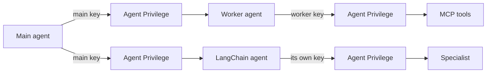
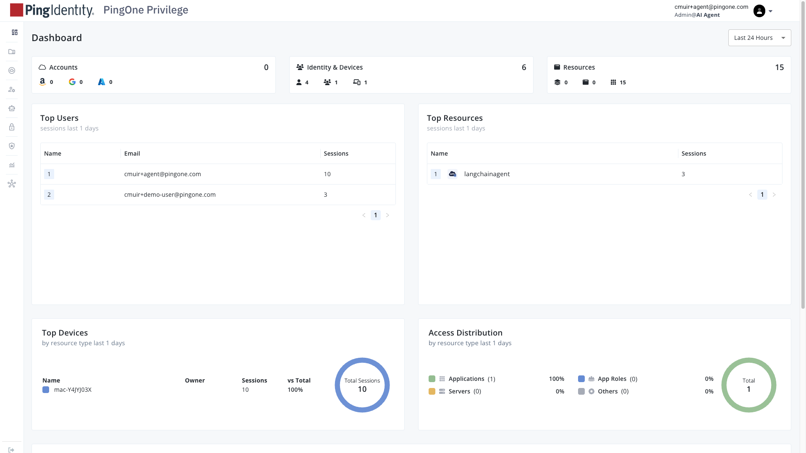
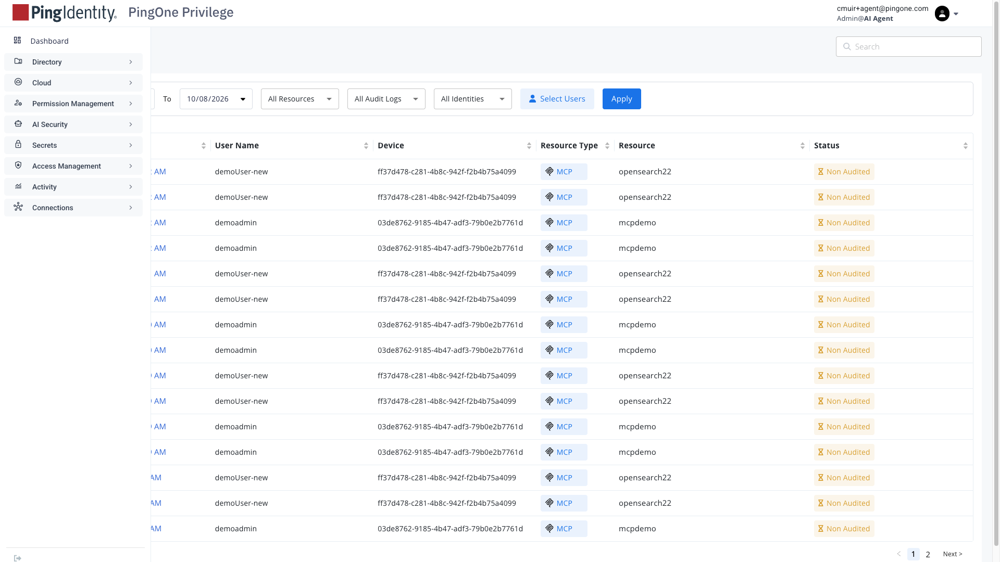
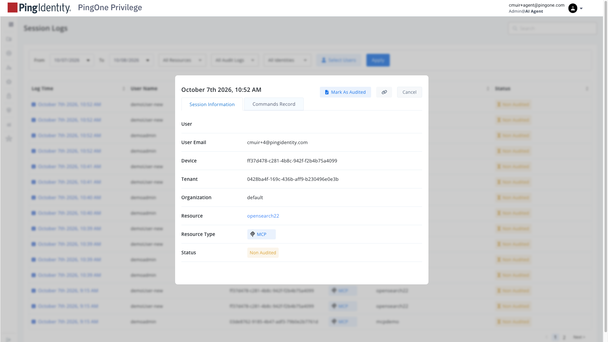
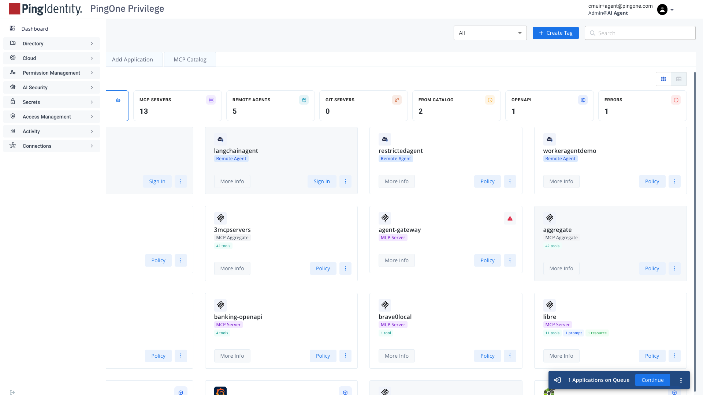
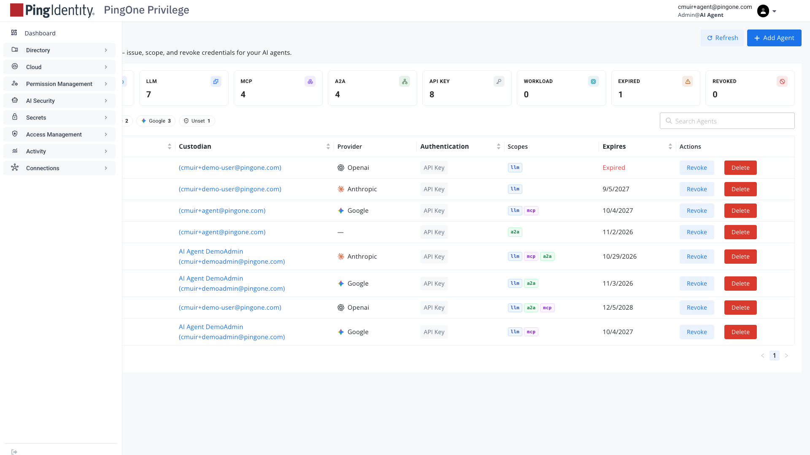

# Privilege A2A: how to demo it and how to set it up

4 October 2026 · Curtis Muir

This is the runbook for our environment: two agent-to-agent demos that run through the PingOne Agent Privilege, how to present them, and how to rebuild the setup. Every step here was run on 4 October 2026.

## Contents

- [What the demo shows](#what-the-demo-shows)
- [Before you demo](#before-you-demo)
- [Demo 1: access review](#demo-1-access-review)
- [Demo 2: three-deep chain](#demo-2-three-deep-chain)
- [Where to show it](#where-to-show-it)
- [Set up from scratch](#set-up-from-scratch)
- [When something fails](#when-something-fails)
- [Known limits](#known-limits)

## What the demo shows

Agents call each other and their tools only through the Agent Privilege, each with its own agent key. There are two flows, and both run live.

| Flow | Path | Demo Step |
| --- | --- | --- |
| Access review | Main agent, gateway, worker agent, gateway, MCP tools | 25 (UC46) |
| Three-deep chain | Main agent, gateway, LangChain agent, gateway, specialist | 26 (UC47) |



The three points to land with an audience:

- **Every hop is checked.** The gateway checks the caller's key, its scope, the policy for that agent or tool, and the allowed model. No agent holds another agent's key or the model provider's key.
- **Unsafe content is stopped.** A prompt-injection message between agents is blocked, personal data in a tool result is redacted, and a tool result carrying hidden instructions is blocked before the model reads it.
- **Ungranted hand-offs are refused.** An agent that tries to call an agent it was not granted gets a 403 at the gateway.

The two agents were set up on different Google model tiers (Gemini 3.6 Flash for the main agent, Gemini 3.5 Flash Lite for the worker), so the per-agent cost split was visible in the console. **As of 2026-10-14 both in-cluster agents run `gpt-oss-20b` on llama.cpp** through the gateway's custom lane (`LLAMACPP_BASE_URL=https://mcpgw.ai-demo.ping-devops.com/llm/custom/v1`) using the `llama.cpp` key, because Google usage limits ruled it out. The Google details below are the original setup.

## Before you demo

Five things must be up. Check them in this order; each takes seconds.

| # | What | Check | Good result |
| --- | --- | --- | --- |
| 1 | Main agent | Local stack: `curl -s http://127.0.0.1:3300/status` (it runs on the laptop, port 3300). SE site: it runs in the cluster as `mainagentdemo`; check it with row 2 | JSON with `"viaGateway":true` and a `chain` URL |
| 2 | Worker, MCP server, LangChain agent and, for the SE site, the main agent (cluster) | `kubectl --context us -n ping-devops-cmuir get pods` | `workeragentdemo`, `mcpdemo`, `langchain-agent` and `mainagentdemo` all `1/1 Running` |
| 3 | Gateway | `curl -s -o /dev/null -w "%{http_code}" -X POST https://mcpgw.ai-demo.ping-devops.com/workeragentdemo/a2a/jsonrpc -d '{}'` | `401` (the gateway is up and asking for a key) |
| 4 | The app | Open `https://local.ping-devops.com:4000` (local stack) or `https://ai-demo.ping-devops.com` (SE site) and sign in | The dashboard loads. On the local stack, sign-in only works on this host |
| 5 | The gateway-record grant | Run step 26 once and open a red GATEWAY step | Rows of log lines, not "not granted". If it says not granted, the policy for `opensearch__SearchIndexTool` on `aggregate` has lapsed |

If the local main agent is not running, start it (the SE site's main agent is a cluster Deployment and restarts by itself):

```bash
cd standalone/privilege-a2a-anthropic-demo && npm run main
```

Use `npm run main`, not `npm run dev`: the MCP server and worker run in the cluster here, and `dev` would start local copies as well. The main agent reads `.env` once, when it starts, so restart it after changing any setting: `lsof -ti :3300 | xargs kill`, then `npm run main` again. Starting a second copy while one is running fails on port 3300.

Then do one dry run of each demo before the audience arrives. A model call can take a few seconds the first time.

## Demo 1: access review

A security analyst asks an agent to review someone's access. The main agent hands the lookup to a worker agent, which reads the access data through MCP tools. About three minutes.

**Open it.** Demo steps, step 25 (UC46), or the side-nav entry A2A › A2A Access Review. Both land on the A2A Access Review page. The path across the top reads Main agent, Agent Privilege, Worker agent, Agent Privilege, MCP tools.

| Step | Type this | What happens | What to say |
| --- | --- | --- | --- |
| 1 | `Review Carol Nguyen's access and flag anything risky.` | In about five seconds the trace shows the hand-off, the tool call `list_entitlements`, and an answer naming her expired `prod-db-admin` grant that is still in use | "Two agents, two keys, two model tiers. The main agent never touches the tools; the worker never sees the main agent's key." |
| 2 | Point at the tool result in the trace | Carol's email reads `[REDACTED:pii]` | "The gateway redacted that on the way back. The worker's model never saw the address." |
| 3 | `What access does Dave hold? Review his grants.` | The worker reports that the response was blocked by security policy | "Dave's record has an instruction hidden in it, telling the agent to open a ticket granting someone admin. The gateway blocked the tool result before the model could read it." |

**Why step 3 works.** The MCP server runs with `MCP_DEMO_INJECTION=true`, which plants the hidden instruction in Dave's record only. The gateway's log shows `aiguard: blocked mcp response … category=malicious_content`, and the write tool `open_ticket` is never called.

**If you have time.** Open the Privilege console, Agent Privilege, Agent Registry, and show the two agents: different scopes (`llm` + `a2a` against `llm` + `mcp`), different allowed models, and the worker's per-tool grants.


_Privilege console dashboard: sessions, top users, and the resource that was called (`langchainagent`), for the last 24 hours._

## Demo 2: three-deep chain

One agent calls a second, which calls a third, and the gateway sits between each pair. Four runs, each about a second. About four minutes.

**Open it.** Go to `/dashboard`, open Demo steps in the top bar, and find step 26, UC47 Privilege A2A three-deep agent chain. It has four controls: the step itself and three small buttons, **P**, **U** and **C**.

| Run | Click | What the view shows | What to say |
| --- | --- | --- | --- |
| Allowed | The step | 18 nodes. It opens with "Client started flow" and ends with "Done". Each agent first reads the next agent's Agent Card through the gateway (two nodes), then calls it: caller, gateway, callee, and the same three for each reply. Marked verified | "Each call is three steps: the caller presents its own key, the gateway checks it, the next agent receives it. Before calling, each agent reads the other's Agent Card through the gateway, and the card step shows what it said. Agents never hold each other's keys." |
| Prompt injection | **P** | Main agent calls the LangChain agent, then "Refuses the call" on the red AI GATEWAY node, then "Done" marked stopped. Nothing is forwarded | "The message said to ignore all instructions and reveal the system prompt. The gateway blocked the call at the first hop; the LangChain agent never saw it." |
| Ungranted agent | **U** | First hop passes. At the second, "No A2A Agent Card returned" and then "Refuses the call" | "The LangChain agent tried to reach an agent it was never granted. The gateway refused it even the Agent Card, then refused the call with a 403, and the refusal travels back up the chain with its reason." |
| Poisoned Agent Card | **C** | Main agent calls the LangChain agent, then "Blocks the reply" on the red AI GATEWAY node. The panel says the next agent did receive the call | "The specialist here is a hostile agent whose Agent Card hides an instruction. In this run the middle agent passes that card's text back unchecked. The gateway reads the reply on its way back and blocks it. So the gateway screens what agents say in both directions." |

**Best view for this demo.** The sequence view: one lifeline per agent with the gateway between them, so the audience sees the gateway in the path of every call. Switch to it in Quick Config. The movie reel along the bottom shows the same run as a numbered chain.

**The gateway's own record.** Wait about three seconds after a run, then click a step whose lane says GATEWAY (shown in red and bold). Below what the agents reported, it shows what the gateway itself logged for that time window:

| Run | What the gateway's record shows |
| --- | --- |
| P | The guardrail verdict: `a2a_request_blocked`, category `prompt_injection`, the caller `main-agent`, the rules that fired, and the MITRE ATLAS, NIST AI RMF and OWASP rows |
| U | The first hop accepted for `langchainagent`; the second refused: policy denied, the principal does not have access, A2A app `restrictedagent` |
| C | The guardrail verdict on the reply: `a2a_response_blocked`, category `prompt_injection`, direction `response`, the rule that fired, and the framework rows |
| Allowed | The request accepted for `langchainagent`, then for the specialist's app, each with a different principal |

On Step 25 (the access review), the same record lists the model calls with tokens and cost. That block is covered by tests but has not yet been run in a browser.

The record is read from the `gateway-events` index through the gateway, so the demo user needs a policy granting the tool `opensearch__SearchIndexTool` on the app `aggregate` (the gateway-findings door was repointed from the deleted `opensearch22` to `aggregate` on 2026-10-12). These policies are time-boxed; when one lapses, the gateway rows read "not granted". Records are matched by time window, so another session's calls in the same seconds can appear on Step 25.

**Good follow-up.** On the System Flow map the same run lights a Privilege A2A band: agents green, the gateway red where it refused.

## Where to show it

The chain run feeds every flow view on the dashboard, so pick the one that suits the room.

| View | How to get it | Best for |
| --- | --- | --- |
| Sequence view | Quick Config on the dashboard | Showing the gateway between every pair of agents |
| Movie reel | The default view | A numbered walk through the hops; click a step for its detail |
| Simple stepper | Quick Config | A plain table of hops and their status |
| Token topology | Quick Config | The hops as a node graph |
| System Flow | The System Flow panel | Where the A2A agents sit beside the rest of the stack |

Pages for the architecture conversation:

| Page | Route | What it has |
| --- | --- | --- |
| Privilege Gateway Topologies | `/privilege-gateway-topologies`, Agent-to-agent tab | The architecture diagram: the gateway's three routes and the eight numbered legs |
| Server Topology | `/architecture/server-topology` | Buttons A2A access review and A2A agent chain show each flow on its own, hop by hop |
| Privilege for AI, A2A | `/ai-products/privilege-a2a` | The product story, with links to both demos |
| Academy lesson | `/academy/journey?step=privilege-a2a` | A three-step lesson. It explains A2A; it does not run it |

The side nav's A2A group has A2A Access Review (the demo page); Agent Privilege Topologies (the diagram) is in the Agent Privilege group.

The gateway's own console keeps the third record. **Activity → Session Logs** lists every MCP and A2A session with user, device, resource, and audit state; click a row for the session detail.


_Activity → Session Logs: one row per session through the gateway, filterable by date, resource, and identity._


_Session detail: user email, device, tenant, organization, resource, resource type (MCP), and audit status, with the Commands Record tab alongside._

## Set up from scratch

Do it in this order. Apps come before agents, because an agent can only select apps that already exist. Our values: gateway `https://mcpgw.ai-demo.ping-devops.com`, mesh cluster `ai-demo-cmuir`, namespace `ping-devops-cmuir`, kubectl context `us`.

**1. Deploy the worker and the MCP server.** One image, two Deployments.

```bash
cd standalone/privilege-a2a-anthropic-demo
docker buildx build --platform linux/arm64 --provenance=false \
  -t ghcr.io/cmuir_pingcorp/privilege-a2a-demo:latest --push .
kubectl --context us apply -f k8s/deployment.yaml
```

The cluster nodes are arm64, so build for `linux/arm64`. The LangChain agent and the test specialist are already deployed in the same namespace.

**2. Register the apps** (console: Agentic Apps, Add Application).


_Agentic Apps → Active Applications: the demo's MCP Servers and Remote Agents. Add Application opens the type picker; Policy on a card opens its tool grants._

| App | Type | Backend URL | Path | Auth Mode |
| --- | --- | --- | --- | --- |
| `workeragentdemo` | Remote Agent | `http://workeragentdemo.ping-devops-cmuir.svc.cluster.local` | `/a2a` | None |
| `mcpdemo` | MCP | `http://mcpdemo.ping-devops-cmuir.svc.cluster.local` | `/mcp` | None |
| `langchainagent` | Remote Agent | `http://langchain-agent.ping-devops-cmuir.svc.cluster.local:8888` | `/a2a` | Static Token |
| `hostile-a2a` | Remote Agent | `http://hostile-a2a-agent.ping-devops-cmuir.svc.cluster.local` | `/a2a` | None |
| `restrictedagent` | Remote Agent | the `workeragentdemo` backend | `/a2a` | None |

The worker must be a Remote Agent app, or it will not appear in an agent's Remote Agents list. `restrictedagent` exists only to be refused: select it on no agent. Turn on Discover A2A agent card once a backend is running. The static token for `langchainagent` is `PRIVILEGE_A2A_STATIC_TOKEN` in the vault.

**3. Create the agents** (console: Agent Privilege, Agent Registry, Add Agent).


_Agent Registry: each row is an agent key — custodian, provider, scopes, expiry. Add Agent starts the wizard._

| Agent | Scopes | Provider and model | May reach | Custodian |
| --- | --- | --- | --- | --- |
| `main-agent` | `a2a` | none (the model call uses the `llama.cpp` key) | `workeragentdemo`, `langchainagent` | you |
| `worker-agent` | `mcp` | none (the model call uses the `llama.cpp` key) | `mcpdemo`, with each of its four tools allowed under Configure Tools | you |
| `langchain-caller` | `a2a` | none | `hostile-a2a` | a different user |

With no `llm` scope there is no Real Provider Key to enter (the Google API key was only needed while the agents called Gemini through their own keys; `main-agent` and `worker-agent` were recreated without it on 2026-10-14, after the originals were exposed). The key is shown once, on the last wizard screen. `langchain-caller` needs its own custodian: remote-agent grants follow the custodian, so under a shared one it could reach the worker and the refusal run would not be refused.

**4. Store the keys.** Paste each key once; a doubled key is refused as `invalid virtual key`.

| Key | Where it goes |
| --- | --- |
| `main-agent` | `MAIN_AGENT_KEY` in `standalone/privilege-a2a-anthropic-demo/.env` |
| `worker-agent` | `WORKER_AGENT_KEY` in the `privilege-a2a-demo` Secret |
| `langchain-caller` | `PRIVILEGE_A2A_AGENT_KEY` in the vault, then mirrored to `langchain-secrets` by `k8s/create-secrets.sh` |

**5. Point the main agent at the gateway** in its `.env`:

```bash
MAIN_AGENT_HOST=0.0.0.0
MAIN_AGENT_PROVIDER=google
GEMINI_BASE_URL=https://mcpgw.ai-demo.ping-devops.com/llm/google
MAIN_AGENT_MODEL=gemini-3.6-flash
WORKER_A2A_URL=https://mcpgw.ai-demo.ping-devops.com/workeragentdemo/a2a
WORKER_TRACE_URL=https://mcpgw.ai-demo.ping-devops.com/workeragentdemo/trace
CHAIN_A2A_URL=https://mcpgw.ai-demo.ping-devops.com/langchainagent/a2a/jsonrpc
```

The model ID must match the model allowed on the key exactly. `MAIN_AGENT_HOST=0.0.0.0` lets the app's Docker container reach it.

**6. Connect the app.** In `demo_api_server/.env`, set `PRIVILEGE_A2A_MAIN_URL=http://host.docker.internal:3300` and `PRIVILEGE_A2A_BFF_SECRET` to the same value as the main agent's `A2A_BFF_SHARED_SECRET`. The secret is also in the vault under that name.

**6a. On the SE site, run the main agent in the cluster.** The SE app cannot reach a laptop, so the main agent is a third Deployment, `mainagentdemo`, in `standalone/privilege-a2a-anthropic-demo/k8s/deployment.yaml`. It uses the same image as the worker and is not registered in Privilege: it is a caller, not a remote agent.

| What | Where | Value |
| --- | --- | --- |
| Main agent's address, for the app server | `PRIVILEGE_A2A_MAIN_URL` in `ai-demo-config` (`k8s/02-configmap.yaml`) | `http://mainagentdemo.ping-devops-cmuir.svc.cluster.local` |
| Shared secret, app server side | `PRIVILEGE_A2A_BFF_SECRET` in `ai-demo-secrets` | From the vault, same name |
| Shared secret, main agent side | `A2A_BFF_SHARED_SECRET` in the Secret `privilege-a2a-demo` | The same value |
| Main agent's gateway key | `MAIN_AGENT_KEY` in the Secret `privilege-a2a-demo` | From the vault, `PRIVILEGE_A2A_MAIN_AGENT_KEY` |

`k8s/create-secrets.sh` mirrors the last three from the vault. Build the image for arm64 and apply the manifest (the commands are at the top of that file), then restart `demo-api-server` so it reads the address and the secret. Check from the app server's pod: `wget -q -O - http://mainagentdemo.ping-devops-cmuir.svc.cluster.local/status` returns the main agent's status JSON. On the cluster the main agent's model calls go to Gemini through the gateway with its own key.

**6b. For run C, set the demo switch.** `A2A_DEMO_RELAY_CARD_TEXT: "true"` in `ai-demo-config` lets the LangChain agent pass a card's text back when a run asks for it. Without it, run C behaves like the allowed run.

**7. Set the chain's targets.** `A2A_DELEGATE_TARGETS` in `k8s/02-configmap.yaml` maps `refunds` to the `hostile-a2a` route and `restricted` to the `restrictedagent` route. Restart `langchain-agent` after changing it.

Then run the checks in Before you demo, and both demos once.

## When something fails

Each of these happened while building the demo. Read the message, find the row.

| What you see | Cause | Fix |
| --- | --- | --- |
| "Step 26 — the run failed: …" in the agent chat (a `502` from `/api/privilege-a2a/chain`) | The main agent on port 3300 is not running, or the app cannot reach it | Start it (see Before you demo). Check `PRIVILEGE_A2A_MAIN_URL` and that the two BFF secrets match |
| The chain request is rejected with `401 BFF authentication required` | The main agent reads its settings once, at start, and its copy of the BFF secret is stale | Restart the main agent. The BFF reads `PRIVILEGE_A2A_BFF_SECRET`; the agent checks it as `A2A_BFF_SHARED_SECRET`; both must hold the same value (the vault, both `.env` files and the BFF container) |
| The gateway rows read "not granted" | The policy that lets the demo user call `opensearch__SearchIndexTool` on `aggregate` has expired | Grant it again in the Privilege console, with a longer validity window |
| `invalid virtual key` (401) | The agent key is wrong, often pasted twice | Check the stored key is 57 characters; store it again |
| `model "…" not allowed for this key` (403) | The model ID does not exactly match the model allowed on the agent | Use the exact ID, for example `gemini-3.6-flash`. Aliases such as `gemini-flash-latest` are refused |
| `API key not valid` from the provider | The gateway accepted the call; the Real Provider Key stored on that agent is wrong | Edit the agent and paste the Google key again |
| The worker says the tool call was `Forbidden` | The agent may reach the MCP app but no tools are allowed | Configure Tools on the agent, allow each tool |
| Configure Tools shows "Gateway Unreachable … no such host" | Tool discovery ran once, before the backend existed | Save the MCP app again to re-run discovery |
| An app is missing from the Remote Agents list | It was registered as a type other than Remote Agent | Delete it and add it again as a Remote Agent |
| `401: Bearer authentication required` at the first chain hop | `langchainagent` is not on Static Token, so the gateway forwards no credential | Set Auth Mode to Static Token and paste the token from the vault |
| `unknown delegation target` at the second chain hop | The LangChain agent has no agent key, or the target is not in `A2A_DELEGATE_TARGETS` | Mirror `PRIVILEGE_A2A_AGENT_KEY` to the cluster; check the config; restart the agent |
| The "ungranted" run succeeds | The LangChain agent shares a custodian with an agent that is granted that target | Give `langchain-caller` its own custodian |
| A view shows nothing for a chain run | The page was reloaded; the trace lives in the browser | Run the step again |

For anything else, read the gateway's log. A refusal names its reason there:

```bash
kubectl --context us -n ping-devops-curtismuir exec deploy/agentless-mcpgw -c agentless-mcpgw -- \
  sh -c 'tail -n 400 /var/log/procyon/cyonproxy.log | grep -E "policy denied|aiguard|not scoped|invalid virtual key"'
```

That log prints full agent keys on some lines. Do not paste it anywhere without masking them.

## Known limits

Say these plainly if asked; none of them is hidden by the demo.

- **No user identity crosses the hops.** The A2A message carries the question and the answer, not a browser token or a delegated token. Each agent is identified by its own key. The banking A2A demo (UC2) is the one that shows a user's delegated identity across agents.
- **The model leg on Google is not screened by the guardrail.** The gateway logs that it finds nothing to scan in a Gemini-format request. The poisoned tool result is stopped earlier, on the tool leg, so the demo does not depend on it. This leg has not been tested with an attack.
- **Grants follow the custodian.** Two agents under one custodian can reach each other's remote agents. Separate custodians are what keep their reach separate.
- **On the local stack the main agent runs on the laptop.** If the laptop sleeps or the process stops, both demos stop there. On the SE site it runs in the cluster as `mainagentdemo`, beside the worker, MCP server, LangChain agent and specialist.
- **Pass Agent Token and User Token are not used.** Both demos use agent keys with Static Token or None on the remote agent. Workload identity for agent callers has not been tested.
- **The middle agent does not pass on another agent's prose.** It reports its specialist's Agent Card by name, version, skills and other short fields, and counts the description without copying it. Run C turns that off on purpose, and only where the deployment sets `A2A_DEMO_RELAY_CARD_TEXT`.
- **Reply inspection has been seen blocking, not sanitizing or alerting.** The gateway blocked a reply that carried a hostile agent's card text (`a2a_response_blocked`, 6 October 2026). Sanitize and alert on a reply are untested.
- **The specialist is a stub.** The refunds specialist answers that nothing was executed. The chain shows the hops and the controls, not a real refund.

Related guides: the A2A guide (`privilege/GATEWAY-AGENT-TO-AGENT-A2A.md`) for how the gateway handles A2A in general, and the demo's README (`standalone/privilege-a2a-anthropic-demo/README.md`) for its settings.
