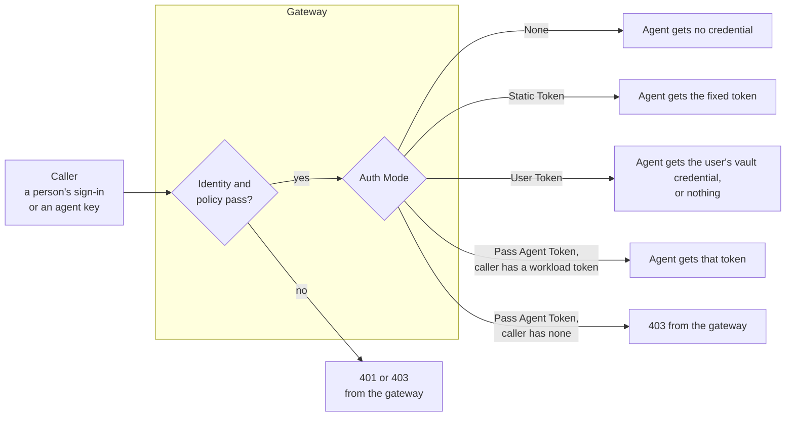

# Agent Privilege: A2A Auth Modes Compared

Oct 4, 2026 · @Curtis Muir

## Contents

- [Overview](#overview)
- [What was tested](#what-was-tested)
- [The four modes at a glance](#the-four-modes-at-a-glance)
- [Where the mode applies](#where-the-mode-applies)
- [None](#none)
- [Static Token](#static-token)
- [User Token](#user-token)
- [Pass Agent Token](#pass-agent-token)
- [Choosing a mode](#choosing-a-mode)
- [Changing the mode](#changing-the-mode)
- [Verifying](#verifying)
- [Quick lookup](#quick-lookup)

## Overview

A Remote Agent app has an **Auth Mode**. It decides what the gateway sends to the remote agent after a call has passed sign-in and policy. The caller's own credential, a gateway sign-in token or an agent key, is never passed on. The auth mode is the only thing that puts a credential on the last hop.

The four modes are None, Static Token, User Token and Pass Agent Token. They differ in two ways that matter:

- **What the remote agent receives,** which decides what the agent must check.
- **Whether the gateway refuses the call itself** when it has nothing to send. Only one mode does.

That second point causes most of the confusion. On three of the four modes a call with nothing to send still reaches the agent, so the agent must refuse it.

Placeholders used: `<gateway-host>`, `<app>` for the Remote Agent app, `<agent-key>`, `<user-id>`, `<gateway-namespace>`, `<gateway-deployment>` and `<gateway-container>`.

## What was tested

Each mode was set on one Remote Agent app in the console, on a cloud gateway, with a Python agent that accepts only a configured static token. Calls were made with a person's sign-in and with an agent key. Results were read at the client and in the gateway log.

| Claim | Result | When |
| --- | --- | --- |
| None: the call reaches the agent with no credential | Reproduced: the agent answered `Bearer authentication required` | 3 Oct |
| Static Token: the agent receives `Authorization: Bearer` with the configured token | Reproduced: the agent accepted it and replied | 3 Oct |
| Static Token works for a person and for an agent key | Reproduced | 3 Oct |
| The gateway log prints the static token in full | Read from the log | 3 Oct |
| User Token with nothing in the user's vault: the call is forwarded with no credential | Reproduced: the agent answered 401; the forwarded request had no `Authorization` header | 4 Oct |
| User Token logs why it sent nothing | Read from the log: `no vault credential for user` | 4 Oct |
| Pass Agent Token refuses a signed-in person at the gateway | Reproduced: 403 | 3 Oct |
| Pass Agent Token refuses an agent key at the gateway | Reproduced: 403 | 3 Oct |
| The caller's own token or key never reaches the agent | Reproduced on None and User Token | 3–4 Oct |
| A mode change takes effect without restarting anything | Reproduced | 3–4 Oct |
| Switching back to Static Token restores the same token | Reproduced: calls succeeded again, and the forwarded token matched the earlier one by fingerprint | 4 Oct |
| Connecting a secrets hub and granting a user a secret does not fill the user's vault | Reproduced: User Token still forwarded nothing | 4 Oct |

Not tested: User Token with a credential in the user's vault, and Pass Agent Token with a caller that holds a workload identity. Their "what the agent receives" entries come from the gateway's own messages and the console's descriptions.

## The four modes at a glance

| Mode | The agent receives | If the gateway has nothing to send | Tells the agent who is calling |
| --- | --- | --- | --- |
| None | No credential | Not applicable | No |
| Static Token | `Authorization: Bearer <static-token>` | Behaves as None | No |
| User Token | The credential stored for that user and app in the user's vault | Forwards the call with no credential | Only if the stored credential does |
| Pass Agent Token | The calling agent's own workload token | Refuses the call with 403 | Yes |

The gateway's internal names for the modes, as they appear in its log, are `none`, `static-token`, `user-token` and `token-pass`.

If no mode is picked, the gateway behaves as Static Token when a token is configured and as None otherwise.

## Where the mode applies



The mode is applied last. A caller with no sign-in or no policy is refused before the mode is looked at, so a 401 or a bare 403 with `policy denied` in the log has nothing to do with the auth mode.

## None

The gateway forwards the call and adds nothing.

- **At the agent:** no `Authorization` header.
- **Use it when:** the agent needs no credential, or does its own sign-in with the caller.
- **The risk:** the agent cannot tell a call that came through the gateway from any other call that reaches it. Only use None when nothing but the gateway can reach the agent.

Tested: the agent answered with its own `401 Bearer authentication required`. That response is the agent's, passed back unchanged.

## Static Token

The gateway adds one fixed token that you configure on the app.

- **At the agent:** `Authorization: Bearer <static-token>`.
- **Use it when:** the agent expects one shared secret. It is the mode that works for both people and agent keys.
- **What the agent learns:** only that the call came through the gateway. Every caller presents the same token, so the agent cannot tell callers apart.

Set it up in this order: generate a long random secret, give it to the agent, then enter the same value in the app's Static Token field. To change it, update the agent first and the console straight after, because calls fail while the two differ.

Two cautions:

- **The gateway log prints this token in full** on each forwarded call. Anyone who can read the log can copy it.
- **The token works wherever the agent is reachable.** If the agent also has its own public address, the token is valid there too, and a call made that way skips the gateway's policy, guardrails and logging.

## User Token

The gateway forwards a credential that belongs to the user, taken from that user's vault in Privilege.

This is **not** a token the gateway creates for the signed-in user. If the user has no credential stored for the app, the gateway has nothing to send, and it forwards the call anyway.

- **At the agent, with a stored credential:** that credential. Not tested.
- **At the agent, with none stored:** no `Authorization` header at all.
- **In the gateway log, with none stored:**

  ```text
  [plasma] no vault credential for user <user-id> on app <app>: user vault not found: UserVault/<tenant-id>/default/<user-id>
  ```

For an agent key, "the user" is the key's custodian.

Tested with nothing stored: the client got the agent's own `401 Bearer authentication required`, and the request the gateway forwarded carried no `Authorization` header.

What this means in practice:

- **The agent must still refuse a call with no credential.** On this mode the gateway will not do it for you.
- **A 401 on User Token usually means an empty vault,** not a wrong setting. Read the gateway log for `no vault credential`.
- **How the vault is filled was not established.** The tested tenant had no place to store a per-user credential for an app, and no user had one. Connecting a Secrets Hub and granting the user a secret through a policy made no difference. Ask Ping how the user vault is populated before you plan around this mode.

## Pass Agent Token

The gateway forwards the calling agent's own workload token, a signed token from the caller's platform that the gateway has already verified.

- **At the agent:** that workload token. Not tested.
- **Use it when:** the remote agent must know which agent is calling.
- **Who can use it:** only a caller that identified itself to the gateway with a workload identity.

This is the one mode where the gateway refuses the call itself. A person who signed in, or an agent with an ordinary key, has no workload token to pass on. The client gets a bare `403 Forbidden`, and the log says:

```text
backend credential refused for <user-id> on <app>: app <app> requires token-pass,
but this session presented no workload assertion
```

Tested with a signed-in person and with an agent key: both were refused, after policy had passed.

Because the refusal looks exactly like a policy denial at the client, check the log before changing a policy that is already correct.

## Choosing a mode

| Your situation | Mode |
| --- | --- |
| The remote agent must know which agent is calling | Pass Agent Token |
| Callers are a mix of people and agents with ordinary keys | Static Token |
| The agent takes one shared API key | Static Token |
| Each user has their own credential for the agent, held in a vault | User Token |
| The agent needs no credential and only the gateway can reach it | None |

Whichever you choose, the agent must accept exactly what the mode delivers. A mismatch passes every check at the gateway and then fails at the agent, which looks like an agent fault.

For most setups today that is Static Token: it is the only mode tested end to end with both kinds of caller.

## Changing the mode

Change Auth Mode on the Remote Agent app in the console and save. The gateway picks it up without a restart. Allow about 15 seconds before testing.

Changing the mode does not change the agent. If the agent accepts only a static token, switching the app to None or User Token makes every call fail at the agent with a 401 until you switch back.

When you switch back to Static Token, check that the token field still holds the token.

## Verifying

After you set or change a mode:

1. **Send one call through the gateway.**

   ```bash
   curl -s -w '\nstatus=%{http_code}\n' -X POST https://<gateway-host>/<app>/a2a/jsonrpc \
     -H 'Authorization: Bearer <agent-key>' -H 'Content-Type: application/json' \
     -d '{"jsonrpc":"2.0","id":1,"method":"message/send","params":{"message":{"role":"user","messageId":"m1","parts":[{"kind":"text","text":"Hello"}]}}}'
   ```

2. **Read who answered.** A JSON-RPC body in the agent's style means the call was forwarded. A bare `Forbidden` means the gateway refused it.
3. **Read the gateway log for the reason.**

   ```bash
   kubectl -n <gateway-namespace> exec deploy/<gateway-deployment> -c <gateway-container> -- \
     sh -c 'tail -n 3000 /var/log/procyon/cyonproxy.log | grep -E "credential refused|no vault credential|policy denied" | tail -n 5'
   ```

| Log line | Mode | Meaning |
| --- | --- | --- |
| `no vault credential for user` | User Token | The user's vault has nothing for this app; the call went on with no credential |
| `backend credential refused … requires token-pass` | Pass Agent Token | The caller has no workload token; the gateway refused |
| `policy denied` | Any | Not an auth mode problem; no policy covers the caller |
| None of these | None or Static Token | The call was forwarded; any error is the agent's |

## Quick lookup

| Symptom | Most likely cause | Fix |
| --- | --- | --- |
| The agent answers 401 after a mode change | The mode no longer sends what the agent checks | Match the mode to the agent, or switch back |
| 401 on User Token | Nothing is stored in the user's vault for this app | Check the log for `no vault credential`; use another mode until the vault is filled |
| 403 with a correct policy | Pass Agent Token and a caller without a workload identity | Read the log for `requires token-pass`; use Static Token for these callers |
| Calls fail right after changing the static token | The agent and the console hold different values | Update the agent first, then the console |
| The agent cannot tell callers apart | Static Token and None carry no identity | Use Pass Agent Token |
| Calls reach the agent with no credential | The mode is None, or User Token with an empty vault | Make the agent refuse them |
| A mode change seems ignored | It has not reached the gateway yet | Wait about 15 seconds |
