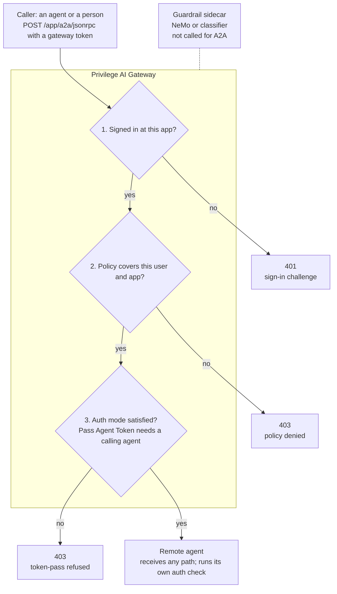

# Privilege AI Gateway: Agent-to-Agent (A2A)

Oct 3, 2026 · @Curtis Muir

## Contents

- [Overview](#overview)
- [What was tested](#what-was-tested)
- [How a call flows](#how-a-call-flows)
- [The agent card](#the-agent-card)
- [Registering a remote agent](#registering-a-remote-agent)
- [Auth modes and the agent token](#auth-modes-and-the-agent-token)
- [Calling an agent through the gateway](#calling-an-agent-through-the-gateway)
- [Guardrails and NeMo](#guardrails-and-nemo)
- [Verifying](#verifying)
- [Common mistakes](#common-mistakes)

## Overview

The Privilege AI Gateway can front an A2A agent the same way it fronts an MCP server. A calling agent signs in at the gateway, the gateway checks policy, and the call goes on to the remote agent with whatever credential the app's Auth Mode sends. The caller's gateway sign-in token is never passed on.

In the console this is a **Remote Agent** application. It sits beside MCP Server applications and uses the same per-app sign-in, policy and logging.

An A2A agent publishes two things:

- **An agent card** at `GET /.well-known/agent-card.json`. This public JSON file names the agent, lists its skills and says how to call it.
- **A JSON-RPC endpoint**, commonly `POST /a2a/jsonrpc`, that takes `message/send` and returns the agent's reply.

Use the gateway in front of an agent when other agents or users should reach it only after sign-in and policy, and when you want each call logged and checked by the gateway's guardrails. That includes an NVIDIA NeMo Guardrails detector if you run one; see the guardrails section below.

This guide uses placeholders: `<gateway-host>`, `<app>` for the application name, and `<agent-backend>` for the agent's in-cluster address.

## What was tested

Ten claims were checked on 3 October 2026 against a cloud gateway (build v1.260925) and a LangChain agent that speaks A2A 0.3.0. Calls were signed in through the gateway's own OAuth flow as a real user. Auth Mode was switched to None for one test and then set back.

| Claim | Result | How it was checked |
| --- | --- | --- |
| The agent card is public at the standard path | Confirmed | `GET /.well-known/agent-card.json` from the gateway pod: 200, version 0.3.0 card |
| The gateway can reach an agent in another namespace | Confirmed | Same request by cluster DNS name across namespaces |
| An unsigned call gets a sign-in challenge | Confirmed | 401 with `WWW-Authenticate` naming the app's authorize URL |
| Each Remote Agent app has its own OAuth server with open registration | Confirmed | Client registered, PKCE sign-in, opaque token issued |
| Without a policy, a signed-in user is refused | Confirmed | 403; log: `policy denied … access to a2a app` |
| Pass Agent Token refuses a person | Confirmed | 403 after policy passed; log: `requires token-pass, but this session presented no workload assertion` |
| With None, the call reaches the agent with no credential | Confirmed | The agent itself answered `Bearer authentication required` |
| The gateway does not pass on the caller's token | Confirmed | Same response: the agent saw no Bearer token |
| The gateway does not check the path | Confirmed | A wrong path was forwarded and refused by the agent itself |
| The guardrail does not inspect A2A messages | Confirmed for this setup | A prompt-injection message reached the agent; no inspection logged by the detector or the gateway |

Auth Mode changes took about 15 seconds to reach the gateway.

Not tested: a real agent-to-agent call with Pass Agent Token, because that needs a caller that holds a workload identity, and the User Token and Static Token modes. Their rows in the Auth modes table come from the console's own descriptions.

## How a call flows



The gateway runs three checks in order and refuses at the first one that fails, so each refusal tells you exactly which layer to fix. After the third check it forwards the call, on any path under the app, and the agent applies its own authentication. In the tested setup the guardrail sidecar was not called for A2A traffic.

## The agent card

The agent card is a public JSON file that tells callers, and the console, what the agent is and how to reach it. It must be served without sign-in at `GET /.well-known/agent-card.json` on the agent's backend address. The console's **Discover A2A agent card** option fetches it from there and lists the agent's skills.

The tested agent serves a version 0.3.0 card with these fields:

| Field | What it holds |
| --- | --- |
| `name`, `description`, `version` | Who the agent is |
| `protocolVersion` | The A2A version the agent speaks, here `0.3.0` |
| `url`, `preferredTransport` | Where to send calls and how: here a JSON-RPC endpoint |
| `skills` | What the agent can do; each skill has an `id` and a `name` |
| `capabilities` | Optional features such as streaming and push notifications |
| `defaultInputModes`, `defaultOutputModes` | The content types it accepts and returns |
| `securitySchemes` | How a direct caller authenticates, for example OAuth 2.0 |

Two things to get right:

- **Serve the current path.** The older path `/.well-known/agent.json` is not what the console fetches. On the tested agent it is not public and answers 401.
- **Mind the `url` field.** It is the address a caller uses when it reads the card directly. If callers should go through the gateway, they need the gateway address instead (see Calling an agent). Whatever host `url` names needs a certificate that matches it: a wildcard such as `*.example.com` covers one level only, so `agent.team.example.com` needs its own. The tested agent hit exactly this, and callers refused its address until it got its own certificate.

## Registering a remote agent

Add the agent in the Privilege console as a **Remote Agent** application. The form has these fields:

| Field | What to enter |
| --- | --- |
| Application Name | `<app>`. It becomes the first part of every gateway URL for this agent: `https://<gateway-host>/<app>/...` |
| Frontend URL Path | The path callers use after the app name, for example `/a2a` |
| Backend URL | The agent's address as the gateway sees it, for example `http://<agent-service>.<namespace>.svc.cluster.local:<port>`. Leave off the port when the Service listens on 80. |
| Discover A2A agent card | On. The console fetches `/.well-known/agent-card.json` from the Backend URL and lists the skills. Leave it off for a plain web application. |
| Auth Mode | What the gateway sends to the agent. See the next section. |
| Mesh Cluster | The gateway that should carry this agent's traffic |

The agent does not need to run in the gateway's pod or namespace. The tested agent runs in a different namespace and the gateway reaches it by its cluster DNS name.

Check the Backend URL before you register it. From the gateway pod, fetch the card:

```bash
kubectl -n <gateway-namespace> exec deploy/<gateway-deployment> -c <gateway-container> -- \
  curl -s -w '\nstatus=%{http_code}\n' <agent-backend>/.well-known/agent-card.json
```

A 200 with the card means the gateway can reach the agent. If discovery fails in the console, this check shows whether the problem is the address or the agent.

## Auth modes and the agent token

Auth Mode decides what the gateway sends to the remote agent once a call has passed sign-in and policy. The console offers four modes. If none is picked, the gateway behaves as Static Token when a token is configured, and as None otherwise.

| Mode | What reaches the agent | Who can call |
| --- | --- | --- |
| Pass Agent Token | The calling agent's own workload token | Only a caller that presents a workload assertion |
| User Token | A token for the signed-in user | Any signed-in, permitted caller |
| Static Token | One fixed token you configure | Any signed-in, permitted caller |
| None | No credential | Any signed-in, permitted caller |

**Pass Agent Token is for agent-to-agent calls only.** The gateway passes on the *caller's* workload identity; it does not mint one of its own. A person signed in through a browser has no workload assertion, so the gateway refuses the call after policy passes. The client gets a bare 403, and the gateway log says why:

```text
backend credential refused for <user-id> on <app>: app <app> requires token-pass,
but this session presented no workload assertion
```

Pick the mode that matches both sides:

- **The caller is another agent and the agent checks workload identity:** Pass Agent Token.
- **People call the agent, or the agent checks user identity:** User Token.
- **The agent expects one shared API key:** Static Token.
- **The agent does its own sign-in or needs none:** None.

Whichever mode you pick, the agent must accept exactly what that mode sends. A mismatch passes the gateway's checks and then fails at the agent.

## Calling an agent through the gateway

A caller signs in at the gateway for this one app, then posts A2A JSON-RPC to the app's gateway address. The sign-in is the same OAuth flow the gateway uses for MCP apps.

1. **Read the challenge.** An unsigned call returns 401 with a `WWW-Authenticate` header. It names the app's protected-resource metadata and its `authorization_uri`, `https://<gateway-host>/<app>/authorize`.
2. **Register a client.** Each app has open dynamic client registration at `https://<gateway-host>/<app>/register`. A public client with `token_endpoint_auth_method: none` works.
3. **Sign in with PKCE.** Use the authorization code flow with `S256` PKCE and the scopes `openid profile email`, then exchange the code at `https://<gateway-host>/<app>/token`.
4. **Call the agent.** Send `message/send` with the gateway's token as a Bearer token:

```bash
curl -s -X POST https://<gateway-host>/<app>/a2a/jsonrpc \
  -H 'Authorization: Bearer <gateway-token>' \
  -H 'Content-Type: application/json' \
  -d '{"jsonrpc":"2.0","id":1,"method":"message/send","params":{"message":{"role":"user","messageId":"m1","parts":[{"kind":"text","text":"Hello"}]}}}'
```

The token the gateway issues is opaque, not a JWT, and is valid for this one app only. The agent never receives it.

On a Remote Agent app the gateway does not check the path at all. Any path under `/<app>/` that passes sign-in, policy and the auth-mode check is forwarded to the agent unchanged, so the agent must refuse paths it does not serve. A signed-in caller with no policy gets `403 Forbidden` on every path, including a wrong one, and the gateway log reads `policy denied … access to a2a app <app> (agent=false): principal … does not have access to …`. The `agent=false` part appears to mean the caller was a person, not another agent.

## Guardrails and NeMo

The gateway can send the text it carries to an external guardrail: a detector the gateway calls before it lets text through. In the tested setup, that guardrail did **not** inspect A2A messages.

**How the guardrail works.** In the console, the gateway's External Guardrail points at a detector service, here a sidecar in the gateway's pod on `http://localhost:<port>/inspect`. For each piece of text the gateway POSTs a list of units (role, direction, text) and gets back a list of findings. An empty list allows the text. A finding at or above the category's block threshold blocks it. If the detector errors, the **Sidecar Fail Closed** setting decides whether the text is blocked or allowed.

**Where NeMo fits.** NVIDIA NeMo Guardrails is one detector engine that can run behind that same `/inspect` contract. It runs in-process in the detector sidecar, needs no LLM, and adds rails you switch on separately:

| Rail | Detects | Category it reports |
| --- | --- | --- |
| Injection | Prompt injection, through a Hugging Face classifier | `prompt_injection` |
| Regex PII | SSN, card number, email, US phone | `pii` |
| Presidio PII | The same plus IBAN and US bank numbers, through Presidio | `pii` |

The gateway does not know or care which engine answers; it sees only findings. Each category is a separate finding, so the gateway applies each category's threshold on its own. A plain classifier without NeMo is the other common engine, and it covers injection only.

**What was seen.** On a local gateway with NeMo selected, the injection and Regex PII rails both flagged test prompts. On the cloud gateway the detector sidecar logged regular inspections of other gateway traffic. But when a prompt-injection message was sent to a Remote Agent through that gateway, neither the detector nor the gateway logged any inspection, and the message reached the agent.

So do not count on the gateway's guardrail to screen A2A traffic. Screen it in the agent itself, for example with NeMo Guardrails inside the agent, until the gateway documents guardrail coverage for Remote Agents.

## Verifying

Check each hop in order. Each one rules out a layer, so a failure points at exactly one place.

**1. The gateway can reach the agent.** From the gateway pod, fetch the card (see Registering a remote agent). Expect 200 and the card.

**2. The gateway protects the app.** Call it without a token:

```bash
curl -s -D - -o /dev/null -X POST https://<gateway-host>/<app>/a2a/jsonrpc \
  -H 'Content-Type: application/json' -d '{}' | grep -iE '^HTTP|www-authenticate'
```

Expect 401 and a `WWW-Authenticate` header naming `https://<gateway-host>/<app>/authorize`.

**3. Sign-in and policy pass.** Sign in as in Calling an agent and send `message/send`. Then read the gateway log for the last decision on the app:

```bash
kubectl -n <gateway-namespace> exec deploy/<gateway-deployment> -c <gateway-container> -- \
  sh -c 'tail -n 3000 /var/log/procyon/cyonproxy.log | grep -E "policy denied|credential refused" | tail -3'
```

| Log line | Meaning |
| --- | --- |
| `policy denied … access to a2a app <app>` | No unexpired policy covers this user and app |
| `backend credential refused … requires token-pass` | Policy passed; the app is on Pass Agent Token and the caller is not an agent |
| Neither | The call was forwarded; the answer came from the agent |

**4. The agent answers.** A JSON-RPC body in the response, even an error, means the call reached the agent. An error such as `Bearer authentication required` is the agent saying it did not get the credential it expects, so compare the app's Auth Mode with what the agent checks.

## Common mistakes

| Symptom | Cause | Fix |
| --- | --- | --- |
| Card discovery fails in the console | The Backend URL is wrong, or the card is not public at `/.well-known/agent-card.json` | Fetch the card from the gateway pod; serve it without sign-in at the current path |
| Callers that read the card cannot connect | The card's `url` host has no matching certificate (a wildcard covers one level only) | Give that host its own certificate, or put the gateway address in `url` |
| Signed-in calls return 403 | No policy grants the user this app, or it expired | Add a policy for the Remote Agent app; check the log for `policy denied` |
| 403 even after adding a policy | The app is on Pass Agent Token and the caller is a person | Call from an agent with a workload identity, or pick the mode that fits your callers |
| The agent answers 401 | The Auth Mode does not send what the agent checks | Match the mode to the agent's check (see Auth modes) |
| A console change seems ignored | It has not reached the gateway yet | Wait about 15 seconds and retry |
| Prompt injection reaches the agent | The gateway guardrail does not inspect A2A messages in the tested setup | Screen input inside the agent |
| A caller reaches a path the agent never meant to expose | The gateway forwards every path under the app | Refuse unknown paths in the agent |
