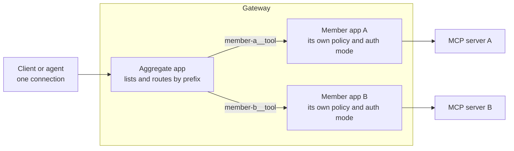

# Privilege AI Gateway: Aggregate Apps

Oct 4, 2026 · @Curtis Muir

## Contents

- [Overview](#overview)
- [What was tested](#what-was-tested)
- [How an aggregate works](#how-an-aggregate-works)
- [Creating one](#creating-one)
- [Tool names](#tool-names)
- [Granting tools](#granting-tools)
- [Two layers of access](#two-layers-of-access)
- [Errors through an aggregate](#errors-through-an-aggregate)
- [Differences a client will notice](#differences-a-client-will-notice)
- [Verifying](#verifying)
- [Quick lookup](#quick-lookup)

## Overview

An aggregate app puts several MCP servers behind one address. A client connects once, to `https://<gateway-host>/<aggregate>/mcp`, and sees the tools of every member server in one list. Each tool's name is prefixed with the server it comes from.

Use one when a client can hold only a few MCP connections, or when you want to hand an agent one address and decide centrally which tools it gets.

Three things to know before you rely on it:

- **Tool names change.** `ListIndexTool` becomes `opensearch__ListIndexTool`. A client or prompt that names tools must use the prefixed form.
- **There are two layers of access.** The grant on the aggregate decides which tools the caller sees. Each member server still applies its own access and its own backend credential when a tool is called.
- **A tool being listed does not mean it will work.** In testing, tools appeared in the list and then failed or hung when called, because of the member behind them.

Placeholders used: `<gateway-host>`, `<aggregate>` for the aggregate app, `<member>` for a member server, `<agent-key>`, `<gateway-namespace>`, `<gateway-deployment>` and `<gateway-container>`.

## What was tested

Tested on 4 October 2026 against a cloud gateway, with an aggregate of two member servers and an agent key holding the `mcp` scope. One member was also called through its own app for comparison.

| Claim | Result |
| --- | --- |
| The aggregate answers `initialize` as its own server | Reproduced: server name `procyon-mcp-aggregate` |
| Its tool list holds tools from both members, each prefixed `<member>__` | Reproduced: 11 tools, 6 and 5 |
| A prefixed tool has the same description and input schema as the original | Reproduced on one tool |
| The list holds only the tools the caller was granted | Reproduced: 11 of the members' tools, matching the grant |
| The grant names tools in their prefixed form | Read from the audit record of the grant |
| Calling a tool without its prefix is refused | Reproduced, with the error quoted below |
| Calling a tool on a server that is not a member is refused | Reproduced |
| Calling a tool outside the grant is refused, and so is one that does not exist | Reproduced: the same error for both |
| A member's own error comes back with the member's name | Reproduced: the member's backend refused the call |
| A call to the other member got no response | Reproduced twice: no reply within 35 and 90 seconds, nothing in the log |
| The aggregate answers in plain JSON; a member's own app answers as an event stream | Reproduced |
| The gateway connects to a member as the caller | Read from the log |

Not tested: creating an aggregate in the console, an aggregate reached with a person's sign-in, resources and prompts (the tested members had none), and why one member hung.

## How an aggregate works



The aggregate has no backend of its own. It is a small MCP server inside the gateway. When a tool is called, it strips the prefix, opens a session to that member as the calling user, and passes the call on. The member is reached the same way any client would reach it, so the member's policy and Auth Mode apply.

## Creating one

In the console an aggregate is an application of type **MCP Aggregate**. It has a name, which becomes its address, and a list of member servers. It has no backend address and no Auth Mode of its own.

Two points from when the tested one was created:

- **It is reachable through the AI Gateway only.** It is not published to the device agent.
- **Members are other registered MCP Server apps.** Register and test each one on its own first.

The form itself was not walked through for this guide.

## Tool names

Every tool is named `<member>__<tool>`: the member's name, two underscores, then the tool's own name.

```text
opensearch__ListIndexTool
opensearch__SearchIndexTool
banking-mcp__get_investment_accounts
```

The description and input schema are unchanged. Only the name differs.

What follows from this:

- **A client must call the prefixed name.** The bare name is refused.
- **The same tool has two names** if the member is also reachable through its own app: bare there, prefixed here. Prompts, allowlists and saved client settings written for one do not work for the other.
- **The prefix is the member's app name, not the server's own name.** Renaming or re-registering a member changes every one of its tool names.
- **Some clients limit tool-name length.** A long member name plus a long tool name can exceed it.

## Granting tools

Access to an aggregate is granted like any MCP app: by a policy for a person, or by selecting the app on a calling agent. The grant can list tools, and on an aggregate it lists them **in their prefixed form**.

The tool list a caller sees is exactly that grant. In testing the two members had many more tools between them than the 11 the caller was given, and the caller saw 11.

A tool outside the grant is not in the list and is refused if called. So an aggregate is a convenient place to give an agent a short, deliberate set of tools drawn from several servers.

## Two layers of access

A call through an aggregate has to pass both layers:

| Layer | Decides | Failure looks like |
| --- | --- | --- |
| The grant on the aggregate | Which prefixed tools the caller may see and call | `access denied for "<tool>"` |
| The member app | Whether this user may use that server, and what credential the backend gets | The member's own error, or no response |

The gateway connects to the member as the calling user. The log shows it:

```text
[mcpagg] connected to member <member> over streamable-http for user <user-id>
```

So the caller needs access to each member as well as to the aggregate. And each member's backend must accept what the member's Auth Mode sends. In testing one member's backend expected a bearer token it was not given, and every tool on that member failed.

Test each member through its own app first. A member that does not work alone will not work inside an aggregate.

## Errors through an aggregate

The aggregate returns its errors as JSON-RPC errors with HTTP status 200. A client that checks only the HTTP status will read them as success.

| Call | Error |
| --- | --- |
| A tool name with no prefix | `-32600` `"<tool>" is not namespaced; expected <server>__<name>` |
| A prefix that is not a member | `-32600` `unknown server "<name>"` |
| A tool outside the caller's grant | `-32600` `access denied for "<member>__<tool>"` |
| A tool that does not exist on a member | The same `access denied` error |
| The member's backend refuses the call | `-32603` `<member>: calling "tools/call": sending "tools/call": Unauthorized` |
| The member does not answer | No response at all |

Three things to take from this:

- **"Access denied" covers two cases.** A tool you were not granted and a tool that does not exist look the same. Check the tool list before assuming a grant is missing.
- **A member's failure names the member.** The text after the member's name is what the member's backend said.
- **A member can hang the call.** Two calls to one member got no reply in 35 and 90 seconds, and the gateway logged nothing for them. Set a timeout in the client. The cause was not established; the same caller was refused with a 403 when calling that member's own app directly.

When a member call fails, the gateway drops its session to that member and logs it:

```text
[mcpagg] tools/call <tool> on <member> failed: calling "tools/call": sending "tools/call": Unauthorized
[mcpagg] discarding session to <member> after error: ...
```

## Differences a client will notice

| | A member's own app | The aggregate |
| --- | --- | --- |
| Server name on `initialize` | The server's own | `procyon-mcp-aggregate` |
| Capabilities | The server's own | `tools`, `resources`, `prompts` |
| Tool names | Bare | Prefixed |
| Response format | Whatever the server uses; the tested one streamed events | Plain JSON |
| A tool outside the grant | Hidden, and a bare 403 if called | Hidden, and a JSON-RPC error if called |

The aggregate did not issue a session ID. Each request stood on its own.

## Verifying

1. **Each member works alone.** Through the member's own app, list tools and call one. Fix any failure here first.
2. **The aggregate lists what you granted.**

   ```bash
   curl -s -X POST https://<gateway-host>/<aggregate>/mcp \
     -H 'Authorization: Bearer <agent-key>' -H 'Content-Type: application/json' \
     -H 'Accept: application/json, text/event-stream' \
     -d '{"jsonrpc":"2.0","id":1,"method":"tools/list"}'
   ```

   Expect each granted tool once, prefixed with its member.

3. **One tool per member works.** Call one tool from each member by its prefixed name, with a timeout. A reply with a `result` means both layers passed.
4. **An ungranted tool is refused.** Call a tool you left out. Expect `access denied`.
5. **Read the log if a member fails.**

   ```bash
   kubectl -n <gateway-namespace> exec deploy/<gateway-deployment> -c <gateway-container> -- \
     sh -c 'tail -n 3000 /var/log/procyon/cyonproxy.log | grep "\[mcpagg\]" | tail -n 10'
   ```

## Quick lookup

| Symptom | Most likely cause | Fix |
| --- | --- | --- |
| `is not namespaced` | The client called the bare tool name | Use `<member>__<tool>` |
| `unknown server` | The prefix is not a member's app name | Check the member names in the tool list |
| `access denied for` a tool that exists | The tool is not in the caller's grant | Add it to the grant, in its prefixed form |
| `access denied for` a tool you were granted | The name is misspelled, or the member's tool list changed | Compare with `tools/list` |
| `<member>: … Unauthorized` | The member's backend rejected what its Auth Mode sent | Fix the member's Auth Mode; test the member alone |
| A call hangs | The member did not answer | Set a client timeout; test that member through its own app |
| A client reports success but nothing happened | The error came back with HTTP 200 | Check the JSON-RPC `error` field |
| Fewer tools than the members have | The grant lists tools | Expected; widen the grant if needed |
| Tool names changed after a re-registration | The prefix is the member's app name | Update prompts and client settings |
