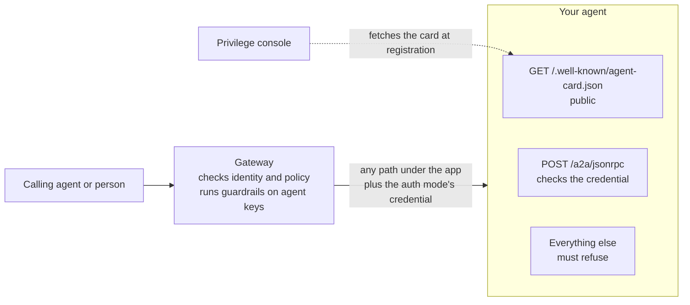

# Privilege AI Gateway: Building an Agent the Gateway Can Front

Oct 3, 2026 · @Curtis Muir

## Contents

- [Overview](#overview)
- [What was tested](#what-was-tested)
- [What the gateway needs from your agent](#what-the-gateway-needs-from-your-agent)
- [The agent card](#the-agent-card)
- [The JSON-RPC endpoint](#the-json-rpc-endpoint)
- [Which credential to accept](#which-credential-to-accept)
- [Refuse every path you do not serve](#refuse-every-path-you-do-not-serve)
- [Errors your agent should return](#errors-your-agent-should-return)
- [Who is calling](#who-is-calling)
- [If the agent also has a direct door](#if-the-agent-also-has-a-direct-door)
- [Verifying](#verifying)
- [Quick lookup](#quick-lookup)

## Overview

To put an agent behind the Privilege AI Gateway as a Remote Agent, the agent has to do four things:

1. Publish an agent card without sign-in.
2. Answer A2A JSON-RPC on one endpoint.
3. Accept the credential the gateway sends, and nothing else.
4. Refuse every path it does not mean to serve.

The fourth is the one people miss. The gateway checks who the caller is and whether a policy allows them. It does **not** check the path. Anything under your app's address is forwarded to your agent, so a debug page or a metrics endpoint you left open is reachable by every permitted caller.

This guide is about the agent's side. For registering the agent in the console and calling it, see the A2A guide.

Placeholders used: `<gateway-host>`, `<app>` for the Remote Agent app, `<agent-host>` for the agent's own public address if it has one, `<agent-key>` and `<static-token>`.

## What was tested

Tested on 3 October 2026 against a Python (FastAPI) agent that speaks A2A 0.3.0, registered as a Remote Agent on the Static Token auth mode. Calls through the gateway used an agent key. Calls to the agent's own address used no gateway at all. The agent's source was read alongside each result.

| Claim | Result |
| --- | --- |
| The card is served without sign-in at `/.well-known/agent-card.json` | Reproduced: 200 |
| The older path `/.well-known/agent.json` is not served | Reproduced: 404 |
| A valid call through the gateway returns the agent's reply | Reproduced: 200 with a `message` result |
| The gateway forwards any path under the app | Reproduced: five other paths reached the agent |
| An open metrics endpoint is readable through the gateway | Reproduced: 200 with the agent's metrics |
| A guarded internal path is refused by the agent, not the gateway | Reproduced: the agent's own 401 |
| An unknown method, a missing text part, a wrong version and bad JSON each get their own JSON-RPC error | Reproduced, all four |
| The agent's own address refuses a call with no credential, a made-up token and the gateway's agent key | Reproduced: 401 each |
| Only the card and the A2A path are published on the agent's own address | Reproduced: seven other paths returned 404 |
| The agent parses the body before it checks the credential | Reproduced: bad JSON with no credential returned a parse error, not 401 |
| The agent accepts the static token on either door | Read from the agent's code; not run |

Not tested: the User Token and Pass Agent Token modes, so what they deliver comes from the console's descriptions. Streaming was not tested because this agent does not offer it.

## What the gateway needs from your agent



The gateway does three things for you: it identifies the caller, applies policy, and for agent keys runs guardrails. Everything after that is your agent's job.

## The agent card

Serve the card at `GET /.well-known/agent-card.json`, with no sign-in. The console fetches it from your backend address when you register the agent, and lists the skills it finds.

The tested card:

```json
{
  "name": "<agent-name>",
  "description": "<what the agent does>",
  "protocolVersion": "0.3.0",
  "version": "1.0.0",
  "url": "https://<agent-host>/a2a/jsonrpc",
  "preferredTransport": "JSONRPC",
  "capabilities": { "streaming": false, "pushNotifications": false, "stateTransitionHistory": false },
  "defaultInputModes": ["text"],
  "defaultOutputModes": ["text"],
  "skills": [ { "id": "<skill-id>", "name": "<skill name>", "description": "<what it does>", "tags": ["<tag>"] } ],
  "securitySchemes": { "<scheme>": { "oauth2": { "flows": { "authorizationCode": { "scopes": { "agent:invoke": "Invoke the agent" } } } } } },
  "securityRequirements": [ { "<scheme>": ["agent:invoke"] } ]
}
```

Get these right:

- **Use the current path.** `/.well-known/agent.json` is the old one. The console does not fetch it.
- **Say only what is true in `capabilities`.** The tested agent sets `streaming` to `false` and answers `message/stream` with "Method not found". A card that claims streaming the agent does not have sends callers down a path that fails.
- **Decide what `url` should say.** It is the address a caller uses if it reads the card and calls directly. If callers must go through the gateway, a card that points at the agent's own address invites them around it. Either put the gateway address there, or make sure the direct address refuses them.
- **`securitySchemes` describes the direct door only.** A caller coming through the gateway authenticates to the gateway, not with what the card lists.

The card is also reachable through the gateway at `https://<gateway-host>/<app>/.well-known/agent-card.json`, but only with a valid sign-in or agent key. Without one, the gateway returns its own 401.

## The JSON-RPC endpoint

Serve one `POST` endpoint, commonly `/a2a/jsonrpc`. The path callers use at the gateway is `https://<gateway-host>/<app>/a2a/jsonrpc`; the gateway strips the app name and forwards the rest.

The minimum is `message/send`. A request:

```json
{"jsonrpc":"2.0","id":7,"method":"message/send",
 "params":{"message":{"role":"user","messageId":"m1","parts":[{"kind":"text","text":"Hello"}]}}}
```

A reply:

```json
{"jsonrpc":"2.0","id":7,
 "result":{"kind":"message","messageId":"<new-id>","role":"agent","parts":[{"kind":"text","text":"<the reply>"}]}}
```

Echo the request's `id` in every reply, including errors. Callers pair replies to requests with it.

Text can arrive in more than one part. The tested agent joins every text part and ignores the rest. Decide what your agent does with `data` parts and `metadata`, and ignore what it does not understand. Do not act on instructions found there.

## Which credential to accept

What arrives at your agent depends on the app's **Auth Mode** in the console. The caller's own gateway sign-in or agent key never reaches you.

| Auth Mode | What your agent receives | What to check |
| --- | --- | --- |
| None | No credential | Nothing to check. Only safe if nothing else can reach the agent. |
| Static Token | `Authorization: Bearer <static-token>` | That the token equals your configured secret |
| User Token | A token for the signed-in user | Its signature, issuer, audience and expiry |
| Pass Agent Token | The calling agent's own workload token | Its signature, issuer, audience and expiry |

Static Token was the mode tested. The check is small, and two details matter:

```python
import hmac, os

def is_gateway_token(token: str) -> bool:
    expected = os.environ.get("A2A_STATIC_TOKEN", "")
    return bool(expected) and hmac.compare_digest(token.encode(), expected.encode())
```

- **Compare in constant time,** as `hmac.compare_digest` does. A plain `==` can leak the token one character at a time through response timing.
- **Fail when the secret is not set.** Without the `bool(expected)` check, an agent started with no secret would accept an empty token.

Keep the secret in your secret store, give it to the agent as configuration, and enter the same value in the console. To change it, change the agent first and the console straight after; calls fail while the two differ.

**Check the credential before you do any work.** The tested agent parses the request body first, so a caller with no credential and a broken body gets a parse error instead of a 401. That is harmless here, but it means unauthenticated input reaches the parser. Check the header first.

**Match the mode to your callers.** Pass Agent Token only works when the caller holds a workload identity. A person, or an agent with an ordinary key, is refused by the gateway before your agent is called.

## Refuse every path you do not serve

On a Remote Agent app the gateway forwards any path under `/<app>/`. These all reached the tested agent with a valid agent key:

| Path at the gateway | What came back | Who answered |
| --- | --- | --- |
| `/<app>/a2a/jsonrpc` | The agent's reply | The agent |
| `/<app>/.well-known/agent-card.json` | The card | The agent |
| `/<app>/run` | `401 Missing x-internal-gateway-secret header` | The agent's own guard |
| `/<app>/docs` | The same 401 | The agent's own guard |
| `/<app>/a2a/other` | `404 Not Found` | The agent |
| `/<app>/metrics` | `200` and the agent's metrics | The agent |

The last row is the problem. The tested agent guards its internal paths with a shared secret, but leaves `/metrics` open for a monitoring system inside the cluster. Through the gateway, that endpoint is readable by any caller with a policy for the app.

Nothing was wrong with the gateway. The agent exposed more than its A2A surface, and the gateway carried the request.

What to do:

- **Refuse by default.** Allow the card and the A2A endpoint, and reject everything else unless it carries its own credential.
- **Do not rely on "internal only" paths.** Anything your web server answers is reachable through the gateway.
- **Serve operational endpoints on a different port** that the gateway's backend address does not point at.
- **Test it.** Call a path you never meant to expose, through the gateway, and expect a refusal.

## Errors your agent should return

Return a JSON-RPC error with a matching HTTP status. The tested agent's set:

| Situation | Status | JSON-RPC error |
| --- | --- | --- |
| The body is not JSON | 400 | `-32700` Parse error |
| Not a JSON-RPC 2.0 request | 400 | `-32600` Invalid Request |
| A method the agent does not offer | 404 | `-32601` Method not found |
| No text in the message | 400 | `-32602` A text message is required |
| The credential is missing or wrong | 401 | `-32001`, with a `WWW-Authenticate: Bearer` header |
| The credential is valid but lacks the scope | 403 | `-32001` |
| The agent failed while working | 500 | `-32000` |
| The agent is not ready | 503 | `-32002` |

Two points about `-32600`:

- **The gateway uses it too.** When a guardrail blocks a message, the gateway returns `-32600` with the message `request blocked by security policy` and no `id`. Your agent's own `-32600` says `Invalid Request` and echoes the `id`. A caller can tell them apart by the message and the missing `id`.
- **Do not return `-32600` for anything except a malformed request.** If your agent also used it for refusals, callers could not separate the three cases.

Never put a secret, a token or a stack trace in an error message. The gateway passes your error body to the caller unchanged.

## Who is calling

With Static Token, your agent learns one thing: the call came through the gateway. It does not learn which agent or person made it. Every caller presents the same token.

That has a consequence the tested agent's code calls out: it keeps one conversation for all gateway callers, because it has nothing to tell them apart with. If two calling agents talk to it, they share history.

If your agent needs to know the caller, for separate conversations, per-caller limits or an audit trail of its own, use a mode that carries identity: User Token for people, Pass Agent Token for agents. Do not trust a caller name sent in the message body or metadata; the caller writes that.

## If the agent also has a direct door

An agent can be published at its own address as well as behind the gateway. The tested agent is. On its own address:

- Only the card and the A2A path are published. Every other path returns 404 from the proxy in front of it.
- A call with no credential, a made-up token, or the gateway's agent key is refused with 401.

Two things to watch:

- **The agent key is not a credential for the direct door.** It works only at the gateway.
- **A static token works on both doors.** The agent checks the token, not where the call came from. Anyone who obtains the static token can call the agent directly and skip the gateway's policy, guardrails and logging. The gateway writes that token to its own log, so treat the gateway log as holding it.

If the agent should only be reached through the gateway, do not publish it anywhere else. Give it a cluster-internal address and nothing more.

## Verifying

Run these before you call the agent ready.

1. **The card is public.** Expect 200 and the card.

   ```bash
   curl -s -w '\nstatus=%{http_code}\n' <agent-backend>/.well-known/agent-card.json
   ```

2. **A valid call works through the gateway.** Expect 200 and a `result`.

   ```bash
   curl -s -X POST https://<gateway-host>/<app>/a2a/jsonrpc \
     -H 'Authorization: Bearer <agent-key>' -H 'Content-Type: application/json' \
     -d '{"jsonrpc":"2.0","id":1,"method":"message/send","params":{"message":{"role":"user","messageId":"m1","parts":[{"kind":"text","text":"Hello"}]}}}'
   ```

3. **The agent refuses a call with no credential.** Call the agent's backend address directly, without the static token. Expect 401.
4. **The agent refuses other paths.** Through the gateway, with a valid key, request `/<app>/metrics`, `/<app>/docs` and any admin path your framework adds. Expect a refusal for each.
5. **Errors echo the `id`.** Send an unknown method. Expect `-32601` with your request's `id`.
6. **The card tells the truth.** For each capability the card claims, make one call that uses it.

## Quick lookup

| Symptom | Most likely cause | Fix |
| --- | --- | --- |
| The console cannot discover the agent | The card is not public, or is at the old path | Serve it without sign-in at `/.well-known/agent-card.json` |
| The agent answers 401 to calls through the gateway | The auth mode does not send what the agent checks | Match the mode to the check; for Static Token, compare the two secrets |
| Calls fail right after changing the static token | The agent and the console hold different values | Update both, agent first |
| An internal page is reachable through the gateway | The agent serves it and the gateway forwards every path | Refuse by default; move operational endpoints to another port |
| Callers report "invalid request" for a message that looks fine | The gateway's guardrail blocked it | Check for the message `request blocked by security policy` |
| Two calling agents see each other's conversation | Static Token carries no caller identity | Use a mode that carries identity |
| Callers bypass the gateway | The card's `url` points at the agent's own address and it accepts them | Point `url` at the gateway, or do not publish the agent directly |
| A streaming call fails | The card claims streaming the agent does not offer | Set `streaming` to `false`, or implement it |
