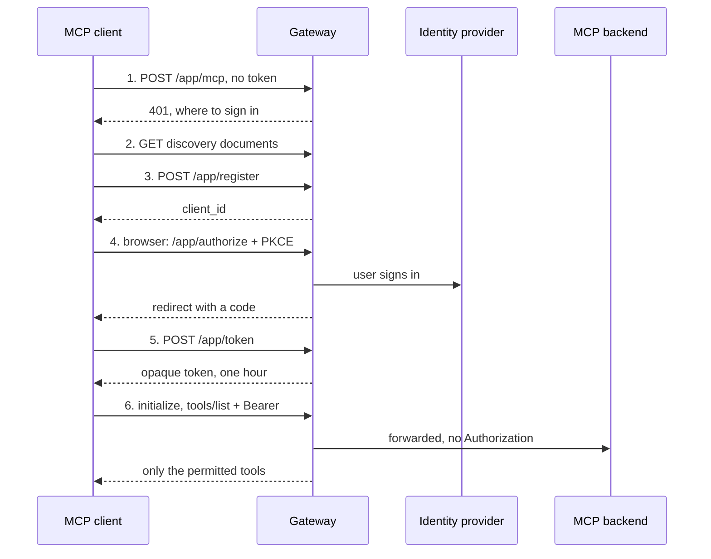

# Privilege AI Gateway: Connecting an MCP Client

Oct 3, 2026 · @Curtis Muir

## Contents

- [Overview](#overview)
- [What was tested](#what-was-tested)
- [How a client connects](#how-a-client-connects)
- [The address to give a client](#the-address-to-give-a-client)
- [The connection step by step](#the-connection-step-by-step)
- [Tokens](#tokens)
- [Setting up a client](#setting-up-a-client)
- [What the client sees once connected](#what-the-client-sees-once-connected)
- [Common mistakes](#common-mistakes)

## Overview

An MCP client needs one thing to connect through the gateway: the app's URL, `https://<gateway-host>/<app>/mcp`. It needs no client ID, no secret and no API key. The client discovers everything else from the gateway and sends the user to sign in.

The client must support three things:

- **Remote MCP over Streamable HTTP.** The gateway is an HTTPS endpoint, not a local process.
- **OAuth sign-in with discovery.** On the first call the gateway answers 401 and says where to sign in. The client follows that.
- **Dynamic client registration.** The client registers itself at the gateway. Nobody creates a client for it in advance.

Check your client's documentation for all three. A client that only takes a fixed bearer token will not work on its own, because the gateway's tokens last about an hour and are issued only through sign-in.

What the gateway does for the client: it signs the user in through your identity provider, applies the access policy for that user and app, and shows the client only the tools that policy grants.

Placeholders used: `<gateway-host>` and `<app>`, the application's name in the console.

## What was tested

The sign-in steps were run by hand against a cloud gateway, build v1.260925, on 3 October 2026. The MCP calls made after sign-in were run on the same gateway the day before.

| Claim | Result | When |
| --- | --- | --- |
| The first call returns 401 with `resource_metadata` and `authorization_uri` | Confirmed | 3 Oct |
| Both discovery documents exist, the second in two URL forms; no `openid-configuration` | Confirmed | 3 Oct |
| Registration needs no prior setup and returns a `client_id` | Confirmed | 3 Oct |
| `token_endpoint_auth_method: none` gives no secret; the default gives one | Confirmed | 3 Oct |
| PKCE sign-in with a local redirect address works end to end | Confirmed, two sign-ins | 3 Oct |
| The token is opaque with `expires_in: 3600`, and no refresh token unless asked for | Confirmed | 3 Oct |
| After an hour the token returns the ordinary 401 | Confirmed | 3 Oct |
| The bare gateway address is a landing page; `/<app>` alone is 404 | Confirmed | 3 Oct |
| An unknown client at `/authorize` gets "registration has expired" | Confirmed | 3 Oct |
| `initialize`, `tools/list` and a tool call work with the token | Confirmed | 2 Oct |
| `tools/list` is filtered: nine tools on the backend, three shown | Confirmed | 2 Oct |
| A tool outside the policy, and a tool that does not exist, both return a bare 403 | Confirmed | 2 Oct |
| With no policy, `initialize` returns 403 after a successful sign-in | Confirmed | 2 Oct |
| A token from one app is refused on another | Confirmed | 2 Oct |
| The backend never receives the `Authorization` header | Confirmed | 2 Oct |

Not tested: exchanging a refresh token by hand, a live LM Studio connection, and the Claude, Cursor, VS Code and ChatGPT clients.

## How a client connects



The first call is meant to fail: the 401 tells the client where to register and sign in. After that the client holds a one-hour token for this one app, and every call it makes is forwarded to the backend without that token.

## The address to give a client

Each app has its own URL: `https://<gateway-host>/<app>/mcp`. Give the client that URL and nothing else.

- **One app, one connection.** There is no single URL for everything. To use three apps, add three servers in the client, each with its own sign-in.
- **The bare gateway address is not an endpoint.** `https://<gateway-host>/` serves a landing page that explains how to connect. `https://<gateway-host>/<app>` with no path returns 404.
- **Use the path the app was registered with.** It is usually `/mcp`. Ask the gateway admin if a call returns 404 after sign-in.
- **Get the app name exactly right.** A wrong name still lets the user sign in and fails only on the first real call, with a 403.
- **To offer many servers behind one URL,** the admin can register an aggregate app. The client then sees every tool, each prefixed with its server's name.

## The connection step by step

A client does these six steps by itself. Run them by hand only to test a gateway or to build your own client.

**1. Call the app and read the challenge.**

```bash
curl -s -D - -o /dev/null -X POST https://<gateway-host>/<app>/mcp \
  -H 'Content-Type: application/json' -d '{}' | grep -iE '^HTTP|www-authenticate'
```

The answer is `401` with a `WWW-Authenticate` header that carries `resource_metadata` and `authorization_uri`.

**2. Read the two discovery documents.**

```bash
curl -s https://<gateway-host>/.well-known/oauth-protected-resource/<app>/mcp
curl -s https://<gateway-host>/<app>/.well-known/oauth-authorization-server
```

The first names the authorization server, `https://<gateway-host>/<app>`. The second lists its endpoints and what it supports:

| Setting | Value |
| --- | --- |
| Endpoints | `/<app>/authorize`, `/<app>/token`, `/<app>/register` |
| Grant types | `authorization_code`, `refresh_token` |
| PKCE | Required, `S256` |
| Client authentication | `none` or `client_secret_post` |
| Scopes | `openid`, `profile`, `email` |

The same document is also served at `https://<gateway-host>/.well-known/oauth-authorization-server/<app>`. There is no OpenID `openid-configuration` document.

**3. Register the client.**

```bash
curl -s -X POST https://<gateway-host>/<app>/register -H 'Content-Type: application/json' \
  -d '{"client_name":"my-client","redirect_uris":["http://127.0.0.1:<port>/callback"],
       "token_endpoint_auth_method":"none","grant_types":["authorization_code","refresh_token"]}'
```

The gateway returns a `client_id`. With `token_endpoint_auth_method: none` it returns no secret; without that field it issues a `client_secret` for `client_secret_post`. At least one `redirect_uri` is required, and a local `http://127.0.0.1` address is accepted.

**4. Send the user to sign in.** Open `/<app>/authorize` in a browser with `response_type=code`, the `client_id`, the `redirect_uri`, `scope=openid profile email`, a `state`, and a PKCE `code_challenge` with `code_challenge_method=S256`. The gateway sends the user to your identity provider and then back to the redirect address with a `code`.

**5. Exchange the code.** POST to `/<app>/token` as a form with `grant_type=authorization_code`, the `code`, `redirect_uri`, `client_id` and `code_verifier`. The answer holds `access_token`, `token_type`, `scope` and `expires_in: 3600`.

**6. Speak MCP.** Send `initialize`, then `tools/list`, to `https://<gateway-host>/<app>/mcp` with `Authorization: Bearer <access_token>`.

## Tokens

The gateway issues its own access token. It is a short opaque string, not a JWT, so a client cannot read a user or an expiry out of it.

| Property | Value |
| --- | --- |
| Lifetime | One hour (`expires_in: 3600`) |
| Valid for | The one app the user signed in to |
| After expiry | The same 401 challenge as having no token |
| Reaches the backend | Never. The gateway removes the `Authorization` header before forwarding. |

- **One token per app.** A token from one app is refused on another with a 401. A client connected to three apps holds three tokens.
- **Ask for a refresh token when you register.** The gateway supports the `refresh_token` grant. A client that registered with only `authorization_code` received no refresh token and had to sign the user in again after an hour.
- **A long-idle client may need to reconnect.** If `/authorize` answers `This client's registration has expired`, the gateway no longer knows the client. Clear the client's saved credentials for that server and connect again; it will register afresh.
- **A fixed token will not work.** There is no long-lived key for MCP apps. A script that needs unattended access must hold a refresh token or sign in again.

## Setting up a client

In every client the setup is the same: add a remote MCP server, give it the app URL, and sign in when the browser opens. These are the clients we have set up:

| Client | How it is configured | Status |
| --- | --- | --- |
| LibreChat | An `mcpServers` entry with `type: streamable-http` and the app URL | Connected; tools listed and called |
| LM Studio | An entry in `mcp.json` with just the app URL | Configured this way; connection not re-checked for this guide |
| A custom client (Node) | The six steps above, with a local callback address | Connected; tools listed and called |
| By hand (curl, Python) | The six steps above | Connected |

LibreChat, in `librechat.yaml`:

```yaml
mcpServers:
  my-app:
    type: streamable-http
    url: 'https://<gateway-host>/<app>/mcp'
    timeout: 60000
```

LM Studio, in `mcp.json`:

```json
{ "mcpServers": { "my-app": { "url": "https://<gateway-host>/<app>/mcp" } } }
```

Neither entry holds a client ID, a secret or a token. If a client's form asks for an OAuth client ID, leave it empty so the client registers itself.

Not tested by us: Claude Desktop, Claude Code, Cursor, VS Code and ChatGPT. Each documents remote MCP with OAuth, so the same URL-only setup should apply, but confirm it on your own gateway before telling users it works. Two things differ between clients and are worth checking: the redirect address the client registers, and whether it accepts your gateway's certificate. A gateway on a private or self-signed certificate is refused by some desktop clients.

## What the client sees once connected

The client sees a normal MCP server, with a few differences that come from policy.

- **The tool list is filtered.** `tools/list` returns only the tools the user's policy grants. In one tested session the backend had nine tools and the client was shown three. The client cannot tell that others exist.
- **A refused call is not an MCP error.** Calling a tool outside the policy returns HTTP `403 Forbidden` with no JSON-RPC body. A tool that does not exist returns exactly the same. A client may show this as a connection or transport failure, not as "permission denied".
- **With no policy at all, the first call fails.** Sign-in succeeds, a token is issued, and `initialize` itself returns 403. To the user it looks like the server is broken right after a successful sign-in.
- **Different users see different tools.** The list depends on who signed in, so two people on the same URL can have different tool lists.
- **Tool lists can change between sessions.** When an admin changes a policy, the client sees the new list on its next `tools/list`.
- **An aggregate app prefixes tool names** with the server each tool comes from, so names differ from the same tool reached through its own app.

A client may also log one harmless error at connect time: some clients first try a newer handshake method, `server/discover`, which older servers answer with 400, 404 or 405. The client then falls back to `initialize` and carries on.

## Common mistakes

| Symptom | Cause | Fix |
| --- | --- | --- |
| The client asks for a client ID or secret | It is set up for a pre-registered OAuth client | Leave those fields empty; the client registers itself |
| 404 before any sign-in prompt | The URL is the bare gateway or stops at `/<app>` | Use `https://<gateway-host>/<app>/mcp` |
| Sign-in works, then every call fails with 403 | No policy for this user, or the app name is wrong | Ask the admin for a policy; check the name |
| Sign-in works, then 404 | The path is not the app's registered entry path | Use the registered path, usually `/mcp` |
| It worked this morning and now returns 401 | The one-hour token expired and the client holds no refresh token | Sign in again; register with the `refresh_token` grant |
| `/authorize` says the registration has expired | The gateway no longer knows this client | Clear the client's saved credentials for the server and reconnect |
| A second app fails with 401 using the first app's sign-in | Tokens are per app | Add the second app as its own server and sign in to it |
| Some tools are missing | The policy does not grant them | Ask the admin to grant them |
| A tool call shows as a transport error | The gateway answered 403 with no JSON-RPC body | Treat a 403 on a tool call as "not permitted" |
| A desktop client refuses to connect at all | It does not trust the gateway's certificate | Put a publicly trusted certificate on the gateway |

The companion guide, Privilege AI Gateway: Reading Gateway Errors, shows how the admin finds the exact reason in the gateway log.
