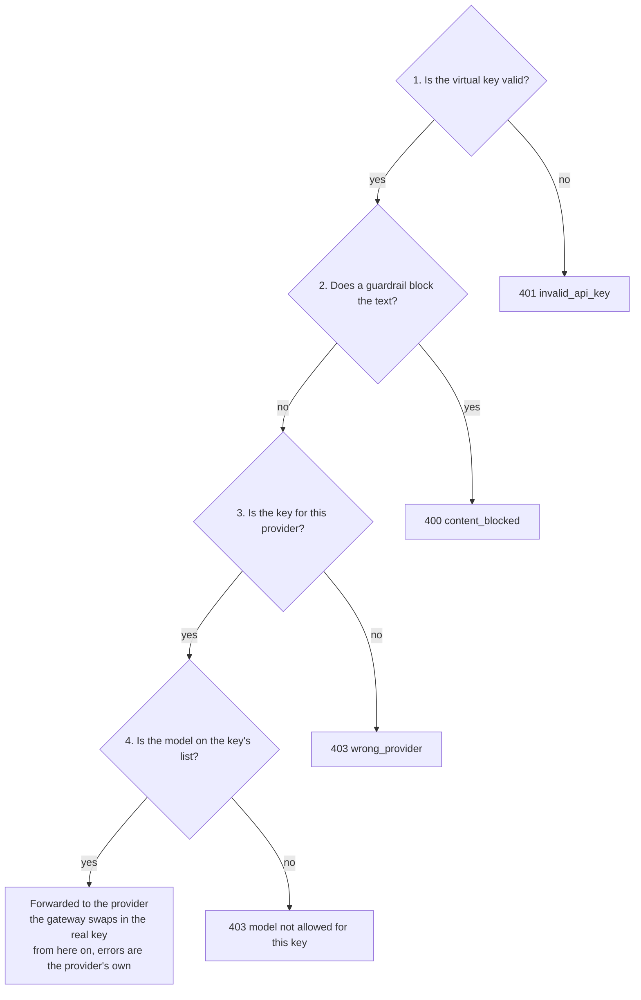

# Privilege AI Gateway: LLM Routing and Virtual Keys

Oct 3, 2026 · @Curtis Muir

## Contents

- [Overview](#overview)
- [What was tested](#what-was-tested)
- [How a model call is checked](#how-a-model-call-is-checked)
- [Setting up a virtual key](#setting-up-a-virtual-key)
- [The route](#the-route)
- [Sending the key](#sending-the-key)
- [Allowed models](#allowed-models)
- [Rate limits and budgets](#rate-limits-and-budgets)
- [What the client sees when a call is refused](#what-the-client-sees-when-a-call-is-refused)
- [The log line for a model call](#the-log-line-for-a-model-call)
- [Verifying](#verifying)
- [Quick lookup](#quick-lookup)

## Overview

The gateway can sit between an application and a model provider such as OpenAI, Anthropic or Google. The application calls the gateway instead of the provider, and it authenticates with a **virtual key** instead of the provider's API key.

Two things change when you do this:

- **The application never holds the provider's key.** The real key is stored in Privilege and added by the gateway. A virtual key works only at the gateway, only for one provider, and only for the models you allow.
- **The gateway can refuse a call before the provider sees it.** A refusal names its reason: a bad key, the wrong provider, a model that is not allowed, or text a guardrail blocked.

Unlike MCP and A2A apps, the model route has no sign-in. The virtual key is the only credential, so treat it as a secret.

Placeholders used: `<gateway-host>`, `<provider>`, `<virtual-key>`, `<gateway-namespace>`, `<gateway-deployment>` and `<gateway-container>`.

## What was tested

Every status code and body in this guide was produced on a running gateway on 3 October 2026, with one OpenAI key and one Anthropic key, unless the table says otherwise.

| Claim | Result | When |
| --- | --- | --- |
| A valid key and an allowed model returns the provider's answer | Reproduced on OpenAI and Anthropic | 3 Oct |
| No key returns 401 `missing Authorization header` | Reproduced | 3 Oct |
| A made-up key returns 401 `invalid virtual key` | Reproduced | 3 Oct |
| A key used on another provider's route returns 403 `wrong_provider` | Reproduced: an OpenAI key on the Anthropic route | 3 Oct |
| A model outside the key's list returns 403 `not allowed for this key` | Reproduced | 3 Oct |
| A model that does not exist returns the same 403 | Reproduced | 3 Oct |
| The key is accepted in `Authorization: Bearer` and in `x-api-key` | Reproduced on both providers | 3 Oct |
| The models list is the provider's catalog, not the key's list | Reproduced: 133 models listed, most refused when called | 3 Oct |
| A refusal returns in about 0.15 seconds; an allowed call takes 1 to 2 seconds | Measured | 3 Oct |
| The guardrail runs after the key check and before the provider and model checks | Reproduced with requests that fail two checks at once | 3 Oct |
| The `x-ratelimit-*` response headers are the provider's | Seen in the response | 3 Oct |
| Going over a key's tokens-per-minute limit returns 429 `tokens_rate_limit_exceeded` with `retry-after` | Reproduced on a key limited to 1,000 tokens a minute | 3 Oct |
| The settings a virtual key carries | Read from the audit record of a key being saved | 3 Oct |
| A provider's own error passes through unchanged | Reproduced: Anthropic's 400 for a missing version header | 3 Oct |
| The log has one JSON `LLM request` line per call, with the fields listed below | Read for the calls above | 3 Oct |
| A call with an invalid key leaves no `LLM request` line | Read from the log | 3 Oct |
| The log records the virtual key in full | Confirmed by comparing the logged value with the key | 3 Oct |

Not tested: the console form's own labels, the requests-per-minute limit, a budget refusal, a key with an empty model list, the Google route (no Google key was set up for the tests), and model calls made by an agent with an agent key.

## How a model call is checked



The order was measured, not assumed. A request with a prompt injection and the wrong provider's key came back as `content_blocked`, not `wrong_provider`. So did one with a prompt injection and a model the key does not allow. A made-up key with the same injection came back as `invalid virtual key`.

This matters when you debug: a guardrail block can hide a provider or model mistake behind it. Fix the block first, then retest.

## Setting up a virtual key

Virtual keys are created in the Privilege console under **Virtual Keys**. You create one per provider. Each key carries these settings:

| Setting | What it does | Example from a tested key |
| --- | --- | --- |
| Provider | The one provider the key works for | `openai` |
| Real key | The provider's API key. It stays in Privilege. | |
| Owner | The user the key belongs to. Calls are logged against this user. | |
| Allowed models | The models the key may call | `gpt-4o-mini`, `gpt-4o` |
| Requests per minute | A rate limit on calls | 60 |
| Tokens per minute | A rate limit on tokens | 90,000 |
| Budget in USD | A spending cap for each budget period | 50 |
| Budget in tokens | A token cap for each budget period | 0, meaning not set |
| Budget period | How often the budget resets | monthly |
| Expiry | The date the key stops working | |
| Scopes | What the key may be used for: `llm`, `mcp`, `a2a` | `llm` |
| Guardrail settings | Which detectors run and their thresholds. See the guide to guardrails. | |

The names in the left column describe the settings. The console's own labels were not checked, so they may differ. The settings themselves were read from the audit record written when a key was saved.

Store the virtual key where you store other secrets. Guardrail settings are per key, so two keys for the same provider can treat the same prompt differently.

Check the provider twice. In an earlier test, a key meant for Google had been created against OpenAI. Every call on the Google route failed with `wrong_provider`, which looked like a gateway fault and was a setup mistake.

## The route

The route has the same shape for every provider:

```text
https://<gateway-host>/llm/<provider>/v1/<the provider's own path>
```

| Provider | Chat route | Request format |
| --- | --- | --- |
| OpenAI | `/llm/openai/v1/chat/completions` | OpenAI chat completions |
| Anthropic | `/llm/anthropic/v1/messages` | Anthropic Messages. Needs the `anthropic-version` header. |
| Google | `/llm/google/v1/chat/completions` | OpenAI-compatible. Not tested here. |

The gateway does not translate between formats. An application that speaks OpenAI's format needs an OpenAI key and the OpenAI route.

An SDK should only need its base URL changed, though no SDK was run for this guide. Point the OpenAI SDK at `https://<gateway-host>/llm/openai/v1` and the Anthropic SDK at `https://<gateway-host>/llm/anthropic`, and pass the virtual key where the provider key would go.

Other paths under `/v1` are forwarded too. A `GET` to `/llm/openai/v1/embeddings` returned OpenAI's own "Only POST requests are accepted" error, which shows the call reached the provider.

A provider name the gateway does not know returns a plain `403 Forbidden` with a valid key.

## Sending the key

Both headers work on both tested providers:

```bash
# OpenAI format
curl https://<gateway-host>/llm/openai/v1/chat/completions \
  -H "Authorization: Bearer <virtual-key>" \
  -H "content-type: application/json" \
  -d '{"model":"gpt-4o-mini","max_tokens":8,"messages":[{"role":"user","content":"Reply with the single word ok"}]}'

# Anthropic format
curl https://<gateway-host>/llm/anthropic/v1/messages \
  -H "x-api-key: <virtual-key>" \
  -H "anthropic-version: 2023-06-01" \
  -H "content-type: application/json" \
  -d '{"model":"claude-haiku-4-5-20251001","max_tokens":8,"messages":[{"role":"user","content":"Reply with the single word ok"}]}'
```

The response is the provider's own, unchanged: the same JSON, the same token counts, and streaming if you asked for it.

Without the `anthropic-version` header, the Anthropic route returns Anthropic's own `400`: `anthropic-version: header is required`. The gateway does not add the header for you.

## Allowed models

The gateway reads the `model` field of each request and compares it with the key's list.

```json
{"error":{"message":"model \"o3\" not allowed for this key","type":"invalid_request_error"}}
```

Three things to know:

- **The models list does not show what is allowed.** `GET /llm/<provider>/v1/models` returns the provider's whole catalog. On the tested gateway it listed 133 OpenAI models, and most of them were refused when called. The only way to learn whether a model is allowed is to call it.
- **A model that does not exist gets the same 403.** The gateway checks its list first, so a typo in the model name looks exactly like a model that is not allowed.
- **A request with no `model` field is forwarded.** The provider then answers with its own error, `you must provide a model parameter`.

## Rate limits and budgets

A virtual key has two rate limits, requests per minute and tokens per minute, and a budget.

**Going over the token limit** was tested on a key limited to 1,000 tokens a minute. A call that used 978 tokens succeeded. The next call was refused:

```json
{"error":{"message":"token rate limit exceeded","type":"rate_limit_error","code":"tokens_rate_limit_exceeded"}}
```

The status is `429`, and the response has a `retry-after` header with the number of seconds to wait; it was 29 in the test. A small call sent straight after was refused the same way. Once the limit is reached, every call on the key fails until the window clears, whatever its size.

The gateway counts tokens after a call completes. The call that crosses the limit succeeds, and the calls after it are refused.

The log records the refusal twice: an `LLM request` line with status 429, and a JSON line with `"msg":"AIGuardControl"`, `"Event":"llm_policy_denied"` and `"Reason":"token_rate_limit"`. That second line is the only place the log states why a call was refused.

The requests-per-minute limit and the budget were not triggered.

One trap was confirmed about headers. A successful OpenAI response carries headers such as:

```text
x-ratelimit-limit-requests: 10000
x-ratelimit-remaining-requests: 9994
x-ratelimit-limit-tokens: 200000
```

These are **the provider's limits on the real key**, passed through by the gateway. They are not the virtual key's limits. Anthropic's `anthropic-ratelimit-*` headers pass through the same way. Do not show them to users as the key's remaining allowance. The gateway has no endpoint that reports a key's own usage.

The same pass-through sends the provider's other headers to the caller. On OpenAI that includes `openai-organization` and `openai-project`, which identify the account behind the real key. If callers should not learn that, remove those headers at a proxy in front of the gateway.

## What the client sees when a call is refused

The body tells you who answered. The gateway's refusals are short JSON in OpenAI's error style, on every provider's route. Anything in the provider's own style came from the provider.

| Status and body | Cause |
| --- | --- |
| `401` `"message":"missing Authorization header"`, `"code":"invalid_api_key"` | No key was sent |
| `401` `"message":"invalid virtual key"`, `"code":"invalid_api_key"` | The gateway does not know this key. It was mistyped, deleted, or belongs to another gateway. |
| `403` `"message":"key not valid for provider \"anthropic\""`, `"code":"wrong_provider"` | The key belongs to a different provider than the one in the URL |
| `403` `"message":"model \"<name>\" not allowed for this key"` | The model is not on the key's list, or does not exist |
| `403` plain text `Forbidden` | The provider name in the URL is not one the gateway knows |
| `400` `"code":"content_blocked"`, `"type":"security_error"` | A guardrail blocked the text. The message names the category. |
| `429` `"code":"tokens_rate_limit_exceeded"`, `"type":"rate_limit_error"`, with a `retry-after` header | The key went over its tokens-per-minute limit |
| `401` with `"error":"unauthorized"`, `"error_description":"Bearer token required"` and an `authorization_uri` | The URL is wrong and the key is not valid, so the gateway treated the call as a call to an app. Check the path. |
| Any other error, in the provider's style | The provider answered. The gateway forwarded the call. |

A refusal is fast. On the tested gateway each one returned in about 0.15 seconds, against 1 to 2 seconds for a call that reached the provider. A fast failure is a gateway refusal.

## The log line for a model call

The gateway writes one JSON line per model call to its log, with `"msg":"LLM request"`.

```bash
kubectl -n <gateway-namespace> exec deploy/<gateway-deployment> -c <gateway-container> -- \
  sh -c 'grep "\"msg\":\"LLM request\"" /var/log/procyon/cyonproxy.log | tail -n 5'
```

A successful call, shortened and with IDs replaced:

```json
{"msg":"LLM request","Provider":"openai","Model":"gpt-4o-mini-2024-07-18",
 "HTTPStatus":200,"UpstreamStatus":200,"Streaming":false,"LatencyMs":1908,
 "PromptTokens":13,"CompletionTokens":2,"TotalTokens":15,
 "CostUSD":0.00000315,"PriceSource":"builtin",
 "KeyType":"api_key","PrincipalKind":"User","User":"<user-id>","Tenant":"<tenant-id>",
 "VirtualKeyID":"<virtual-key>","RequestID":"<id>","RequestTS":"2026-10-03T23:05:59Z"}
```

| Field | What it tells you |
| --- | --- |
| `Provider`, `Model` | The provider from the URL, and the exact model that answered |
| `PromptTokens`, `CompletionTokens`, `TotalTokens` | Usage for the call |
| `CostUSD`, `PriceSource` | The gateway's own cost estimate. `builtin` means it used its own price list; `unpriced` means it had no price. |
| `LatencyMs` | Time spent on the call. `0` means the gateway answered without calling the provider. |
| `User`, `PrincipalKind` | The owner of the key |
| `Streaming` | Whether the response was streamed |

What the line does not tell you:

- **Why a call was refused.** A rate-limit refusal is the exception: it gets its own `AIGuardControl` line with the reason. For the rest, a refused call has the status, an empty `Model` and zero tokens. A `wrong_provider` refusal and a model refusal both show as `403` with nothing to tell them apart, and the refused model's name is not recorded. Only the client's response body has the reason.
- **Whether the gateway or the provider refused.** `HTTPStatus` and `UpstreamStatus` were equal on every line, including the gateway's own refusals. Use `LatencyMs` and the response body instead.
- **Anything about a bad key.** A call with an invalid or missing key writes no `LLM request` line at all.

A guardrail block adds two more lines beside it: a plain-text `aiguard: blocked request` line with the category, and a JSON `AIGuard` line with the details.

**The log holds the virtual key in full.** `VirtualKeyID` is the key itself, not an ID for it, and the `aiguard: blocked request` line repeats it. Anyone who can read the gateway log, or any index the log is shipped to, can copy working keys. Limit who can read both, and remove the field if you ship these lines elsewhere.

## Verifying

Run these four calls after you create a key. Together they prove the key, the provider and the model list.

1. **An allowed model.** Expect `200` and the provider's answer.
2. **A model you did not allow.** Expect `403` and `not allowed for this key`. If you get an answer instead, the key's model list is wider than you intended.
3. **The same key on another provider's route.** Expect `403` and `wrong_provider`.
4. **No key.** Expect `401` and `missing Authorization header`.

If call 1 fails with `wrong_provider`, the key was created against the wrong provider.

## Quick lookup

| Symptom | Most likely cause | Fix |
| --- | --- | --- |
| 401 `invalid virtual key` | A mistyped or deleted key | Copy the key again, or create a new one |
| 403 `wrong_provider` on the right route | The key was created against another provider | Create the key again with the right provider |
| 403 `not allowed for this key` on a model you expect to work | A typo in the model name, or the model is not on the list | Check the exact model ID, then the key's list |
| The models list shows a model but calling it fails | The list is the provider's catalog | Add the model to the key's list |
| 400 from Anthropic about a version header | `anthropic-version` is missing | Send the header; the gateway does not add it |
| 400 `content_blocked` | A guardrail blocked the text | See the guide to guardrails |
| A `wrong_provider` or model error appears only after a guardrail block is fixed | The guardrail runs first and hid it | Fix each in turn |
| 401 asking for a Bearer token, with sign-in URLs | A wrong path and a bad key together | Check the URL starts with `/llm/<provider>/v1/` |
| 429 on every call, even small ones | The key is over its tokens-per-minute limit | Wait for the seconds in `retry-after`, or raise the limit |
| Rate-limit headers do not match the key's limits | They are the provider's | Ignore them for the key's allowance |
| A 403 in the log with no reason | The log does not record why | Read the response body at the client |
| A failed call has no line in the log | The key was invalid or missing | Check the key first |
