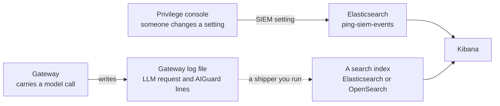

# Privilege AI Gateway: Logging and Monitoring with Elasticsearch

Oct 3, 2026 · @Curtis Muir

## Contents

- [Overview](#overview)
- [What was tested](#what-was-tested)
- [Two feeds, two kinds of event](#two-feeds-two-kinds-of-event)
- [The audit feed: sending it to Elasticsearch](#the-audit-feed-sending-it-to-elasticsearch)
- [What an audit event looks like](#what-an-audit-event-looks-like)
- [The traffic events: model calls and guardrail verdicts](#the-traffic-events-model-calls-and-guardrail-verdicts)
- [Getting traffic events into a search index](#getting-traffic-events-into-a-search-index)
- [Checking that events arrive](#checking-that-events-arrive)
- [Opening Kibana](#opening-kibana)
- [Searching and dashboards](#searching-and-dashboards)
- [Secrets in the events](#secrets-in-the-events)
- [Quick lookup](#quick-lookup)

## Overview

Privilege can send events to Elasticsearch through its SIEM setting. Before you build dashboards on it, know what that feed contains.

**The SIEM feed is an audit log of changes made in the Privilege console.** It records who created or changed an app, a policy, a virtual key or a setting. It does not record the traffic through the gateway. On the tested deployment, no model call, guardrail verdict or MCP call appeared in it.

The traffic is recorded somewhere else: in the gateway's own log file, as one JSON line per model call and one per guardrail verdict. To search those in Elasticsearch, you ship them yourself.

So a full picture needs both:

| Question | Where the answer is |
| --- | --- |
| Who changed this policy, and when? | The SIEM feed in Elasticsearch |
| Who created or edited a virtual key? | The SIEM feed in Elasticsearch |
| How many model calls did this key make, and what did they cost? | The gateway log's `LLM request` lines |
| What did the guardrails block this week? | The gateway log's `AIGuard` lines |
| Why did this one call fail? | The gateway log; see the guide to reading gateway errors |

Placeholders used: `<elasticsearch-host>`, `<ingestion-user>`, `<namespace>`, `<gateway-namespace>`, `<gateway-deployment>`, `<gateway-container>` and `<console-host>`.

## What was tested

Everything below was read from a running deployment on 3 October 2026: Elasticsearch and Kibana 9.1.4 beside a gateway in Kubernetes.

| Claim | Result | When |
| --- | --- | --- |
| The SIEM feed writes to the `ping-siem-events` index | Seen: 219 events over 18 days, 20 in the last day | 3 Oct |
| Every SIEM event is a console change, not gateway traffic | Read all 219 events: 217 from the module `apigw`, each a console API request | 3 Oct |
| Model calls do not appear in the SIEM feed | 26 model calls were made; the newest SIEM event stayed older than all of them | 3 Oct |
| The field names and types in this guide | Read from the index mapping | 3 Oct |
| The two example searches | Run against Elasticsearch; each returned 14 events | 3 Oct |
| SIEM events contain secrets | Counted: virtual keys in 12 events, plus real provider keys and a password in others | 3 Oct |
| The gateway log has one `LLM request` line per model call, one `AIGuard` line per verdict and one `AIGuardControl` line per rate-limit refusal | Read for the calls made that day | 3 Oct |
| The index could be read with no password | An unauthenticated request was signed in as a shared anonymous role and could count events | 3 Oct |
| A sidecar that tails the log and posts those lines to a search index works | Seen working against OpenSearch: 693 events, the newest seconds old | 3 Oct |
| Kibana is running | Its status endpoint answered 200 | 3 Oct |
| Opening Kibana through a port-forward and a PingOne sign-in proxy | From the working setup; not re-run | 21 Sep |

Not tested: shipping the traffic lines to Elasticsearch itself. The tested shipper posts to OpenSearch, which accepts the same request. Alerting, and events from a gateway in agent mode, were also not tested.

## Two feeds, two kinds of event



The solid arrows are built in. The dotted arrow is yours to build.

## The audit feed: sending it to Elasticsearch

In the Privilege console, open the SIEM configuration, choose **Elastic**, and fill in:

| Field | Value |
| --- | --- |
| URL | The Elasticsearch address, with its scheme: `http://<elasticsearch-host>:9200` |
| Index | `ping-siem-events` |
| Username | A dedicated ingestion user |
| Password | That user's password |

Two rules for the URL:

- **Include the scheme.** `<elasticsearch-host>:9200` on its own fails with `first path segment in URL cannot contain colon`.
- **Use an address the sender can reach.** A URL that works from your laptop may not resolve from where Privilege sends. On the tested deployment every event carried a region of Privilege's cloud service, which suggests the events are sent from there and not from the gateway's own pod. If so, the address must be reachable from outside your cluster.

The console has a health check for the SIEM setting. Running it shows in the feed as a request to `tenantsiemconfigs-healthcheck`.

## What an audit event looks like

Each event is one request to the console's API.

| Field | What it holds | Example |
| --- | --- | --- |
| `@timestamp` | When the change was made | |
| `Message` | The method and the address of the object changed | `HTTP PUT Request <console-host>/api/.../applications/default/<app>` |
| `Status` | The HTTP status, then the response body | `HTTP Status Code 200, Response Data: {...}` |
| `Module` | The part of Privilege that logged it | `apigw` |
| `Region` | The cloud region that handled the request | |
| `Index` | The feed's name | `audit-log` |
| `User.Name` | The ID of the user who made the change | A user ID, not an email |
| `User.Tenant` | The tenant ID | |
| `Device` | The device, when the change came from an agent | |
| `Data` | The whole object that was changed, as JSON text | |

The object type is in the `Message` address. Types seen on the tested deployment:

| In the address | What was changed |
| --- | --- |
| `applications` | An agentic app |
| `pacpolicys` | An access policy |
| `agentaccesskeys` | A virtual key |
| `shadowaipolicys` | A shadow AI policy |
| `nonhumanidentities` | An agent or workload identity |
| `proxytokens` | A gateway enrollment token |
| `tenantsiemconfigs` | The SIEM setting itself |
| `carts`, `userpreferences` | Console housekeeping. These were a third of all events. |

Three things to know when you search:

- **Users are IDs.** To find one person's changes, search `User.Name` for their user ID.
- **`Status` is a long string, not a number.** It starts with `HTTP Status Code 200` and then holds the response. Search it as a phrase.
- **`Data` is text, not fields.** You can search for words in it, but you cannot filter on a value inside it.

Every text field also has a `.keyword` version for exact matches and for counting in dashboards, limited to the first 256 characters.

## The traffic events: model calls and guardrail verdicts

The gateway writes two kinds of JSON line to its log file, `/var/log/procyon/cyonproxy.log`.

**One line per model call**, with `"msg":"LLM request"`:

| Field | What it holds |
| --- | --- |
| `Provider`, `Model` | The provider, and the model that answered |
| `HTTPStatus`, `UpstreamStatus` | The status the caller received |
| `PromptTokens`, `CompletionTokens`, `TotalTokens` | Token counts |
| `CostUSD`, `PriceSource` | The gateway's own cost estimate, and where the price came from |
| `LatencyMs` | Time taken |
| `Streaming` | Whether the response was streamed |
| `User`, `Tenant`, `KeyType` | Who owns the key, and the kind of key |
| `VirtualKeyID` | The virtual key. See [Secrets in the events](#secrets-in-the-events). |
| `RequestID`, `RequestTS` | An ID and time for the call |

A refused call still gets a line, with the status, no model and no tokens. The line does not say why it was refused. A call with an invalid key gets no line at all.

**One line per guardrail verdict**, with `"msg":"AIGuard"`:

| Field | What it holds |
| --- | --- |
| `Event` | What happened, such as `llm_request_blocked` |
| `Category` | The guardrail category, such as `prompt_injection` |
| `Direction` | `request` or `response` |
| `ComplianceMappings` | The matching entries in MITRE ATLAS, NIST AI RMF and OWASP, and the rule that fired |
| `User`, `Tenant`, `VirtualKeyID` | Who and which key |

Event names seen: `llm_request_blocked`, `llm_request_alert`, `llm_request_sanitized`, `llm_response_blocked`, `llm_response_sanitized`, `mcp_response_sanitized`, `a2a_request_blocked` and `a2a_request_alert`.

**One line per rate-limit refusal**, with `"msg":"AIGuardControl"`. It has `"Event":"llm_policy_denied"`, a `Reason` such as `token_rate_limit`, and the user and key.

The log file rotates at about 50 MB. On the tested gateway that was every one to two days. After that the lines are gone unless you shipped them.

## Getting traffic events into a search index

Because these lines are already JSON, shipping them is simple: read the log, keep the lines with `"msg":"LLM request"` or `"msg":"AIGuard"`, and post each one to an index.

The tested deployment does this with a small sidecar in the gateway's pod that shares the log directory:

```sh
tail -F /var/log/procyon/cyonproxy.log | while IFS= read -r line; do
  case "$line" in
    *'"msg":"LLM request"'*|*'"msg":"AIGuard"'*)
      echo "$line" > /tmp/gw-event.json
      wget -q -O /dev/null -T 3 \
        --header 'Content-Type: application/json' \
        --post-file=/tmp/gw-event.json \
        "http://<search-host>:9200/gateway-events/_doc"
      ;;
  esac
done
```

The pattern above does not match `AIGuardControl` lines, so rate-limit refusals are not shipped. Add `*'"msg":"AIGuardControl"'*` to the `case` to include them.

That sidecar posts to OpenSearch. Elasticsearch accepts the same `POST /<index>/_doc` request, so the same approach should work with an Elasticsearch address and an `Authorization` header for the ingestion user. That last step was not tested.

For anything beyond a demo, use a real shipper such as Filebeat instead of a shell loop. The loop drops events when the index is unreachable and has no retry.

Use a separate index from the audit feed, for example `gateway-events`. The two kinds of event share almost no fields. The time field in these lines is `time`, not `@timestamp`.

## Checking that events arrive

Query Elasticsearch directly. Read the password into a variable so it stays out of your shell history:

```bash
read -s ES_PASS
export ES_PASS

ES_URL='http://<elasticsearch-host>:9200'
ES_USER='<ingestion-user>'

# Is the cluster reachable?
curl -fsS -u "$ES_USER:$ES_PASS" "$ES_URL/"

# How many audit events are stored?
curl -fsS -u "$ES_USER:$ES_PASS" "$ES_URL/ping-siem-events/_count?pretty"

# The five newest
curl -fsS -u "$ES_USER:$ES_PASS" \
  "$ES_URL/ping-siem-events/_search?pretty&size=5&sort=@timestamp:desc"
```

To test the audit feed, run the count, change something small in the console, and run the count again. **Making a call through the gateway does not raise this count.** That is expected, not a fault.

## Opening Kibana

Kibana does not need to be on the internet. Forward its port to your machine and leave the command running:

```bash
kubectl -n <namespace> port-forward service/kibana-siem 5601:5601
```

Then open `http://localhost:5601`.

To put a sign-in in front of it, run an OAuth proxy on your machine that signs users in with PingOne and passes them through to the forwarded port. Then open the proxy's address instead, for example `http://localhost:4180`. The PingOne application for the proxy is an OIDC web app with the authorization code grant and the redirect URI `http://localhost:4180/oauth2/callback`.

If Kibana shows its own Elastic login page, you opened the forwarded port directly, or the proxy is not running.

## Searching and dashboards

Kibana searches a **data view**, so create one first:

1. Open **Analytics**, then **Discover**.
2. Create a data view with the index pattern `ping-siem-events*`.
3. Choose `@timestamp` as the time field.
4. Set a time range that covers the events you expect. The audit feed is quiet: the tested one averaged about 12 events a day.

Typing an index name into the search bar does not choose an index. It searches the selected data view.

Searches that work on the audit feed:

| To find | Search |
| --- | --- |
| Changes to virtual keys | `Message : "agentaccesskeys"` |
| Changes to policies | `Message : "pacpolicys"` |
| Changes to one app | `Message : "applications/default/<app>"` |
| Failed changes | `Status : "HTTP Status Code 500"` |
| One person's changes | `User.Name : "<user-id>"` |
| Everything except console housekeeping | `NOT Message : ("carts" or "userpreferences")` |

Panels worth building on the audit feed:

- Changes over time, on `@timestamp`
- Changes by user, on `User.Name.keyword`
- A table of recent changes: `@timestamp`, `User.Name`, `Message`
- Failed changes, filtered on `Status`

If you ship the traffic events, build these on that index instead:

- Model calls over time, split by `Provider` or `Model`
- Tokens and `CostUSD` by `VirtualKeyID` or `User`
- Refused calls: `HTTPStatus` of 400, 401 or 403
- Guardrail verdicts by `Category` and by `Event`

A read-only Kibana account can view data views and dashboards but cannot create them. An administrator creates them once, or the account is given editor rights.

## Secrets in the events

Both kinds of event hold secrets. Plan for this before you give anyone access to the index.

**The audit feed stores the whole changed object in `Data`.** When someone creates or edits a virtual key, the event contains the virtual key itself. On the tested deployment, some events also held the real provider key behind a virtual key, and the password from a SIEM setting. Most secret fields were blank, but not all.

**The traffic lines store the virtual key in full,** in `VirtualKeyID`. So does the gateway's plain-text line for each guardrail block.

What to do about it:

- **Treat the index like a secret store.** Anyone who can read it can copy keys out of it.
- **Give read access to as few people as possible,** and do not put a shared, anonymous role in front of it. An anonymous role set up so Kibana needs no login also lets anyone who can reach port 9200 read the same indices with no password.
- **Test it.** From outside your network, run `curl http://<elasticsearch-host>:9200/_security/_authenticate` with no credentials. The answer should be `401`. If it returns a username, the index is open.
- **Do not expose port 9200 to the internet.** Use a private address. If it must be reachable from outside, put TLS in front of it and limit who can connect. Plain HTTP sends the ingestion password unencrypted.
- **Use a dedicated ingestion user** that can write to the one index and nothing else. Never use the `elastic` administrator for ingestion.
- **Drop the key when you ship traffic lines.** Remove or hash `VirtualKeyID` in the shipper, or keep only its last few characters.
- **If a real provider key has been indexed,** change that key at the provider and delete the affected events.

## Quick lookup

| Symptom | Most likely cause | Fix |
| --- | --- | --- |
| Model calls and guardrail blocks are missing from Elasticsearch | The SIEM feed carries console changes only | Ship the gateway log's `LLM request` and `AIGuard` lines |
| The count does not rise after a gateway call | Same cause | Test the audit feed with a console change instead |
| `first path segment in URL cannot contain colon` | The URL has no scheme | Use `http://<elasticsearch-host>:9200` |
| `no Elasticsearch node available` or `context deadline exceeded` | The sender cannot reach the URL | Use an address reachable from where Privilege sends; check DNS, firewalls and the port |
| Discover is empty | The wrong data view, or a time range that misses the events | Select `ping-siem-events*` and widen the time range |
| A user search finds nothing | You searched for a name or an email | Search `User.Name` for the user ID |
| A dashboard cannot count by a field | The field is text | Use its `.keyword` version |
| Most events are `carts` and `userpreferences` | Console housekeeping | Filter them out |
| An authorization error naming `indices:monitor/stats` | The Kibana account lacks index monitoring rights | Add read-only monitoring on the index to the role |
| Kibana shows an Elastic login page | The sign-in proxy was bypassed | Open the proxy's address |
| Traffic events stop after a few days | The log rotated and the shipper was not running | Run the shipper continuously; old lines cannot be recovered |
