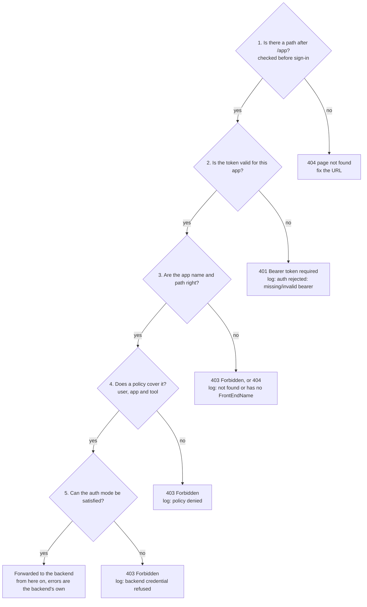

# Agent Privilege: Reading Gateway Errors

Oct 3, 2026 · @Curtis Muir

## Contents

- [Overview](#overview)
- [What was tested](#what-was-tested)
- [From status code to cause](#from-status-code-to-cause)
- [Where the logs are](#where-the-logs-are)
- [What the client sees](#what-the-client-sees)
- [Log lines and what they mean](#log-lines-and-what-they-mean)
- [Tracing one request](#tracing-one-request)
- [Errors from the backend or the guardrail](#errors-from-the-backend-or-the-guardrail)
- [Quick lookup](#quick-lookup)

## Overview

The gateway tells the client almost nothing when it refuses a call, and tells its own log almost everything. A client sees a status code and a short body such as `Forbidden`. The reason, the user and the app are in the gateway log.

A caller who is not allowed in does not learn why. The cost is that different problems look identical from the client:

- A missing token, an expired token and a made-up token all return the same 401.
- A missing policy, an expired policy, a wrong app name and a refused auth mode all return the same bare 403.
- An error from your own backend arrives with the gateway's address on it.

So the method is always the same. Note the status code, find the matching lines in the gateway log, and read the reason there. The rest of this guide is the lookup: what each code can mean, what the log says for each cause, and how to tell a gateway refusal from a backend or guardrail error.

Placeholders used: `<gateway-host>`, `<app>`, `<gateway-namespace>`, `<gateway-deployment>` and `<gateway-container>`.

## What was tested

Every status code, body and log line in this guide was produced on a running gateway; the October tests ran on build v1.260925. Most were reproduced on 3 October 2026; the rest came from signed-in tests in the days before, as marked.

| Error | Result | When |
| --- | --- | --- |
| 401 body is identical for no token, a made-up token and an unknown app name | Reproduced | 3 Oct |
| An expired token returns the same 401 | Reproduced: a one-hour-old token | 3 Oct |
| `/<app>` with no path returns `404 page not found` before sign-in | Reproduced | 3 Oct |
| `/authorize`, `/token` and `/register` error bodies | Reproduced, all four | 3 Oct |
| Registration succeeds for an app that does not exist | Reproduced: 201 | 3 Oct |
| 403 with `policy denied` in the log | Reproduced, then cleared by adding a policy | 3 Oct |
| 403 with `requires token-pass … no workload assertion` | Reproduced, then cleared by changing the auth mode | 3 Oct |
| The backend's own 401 passes through unchanged | Reproduced, two different bodies | 3 Oct |
| The request line redacts `Authorization` | Seen in the log | 3 Oct |
| Error-level lines are mostly noise; `policy denied` is info-level | Counted: 13,646 error lines in 40,362 | 3 Oct |
| A token used on another app is rejected | Seen in the log | 3 Oct |
| 404 on a wrong path after sign-in (MCP app) | Reproduced | 2 Oct |
| 403 on a wrong app name after sign-in, with `not found or has no FrontEndName` | Reproduced | 2 Oct |
| 403 on a tool outside the policy; filtered `tools/list` | Reproduced | 2 Oct |
| Guardrail `content_blocked` 400 on a streaming model call | Reproduced | 13 Sep |

Not tested: errors on a gateway run in agent mode, rate limiting, and what the client sees when the detector sidecar is down.

## From status code to cause



Read it from the status code back to the check. A 401 can only be the token. A 404 is the URL. A 403 has three possible checks behind it, and the log line is the only way to know which. Once a call is forwarded, the gateway stops being the source of errors.

## Where the logs are

The gateway writes one log file inside its container: `/var/log/procyon/cyonproxy.log`. The file rotates at about 50 MB; older files sit beside it as `cyonproxy-<timestamp>.log`.

```bash
# The last decisions the gateway made
kubectl -n <gateway-namespace> exec deploy/<gateway-deployment> -c <gateway-container> -- \
  sh -c 'tail -n 3000 /var/log/procyon/cyonproxy.log | grep -E "\[mcpgw\]|\[mcpfilter\]"'
```

If your deployment ships the file to the container's standard output, `kubectl logs` works too. With Docker, use `docker exec <gateway-container>` the same way.

Four things make this log hard to read at first:

- **The level does not tell you what matters.** In the tested log, 13,646 of 40,362 lines were `level=error`, and almost all were background noise: mesh reconnects and timeouts that affect no request. Meanwhile `policy denied`, the line that explains most 403s, is logged at `level=info`. Never filter by level.
- **Filter by tag instead.** Lines about a request start with `[mcpgw]` (sign-in, routing, policy, credentials) or `[mcpfilter]` (the tool list and tool permissions).
- **Two formats share the file.** Most lines are `key=value` text. A few are JSON, one object per line: `Received HTTP request` for each call, and `LLM request` for each model call with its status, model and token counts.
- **IDs, not names.** Users appear as a user ID, and some lines carry a base64 reference. Decoded, it reads `<tenant-id>@@@default@@@<user-id>`.

Noise you can ignore when chasing one failed call:

| Line | What it is |
| --- | --- |
| `this node and &MedusaNode{…` | Mesh housekeeping |
| `Error connecting to … context deadline exceeded` | A mesh peer that is not reachable |
| `Error receiving from the stream: rpc error …` | The control connection reconnecting |
| `auth rejected: missing/invalid bearer app=api path=/api/tags` and similar | Internet scanners probing an exposed gateway. The "app" is just the first part of whatever path they tried. |
| `Access token expired but refresh token valid` | A client's session that will refresh on next use |

## What the client sees

The response body tells you who answered. Plain text or the gateway's own small JSON came from the gateway. A JSON-RPC body, or JSON in your server's style, came from your backend.

**On a call to an app** (`https://<gateway-host>/<app>/...`):

| Status and body | Possible causes |
| --- | --- |
| `401` with JSON: `"error":"unauthorized"`, `"error_description":"Bearer token required"`, plus `authorization_uri` and `token_uri` | No token; an expired token (about one hour); a made-up token; a token issued for a different app. The body is the same for all four, and for an app name that does not exist. |
| `404` with text `404 page not found` | The URL is just `/<app>` with nothing after it; this is answered before sign-in. Or, on an MCP app after sign-in, the path is not the app's registered entry path. |
| `403` with text `Forbidden` | After sign-in: no policy, an expired policy, a wrong app name, a tool the policy does not grant, a tool that does not exist, or an auth mode the caller cannot satisfy. Only the log tells them apart. |
| `200` with fewer tools than the server has | Not an error. The gateway removes tools the policy does not grant from `tools/list`. |
| A JSON-RPC error, or your server's own error JSON | The gateway forwarded the call. The error is your backend's. |
| `400` with `"code":"content_blocked"`, `"type":"security_error"` | A guardrail blocked the text. Seen on the model route; the message names the category. |

**On the sign-in endpoints:**

| Endpoint | Status and body | Cause |
| --- | --- | --- |
| `/<app>/authorize` | `400` `Invalid request parameters` | A required OAuth parameter is missing |
| `/<app>/authorize` | `400` `This client's registration has expired. Clear its saved credentials for this server and reconnect.` | The gateway does not know this `client_id`. Registrations do not last forever; the client must register again. |
| `/<app>/token` | `401` `Invalid client credentials` | The gateway does not know this client |
| `/<app>/register` | `400` `at least one redirect_uri is required` | The registration body has no `redirect_uris` |
| `/<app>/register` | `201` with a new client | Success, but it proves nothing about the app: registration succeeds for any app name, including one that does not exist |

Two traps follow from this. A successful registration and even a successful sign-in do not mean the app name is right; the name is checked only when the first real call arrives. And a client that worked yesterday can fail at `/authorize` today because its stored registration is gone.

## Log lines and what they mean

Each line below was copied from a running gateway, with IDs replaced by placeholders. Search for the quoted words.

**Sign-in and tokens**

| Log line | Meaning | Client saw |
| --- | --- | --- |
| `[mcpgw] auth rejected: missing/invalid bearer app=<app> method=<m> path=<path> remote=<ip>` | No usable token on the call | 401 |
| `[mcpgw] token issued for app "<a>" presented on app "<b>"; rejecting` | A token from one app was used on another. Each app needs its own sign-in. | 401 |
| `Access token found for user: <user-id>, client: <client-id>` | The token was accepted. Everything after this line is about this user. |  |
| `[mcpgw] identity leg resolved UserID=<user-id>` | A sign-in finished. This is the ID to name in a policy. |  |

**Routing and the app name**

| Log line | Meaning | Client saw |
| --- | --- | --- |
| `[mcpgw] resolved host for app <app>: <app>.default.applications…` | The app name is known and the call is being routed |  |
| `[mcpgw] app <name> not found or has no FrontEndName, falling back to synthesized host: application not found` | No app has this name. Check the name in the URL against the console. | 403 |
| `Domain <name>.default.applications… not found` | Follows the line above | 403 |

**Policy and credentials**

| Log line | Meaning | Client saw |
| --- | --- | --- |
| `Principal {RefKind:User …} has policy based capabilities for {RefKind:Application …}` | A policy covers this user and app |  |
| `[mcpgw] policy denied <user-id> access to a2a app <app> (agent=false): principal … does not have access to …` | No unexpired policy covers this user on this Remote Agent app | 403 |
| `[mcpgw] backend credential refused for <user-id> on <app>: app <app> requires token-pass, but this session presented no workload assertion` | Policy passed. The app's auth mode is Pass Agent Token and the caller is not an agent. | 403 |
| `[mcpfilter] cap header present on request: {"tools":[…]}` | The exact tools this user is granted on this app. A tool missing here is hidden from `tools/list` and refused if called. |  |

**Discovery and the backend**

| Log line | Meaning |
| --- | --- |
| `Error discovering MCP server: calling "initialize": sending "initialize": Unauthorized` | The backend rejected the gateway's own discovery call. It wants a credential the app's auth mode is not sending. |
| `MCP status not published for app=<app>, keeping the N tools already discovered: … no such host` | Discovery failed because the backend address does not resolve. The gateway keeps its old tool list, so the app can look healthy while the backend is gone. |
| `Failed to dial to connect to <backend-url> via cluster <name>. Err: context deadline exceeded` | The gateway cannot reach the backend: wrong address, wrong port, or the backend is down |
| `Received event stream in MCP response, wrapping body for on-the-fly modification` | Normal. The gateway is filtering a streamed response. |

## Tracing one request

The gateway writes a short run of lines for each call, within a few milliseconds of each other. Find the run and read it top to bottom; the last line is the decision.

1. **Note three things at the client:** the time, the status code and the app name. Log times are UTC.
2. **Pull that minute from the log,** without the mesh noise:

```bash
kubectl -n <gateway-namespace> exec deploy/<gateway-deployment> -c <gateway-container> -- \
  sh -c 'grep "T15:41" /var/log/procyon/cyonproxy.log | grep -v MedusaNode \
    | grep -E "RequestURI|Access token found|\[mcpgw\]|\[mcpfilter\]"'
```

3. **Read the run in order.** A refused call from the tested gateway looks like this:

```text
req.Host <gateway-host> and RequestURI /<app>/a2a/jsonrpc and request.headers map[… Authorization:[[REDACTED]] …]
Access token found for user: <user-id>, client: <client-id>
[mcpgw] resolved host for app <app>: <app>.default.applications…
[mcpgw] backend credential refused for <user-id> on <app>: app <app> requires token-pass, but this session presented no workload assertion
```

Each line rules something out. The first shows the call arrived and on which path. The second shows the token was good and whose it was. The third shows the app name was right. The fourth is the reason.

4. **If the run ends without a refusal,** the gateway forwarded the call. Move to the backend's own log; the gateway has nothing more to say.

The request line prints the caller's headers. The gateway replaces the `Authorization` value with `[REDACTED]`, but other headers appear in full, so treat the log file as sensitive and do not paste whole lines into tickets.

## Errors from the backend or the guardrail

Not every error at the gateway's address is the gateway's. Once a call passes the gateway's checks, the answer comes from your backend, and a guardrail can block text on the way.

**From the backend.** The body is in your server's style, and the gateway log shows no refusal for that call.

| What the client got | What happened |
| --- | --- |
| `401` with `{"jsonrpc":"2.0","error":{"code":-32001,"message":"Bearer authentication required"}}` | The backend wants a credential and received none. The gateway never forwards the caller's sign-in token; what the backend receives is set by the app's Auth Mode. |
| `401` with `{"detail":"Missing x-internal-gateway-secret header"}` | The backend's own guard refused a path. On a Remote Agent app the gateway forwards any path. |
| `400`, `404` or `405` on a `server/discover` request | An older server that does not know a newer handshake method. Harmless: the client falls back to `initialize`. |
| The app shows no tools in the console | Discovery failed. Look for `Error discovering MCP server` in the log; the words after it are the backend's answer. |

**From the guardrail.** A block is returned as its own error, naming the category:

```json
{"error":{"code":"content_blocked","message":"request blocked by security policy: data_exfiltration","type":"security_error"}}
```

Three things to know about guardrail blocks, from the model route where they were seen:

- **Clients often hide the body.** A chat client showed only "upstream model error 400". Replay the request yourself to read the real message.
- **Replay it the way the client sent it.** The block appeared on streaming requests (`"stream": true`) and not on the same request sent without streaming.
- **Borderline text is not blocked every time.** The same tool result was blocked on one day and passed on another.

If the gateway uses an external detector, its own log records each inspection as allowed or flagged with a category. When the detector itself fails, the gateway's fail-closed setting decides whether text is blocked or let through.

For model calls the log also has one JSON line per call, `"msg":"LLM request"`, with `HTTPStatus` and `UpstreamStatus` side by side. Do not use them to tell a gateway refusal from a provider error: on 3 October the two were equal on every line, including the gateway's own refusals. Use `LatencyMs` instead, which is `0` or close to it when the gateway answered without calling the provider, and read the response body at the client. A guardrail block also writes an `AIGuard` line, and a rate-limit refusal an `AIGuardControl` line, each with the reason.

## Quick lookup

| Symptom | Most likely cause | Fix |
| --- | --- | --- |
| 401 on a client that worked an hour ago | The token expired | Sign in again, or let the client refresh |
| 401 right after signing in to another app | The token belongs to that other app | Sign in to this app; tokens are per app |
| `/authorize` says the registration has expired | The gateway no longer knows the client | Clear the client's saved credentials and reconnect |
| 403 on every call after a clean sign-in | No policy, an expired policy, or a wrong app name | Read the log: `policy denied` or `not found or has no FrontEndName` |
| 403 on one tool only | The policy does not grant that tool | Check the `cap header` line for the tools granted |
| 403 with a policy in place, Remote Agent app | Auth mode is Pass Agent Token and the caller is a person | Call from an agent, or change the auth mode |
| 404 on an MCP app after sign-in | The path is not the registered entry path | Use the path the app was registered with, usually `/mcp` |
| 404 with no sign-in prompt | The URL stops at `/<app>` | Add the path |
| Fewer tools than expected, no error | The policy filters the tool list | Grant the missing tools |
| The app has no tools at all | Discovery failed | Read `Error discovering MCP server` in the log |
| A JSON-RPC error from the gateway's address | The backend answered | Read the backend's log, not the gateway's |
| A model call fails with a vague 400 | A guardrail block the client is hiding | Replay with streaming on and read the body |
| A console change does not take effect | It has not reached the gateway yet | Wait about 15 seconds and retry |
