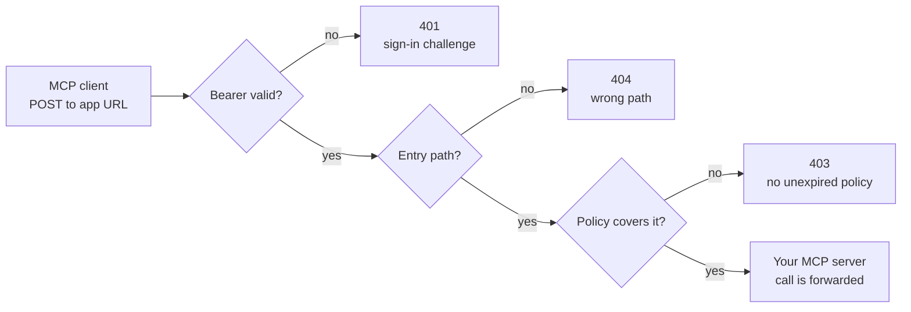
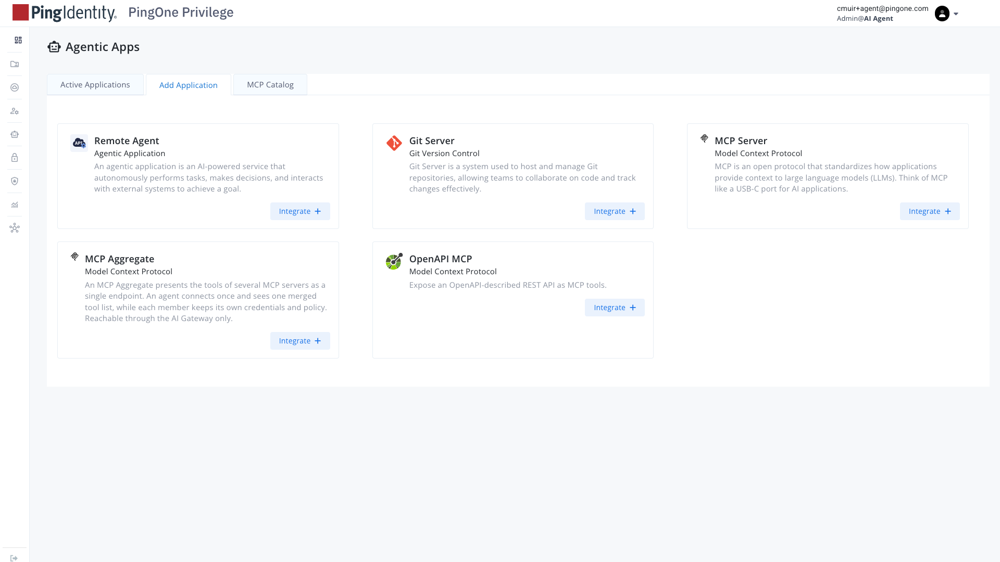
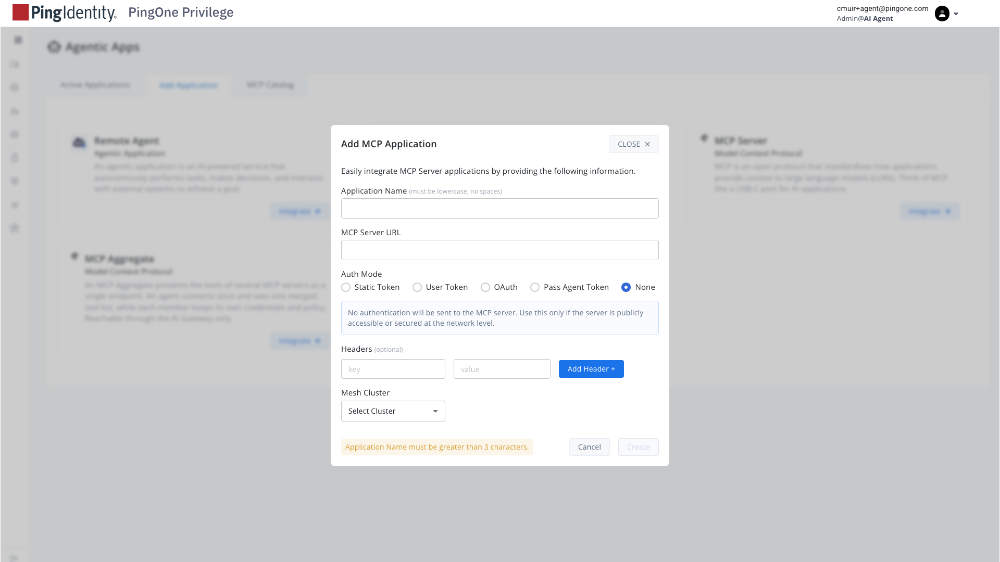
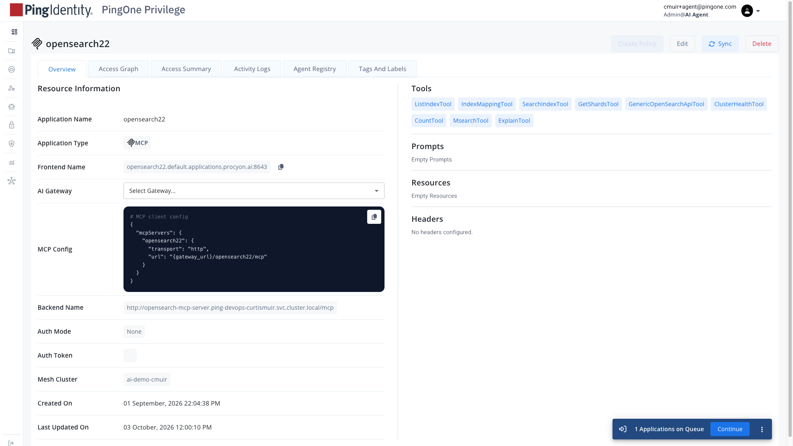

# Privilege AI Gateway: Registering an MCP Server

Oct 2, 2026 · Curtis Muir

## Contents

- [Overview](#overview)
- [What was tested](#what-was-tested)
  - [Confirmed with a signed-in session](#confirmed-with-a-signed-in-session)
- [How a call is routed](#how-a-call-is-routed)
- [Registering the app](#registering-the-app)
- [What the gateway exposes for each app](#what-the-gateway-exposes-for-each-app)
- [Backend URL and entry path](#backend-url-and-entry-path)
  - [Which path to register depends on the gateway build](#which-path-to-register-depends-on-the-gateway-build)
  - [Entry path is checked after authentication](#entry-path-is-checked-after-authentication)
- [Application types](#application-types)
- [Auth Mode](#auth-mode)
- [Policy](#policy)
- [Verifying the registration](#verifying-the-registration)
- [Lessons from fixing a live client](#lessons-from-fixing-a-live-client)
- [Common mistakes](#common-mistakes)

## Overview

Registering an MCP server on the Privilege AI Gateway means creating an Agentic App in the Privilege console that tells the gateway which backend to front. Clients then call the gateway, the gateway signs the user in, checks policy, records the session, and forwards what it permits to your server.

Three things must exist before a client call succeeds: the app, a successful tool discovery by the gateway, and an unexpired policy naming the caller. A new app has no policy, so it denies everything until one is written.

This guide covers the registration itself. Values in angle brackets are placeholders for your own.

**Basis for this guide.** The MCP gateway feature shipped without configuration documentation in the Privilege docs. This guide comes from running a gateway between August and October 2026, and from tests on 2026-10-02 against two builds: `v1.260729` and `v1.260925`. The section below says which claims were tested and which rest on earlier notes. Behaviour has changed between builds, so confirm anything important on yours.

## What was tested

Tested on 2026-10-02 in two rounds. First without a signed-in user: front-door probes on both builds, the backends directly, and the gateway's own log. Then with one signed-in session, for the claims that need a real token. Anything that needs the console was not checked.

| Claim | Result | How |
| --- | --- | --- |
| Client URL is `/<application-name>/<path>` | Confirmed on both builds | `/mcp` with no app segment answers 404 `page not found` |
| A tokenless call gets a 401 challenge naming the gateway's own endpoints | Confirmed on both builds | Header and body captured |
| An unknown app name answers the same 401 | Confirmed on both builds | `/no-such-app/mcp` |
| The wrong path answers the same 401 without a token | Confirmed | `/sse` on an app registered on `/mcp` |
| Discovery POSTs `initialize` to the registered path | Confirmed on `v1.260925` | Gateway log: `sending "initialize": rejected by transport: Post "http://.../mcp"` |
| The console can show cached tools after discovery fails | Confirmed | Log: `MCP status not published for app=<name>, keeping the 1 tools already discovered` |
| A wrong backend hostname fails discovery | Confirmed | Log: `no such host` |
| Clients can register themselves with no prior setup | Confirmed | A new client got HTTP 201 from `/<app>/register` |
| A legacy `/sse` backend refuses POST | Confirmed | 405 from a FastMCP-style server |
| A standard MCP server rejects `server/discover` | Confirmed | Two backends returned errors |
| A GET to the door answers 405 with no challenge | **Wrong, corrected** | GET gets the same 401 challenge on both builds |
| 404 on the wrong path once signed in | Confirmed | See the signed-in results below |
| Policy rules: deny by default, per app, expiry, union, which identity to grant | Partly confirmed | Permit, deny, deny-by-default and the granted identity are confirmed below; expiry and union are still untested |
| What each Auth Mode sends to the backend | Partly confirmed | The no-credential case is confirmed below; Static Token and OAuth are still untested |
| Console field names and menu path | Not tested | Console not visible from here |
| Discovery by GET on earlier builds | Not tested | Rests on August notes; no log from that period |

### Confirmed with a signed-in session

One real sign-in and a `tools/list` on build `v1.260925`, read from the gateway log:

| What happened | Evidence in the log |
| --- | --- |
| The client registered, the browser signed in at PingOne, and the gateway issued its own token | `starting new IdP2 OAuth dance`, `Token exchange successful`, `identity leg resolved UserID=...` |
| The gateway accepted its own token | `Access token found for user: ..., client: ...` |
| The user was matched to a policy through group membership | `principal ... is allowed as part of ... group`, then `has policy based capabilities for {Application ...}` |
| The call was forwarded to the backend on the path after the app name | Client called `/<app>/mcp`; log shows `incoming request: POST /mcp` and `Proxying to: http://<backend-host>` |
| The `Authorization` header was removed before the backend | Present in the client's request, absent from the forwarded one |
| Other client headers were passed through | Tracing, request ID, forwarding and MCP protocol headers all arrived |
| The gateway added the user's permitted tools as a header | `X-Procyon-Mcp-Cap`, logged as `[mcpfilter] cap header present on request: {"tools":[...]}` |
| `tools/list` was filtered to the permitted tools | Six lines of `Removing unauthorized tool from MCP response: <tool>`; the backend has nine tools, the client was shown three |
| `server/discover` came from the client and the backend refused it | Forwarded with `Mcp-Method: server/discover`; backend answered 400; the session carried on |

Direct calls with the same signed-in token, each matched to its line in the gateway log:

| Test | Result | Gateway log |
| --- | --- | --- |
| Call a tool the policy allows | 200, data returned | `MCP call detected for method tools with target: <tool>`, then `has permission for {Application ...}` |
| Call a tool the policy does not allow | 403 `Forbidden` | `[mcpgw] policy denied <user-id> access to <app> (agent=false): Access Denied for` |
| Call a tool that does not exist | 403 `Forbidden`, the same response | The same `policy denied` line |
| POST to the wrong path, `/sse` on an app registered on `/mcp` | 404 `Not found` | `[mcpgw] rejecting /sse on app <app>: outside entry path "/mcp"` |
| Use the token on a different app | 401, the same challenge as no token | `[mcpgw] token issued for app "<app>" presented on app "<other>"; rejecting` |

The gateway's token is opaque, not a JWT, and expires with the identity session, one hour in this test.

A second sign-in, to an app that has no policy, confirmed deny-by-default: sign-in succeeds and a token is issued, but the first call, `initialize`, answers `403 Forbidden`. The backend is never contacted. The log line is the same one a denied tool call produces: `[mcpgw] policy denied <user-id> access to <app> (agent=false): Access Denied for`.

So four different situations give a client the identical bare 403: no policy on the app, a tool outside the policy, a tool that does not exist, and an app name that does not exist on the gateway. With no policy or no such app the 403 comes on the first call; with a policy it comes only on the tool call.

Still untested: policy expiry, policy union, Static Token and OAuth auth modes, and the console's field names.

## How a call is routed



The checks run in this order, which is why a wrong path or a missing policy is invisible until the client has signed in. The backend is contacted only when all three pass.

## Registering the app

You need a gateway that is already enrolled and showing in the console, and a backend MCP server the gateway can reach on the network.

1. **Check the backend from where the gateway runs.** Test from inside the gateway's pod or container, not from your laptop; cluster-internal names do not resolve outside the cluster. A tokenless `initialize` should answer 200.

   ```bash
   curl -s -i -X POST <backend-url> \
     -H 'content-type: application/json' \
     -H 'accept: application/json, text/event-stream' \
     -d '{"jsonrpc":"2.0","id":1,"method":"initialize","params":{"protocolVersion":"2025-03-26","capabilities":{},"clientInfo":{"name":"probe","version":"0"}}}'
   ```
2. **Open the wizard.** In the Privilege console: AI Security, then Agentic Apps, then Add Application. Choose the MCP Server tile and Integrate.

   
   *AI Security → Agentic Apps → Add Application: choose the MCP Server tile, then Integrate.*
3. **Fill in the fields.**

   | Field | What to enter | Watch for |
   | --- | --- | --- |
   | Application Name | A short lowercase name | It becomes the first path segment of the client URL, and it cannot be edited later. Renaming creates a second app |
   | MCP Server URL (shown elsewhere as Backend Name) | The backend URL as the gateway reaches it, including its path | The path you choose becomes the client-facing path. See the next section |
   | Auth Mode | None, unless the backend needs a credential | See Auth Mode |
   | AI Gateway | Your gateway | It is not always pre-selected. An app saved on the `Select Gateway...` placeholder reaches no gateway and produces no log lines |
   | Mesh Cluster | The cluster your gateway enrolled in |  |

   
   *The Add MCP Application form: Application Name, MCP Server URL, Auth Mode (Static Token, User Token, OAuth, Pass Agent Token, None), optional Headers, and Mesh Cluster.*
4. **Wait for discovery.** The gateway connects to the backend and lists its tools. The app's Tools panel fills in. An empty panel means discovery failed; policy cannot be authored until it succeeds.

   
   *The app's Overview after discovery succeeded: Frontend Name, Backend Name, Auth Mode, Mesh Cluster, the generated MCP client config, and the discovered Tools.*
5. **Write a policy.** Name the user and the tools they may call, and set its time window. See Policy.
6. **Give clients the URL.** It is `https://<gateway-host>/<application-name>/<path>`, where `<path>` is the path the backend was registered with. Do not copy it from the console's generated client config without checking; that snippet has shown `/mcp` for an app pinned to `/sse`.

These are console steps. Nothing in a repository can perform or test them.

## What the gateway exposes for each app

Once an app exists, the gateway serves a small set of URLs under the app's name. These were read from a live gateway.

| URL | What it is |
| --- | --- |
| `/<app>/mcp` | The MCP endpoint clients call |
| `/.well-known/oauth-protected-resource/<app>/mcp` | Resource metadata; names `/<app>` as the authorization server |
| `/<app>/.well-known/oauth-authorization-server` | Authorization server metadata |
| `/<app>/register` | Dynamic client registration, open, no credential needed |
| `/<app>/authorize` | Starts sign-in; redirects the browser to PingOne using the gateway's own OIDC client |
| `/<app>/token` | Exchanges the code for a gateway token |
| `/callback` | Where PingOne returns to the gateway. One for the whole gateway, not per app |

Details worth knowing:

- **The gateway is its own authorization server, one issuer per app.** It advertises authorization code with PKCE (`S256`) and refresh tokens, and client authentication by `none` or `client_secret_post`.
- **Client registration is gateway-wide.** A client registered under one app's `/register` was accepted by another app's `/authorize`.
- **Any bearer the gateway did not issue is refused the same way as none.** The response says `Bearer token required`; the gateway log says `auth rejected: reason=token_not_found`.
- **The gateway stores the backend as host and port.** In its own records the backend has no path; the registered path is kept separately as the app's entry path.
- **Each app has a type.** MCP servers are recorded as type `mcp`; remote agents registered for agent-to-agent calls are type `http`.
- **A public gateway is scanned.** The log shows internet scanners probing paths such as `/.git/config`. They get the same 401. Expect this noise when reading the log.

One more, confirmed with a signed-in token: **a token works for one app only.** A token issued through one app's sign-in is refused on every other app with the ordinary 401 challenge. A client that talks to three apps signs in three times.

## Backend URL and entry path

The path on the end of the backend URL does two jobs: it is where the gateway sends calls, and it becomes the only client-facing path the app accepts.

- **One app, one path.** The gateway pins each app to the path its backend was registered with, `/mcp` or `/sse`. A client calling any other path gets a bare 404.
- **The gateway forwards to the same path.** It POSTs JSON-RPC to the registered path itself. It does not follow the SSE transport's announced `/messages` endpoint, so a backend must accept POST on the path you register.
- **Editing the backend URL moves the path for every client.** A console edit from `/sse` to `/mcp` breaks every client pointed at the old path, with no warning. The change takes effect when the gateway re-runs discovery: at restart, or when a re-scan is forced. The log shows it as MCP force-sync app=\<name>: LastDiscoveredAt reset.
- **A typo is silent.** A wrong hostname fails discovery (`no such host` in the gateway log) while the console keeps showing the previously discovered tools from cache.

### Which path to register depends on the gateway build

The gateway's discovery behaviour changed between builds, and the two behaviours need opposite registrations:

| Gateway build | How it discovers | Register the backend on |
| --- | --- | --- |
| Earlier builds (August 2026), from notes | A bare GET, then waits for an SSE `endpoint` event | `/sse`. A streamable-HTTP `/mcp` answers 200 but never sends that event, so discovery fails |
| `v1.260906` and `v1.260925`, confirmed in the log | POSTs `initialize` to the registered path | `/mcp`. A legacy `/sse` endpoint is GET-only and answers 405 to the POST |

If you do not know which your build does, register one path, watch the gateway log during discovery, and switch if it fails. A backend that answers both the SSE handshake and POST on both paths works either way.

A note on `server/discover`. Earlier notes describe it as a call the gateway makes to list tools, and say a backend that returns an error for it breaks the session. In the session tested on 2026-10-02 it arrived from the client, the backend answered 400, and the session carried on normally. Treat the earlier warning as unconfirmed on current builds.

### Entry path is checked after authentication

A wrong path looks healthy without a token: it answers the normal 401 challenge. Only with a valid bearer does it answer 404. That sequence reads like an authentication fault and is not. The gateway log is the only place that says so:

```text
[mcpgw] rejecting /mcp on app <name>: outside entry path "/sse"
```

## Application types

The wizard offers several kinds of app, and they are wired differently. This guide is about the first.

| Type | Backend | What you run | Notes |
| --- | --- | --- | --- |
| MCP Server | Any URL the gateway can reach, editable | Your own MCP server | Gets its own path. The entry-path rules above apply |
| Catalog app (for example Grafana, Brave) | Fixed to `http://localhost:<port>/mcp` | The connector, as a sidecar container beside the gateway | Adding it in the console deploys nothing. The console's Configuration panel stores values on the app record and does not pass them to your container |
| OpenAPI MCP | An adapter that turns an OpenAPI spec into tools | Depends on packaging | The hosted adapter image did not discover tools for us; running the same adapter ourselves and registering it as an MCP Server app did |
| MCP Aggregate | None of its own; combines other registered servers | Nothing extra | Tool names are prefixed with the server name. Reachable through the AI Gateway only |

Two traps with catalog apps: every one defaults to `localhost:8080`, so a second app on the same port silently returns the first one's tools; and the port in the console has to match the sidecar's real port, which nothing checks for you.

## Auth Mode

Auth Mode decides what the gateway presents to your backend. It is separate from how clients authenticate to the gateway, with one exception noted below.

| Auth Mode | What the backend receives | Use it when |
| --- | --- | --- |
| None | No `Authorization` header at all. Not the caller's bearer, and nothing in its place | The backend trusts the gateway and accepts anonymous calls on that listener |
| Static Token | `Authorization: Bearer <the token you configured>` | The backend needs to know the call came through the gateway. Both sides hold the same shared value |
| OAuth | Not established. See the warning | Avoid until confirmed on your build |

What the backend actually received in a tested call, on an app that sends no credential: every header the client sent except `Authorization` and `Accept-Encoding`, plus one the gateway adds, `X-Procyon-Mcp-Cap`, holding the tools the policy allows this user.

Measured under Auth Mode None: custom request headers from the client arrive at the backend unchanged. `x-forwarded-for` carries the caller's real address. `x-forwarded-host` arrives empty; do not key anything on it.

That makes this pattern possible: the client puts a user's token in a custom header, the gateway passes it through, and the backend verifies it. The bearer slot stays empty (None) or holds the shared secret (Static Token). The backend must only trust such a header when the shared secret is also present.

**Warning on OAuth mode.** On build `v1.260906`, setting Auth Mode to OAuth also gated the client side: a tokenless `initialize` returned 401, the console's own discovery hit the same wall, and the Tools panel went empty. The OAuth client credentials entered in the wizard were rejected by the gateway's own token endpoint. Reverting to None restored discovery.

## Policy

A policy grants named users named tools on one app for a period of time. Without one, every call is refused.

- **A new app denies everything.** There is no default permit and no inheritance from a sibling app. Deleting and re-creating an app resets it to no policy.
- **Policies are per app.** Two apps running identical code need separate policies.
- **Policies expire.** They are created with a time window, often short. An expired policy denies exactly as a missing one does, with nothing in the response to tell them apart.
- **Policies add up.** A second policy on the same app does not replace the first. The caller gets the union, including anything granted through group membership. To narrow access, delete the broader policy; editing a new one down changes nothing.
- **Grant the identity the gateway sees.** The account you are signed in to the console with is not necessarily the identity the gateway resolves for an MCP call. Read the user ID from the gateway log and name that in the policy.

```bash
# The identity to grant
grep -oE 'Request is for user: [^"]*' <gateway-log>
# -> User/<privilege-tenant>/default/<user-id>

# The tools actually granted; repeated names mean more than one policy applies
grep -A1 'mcpfilter\] cap header' <gateway-log>
```

**The client only sees what the policy allows.** The gateway rewrites the `tools/list` response and removes every tool the user is not granted, so a client never learns the hidden tools exist. In the tested session a backend with nine tools appeared to the client as three.

**A denied call is a bare 403.** Calling a tool outside the policy returns `403 Forbidden` with no detail, and calling a tool that does not exist returns exactly the same. A client cannot tell "not allowed" from "no such tool"; only the gateway log can. The log line names the user ID being denied, which is also the ID to put in a policy.

A policy can only be written once discovery has listed the app's tools.

## Verifying the registration

Check in this order. Each step rules out one layer.

1. **Discovery succeeded.** The app's Tools panel lists the backend's tools, and the gateway log shows no discovery error for the app.
2. **The door challenges.** A tokenless POST to the client URL answers 401 with a `WWW-Authenticate` header naming the gateway's own authorization endpoint. A GET or HEAD gets the same challenge.

   ```bash
   curl -s -i -X POST https://<gateway-host>/<application-name>/<path> \
     -H 'content-type: application/json' \
     -d '{"jsonrpc":"2.0","id":1,"method":"initialize","params":{"protocolVersion":"2025-03-26","capabilities":{},"clientInfo":{"name":"probe","version":"0"}}}'
   ```
3. **A signed-in client can list tools.** Connect a real MCP client, complete the gateway's sign-in, and run `tools/list`. This is the first step that proves the entry path, because the path is only checked once a bearer is accepted.
4. **A permitted tool call returns data,** and the gateway log shows `has policy based capabilities` for the user.
5. **A call outside the policy is refused** with 403, and the log shows `policy denied`. Seeing both a permit and a deny is the evidence that enforcement is real.

Step 2 passing does not prove the app exists or the path is right. The gateway checks the bearer before it checks either, so a mistyped app name answers the same 401.

## Lessons from fixing a live client

On 2026-10-02 a client page that talks to four apps showed three 403s and a 400 on every load. Reading the gateway log beside the client's own trace gave each a different cause. Only one was a fault.

| What the client showed | Real cause | Gateway log | Fix |
| --- | --- | --- | --- |
| 403 on one app | The client was configured with an app name that does not exist; the real app had a different name | `[mcpgw] app <name> not found or has no FrontEndName ... application not found`, then `Domain <name>.default.applications.procyon.ai not found` | Correct the app name in the client's configuration |
| 403 on a second app | No unexpired policy for the user on that app | `policy denied <user-id> access to <app>` | Add a policy in the console |
| 403 on a third app | Deliberately left without a policy, as a known-deny example | The same `policy denied` line | None |
| 400 on the working app | The client first tries a newer handshake call; the backend refuses it and the client falls back to `initialize` | Backend response 400, then 200 on the next call | None; relabel it in the client so it does not look like an error |

What this taught us:

- **A wrong app name still signs in.** The gateway serves its sign-in endpoints under any path segment and issues a token for an app that does not exist. The mistake only shows as a 403 on the first MCP call. Check the name against the console before debugging policy.
- **The app name in every client must match the console exactly.** Application Name cannot be edited after creation, so a name chosen in the console (`<name>0local`, a typo, a suffix) has to be copied into each client's configuration. A code default that assumes a tidy name will be wrong.
- **A new policy takes effect without restarting the gateway.** After the policy was added in the console, the next sign-in to that app was permitted and its tool list returned.
- **A sidecar-backed app behaves like any other once it is named correctly.** The gateway forwarded to `http://localhost:<port>`, applied the policy, and filtered the tool list to the single tool granted.
- **Tokens are short-lived.** The gateway's token lasted one hour. A client or a test that worked in the morning gets the ordinary 401 challenge in the afternoon.
- **Label expected outcomes in your client.** A handshake fallback and a policy denial are not faults. Showing them in the same red as a real failure sends people looking for bugs. Our client now shows the fallback in a neutral colour and a 403 from the gateway as "denied by Privilege policy".
- **Read both logs together.** The client's trace gives the time and the status; the gateway log gives the reason. Neither is enough alone.

## Common mistakes

| Symptom | Cause | Fix |
| --- | --- | --- |
| Tools panel empty, console says `Gateway Unreachable` or `calling "initialize": Unauthorized` | Discovery failed. Wrong path for this build, wrong hostname, backend demanding a credential, or an expired policy reported misleadingly | Read the gateway log for the real line; test the backend URL from where the gateway runs |
| Tools panel shows tools, but calls fail | The panel can be showing cached tools from an earlier discovery | Look for `keeping the N tools already discovered` in the log |
| App saved, nothing happens, no log lines | AI Gateway left on `Select Gateway...` | Edit the app and select the gateway. It can revert on some edits |
| 401 without a token, 404 with one | The client is calling a path other than the app's pinned entry path | Call the registered path, or re-register the backend on the path clients use |
| Every call 403, immediately, with no backend hop | No policy on this app, or it expired | Write or renew the policy |
| 403 after narrowing a policy did nothing | An older, broader policy still applies; policies add up | Delete the older policy |
| 403 for a user you granted | The policy names your console account, not the identity the gateway resolved | Read the user ID from the gateway log and grant that |
| Wanted to rename an app, now there are two | Application Name is fixed at creation | Delete the one you do not want |
| Backend answers 401 `Bearer token required` | Auth Mode None sends no bearer and the backend demands one | Use a listener that accepts anonymous calls, or Static Token |
| Catalog app returns another app's tools | Two apps on the same `localhost` port | Give each sidecar its own port and edit the app's backend to match |
| Console client config does not work | The generated snippet can show a path the app is not pinned to | Use the path the backend was registered with |

The gateway log is the source of truth for almost every row. The client sees only a status code, and the console's wording is often misleading.
