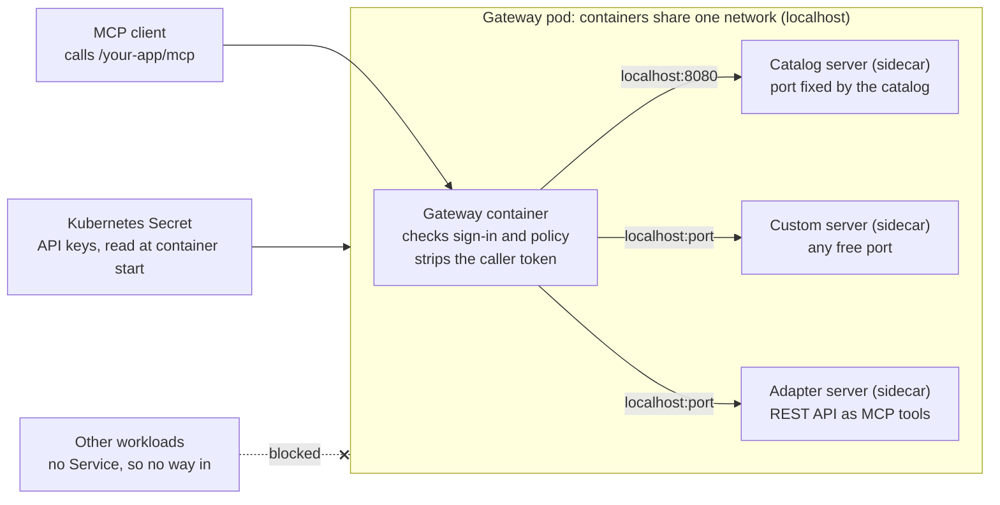

# Agent Privilege: Sidecar MCP Servers

Oct 2, 2026 · @Curtis Muir

## Contents

- [Overview](#overview)
- [What was tested](#what-was-tested)
- [How it fits together](#how-it-fits-together)
- [Adding a sidecar](#adding-a-sidecar)
- [Ports](#ports)
- [Configuration and secrets](#configuration-and-secrets)
- [Registering it and granting access](#registering-it-and-granting-access)
- [Verifying](#verifying)
- [Common mistakes](#common-mistakes)

## Overview

A sidecar is an MCP server that runs as an extra container inside the gateway's own pod. The gateway reaches it at `http://localhost:<port>`, so the server needs no Service, no Ingress and no network exposure of its own.

Use a sidecar in two cases:

- **A catalog app.** Apps added from the Privilege MCP catalog are registered with a fixed backend address of `http://localhost:8080/mcp`. Adding the app in the console does not start a server. You must run one where that address points.
- **A server only the gateway should reach.** A sidecar listens inside the pod only. Nothing else in the cluster can call it, so every request passes the gateway's sign-in and policy checks.

Do not use a sidecar for a server that other clients also call directly, or one that must scale separately from the gateway. Run that as its own Deployment and register its Service address instead.

This guide uses placeholders throughout: `<namespace>`, `<release>`, `<gateway-deployment>`, `<port>` and `<app>`. It covers Kubernetes with Helm. The same idea applies to any runtime where containers can share one network namespace.

## What was tested

Six of the nine claims below were checked on 2 October 2026 against a running gateway, build v1.260925, whose pod holds the gateway, six MCP sidecars and two helper containers. One was confirmed in an earlier signed-in test. Two were seen during earlier work and were not re-run, because each one takes the gateway down.

| Claim | Result | How it was checked |
| --- | --- | --- |
| Many servers run in one gateway pod | Confirmed | Nine containers in one pod, all ready, zero restarts |
| The gateway reaches each sidecar on localhost | Confirmed | From the gateway container, `/health` answered 200 on six sidecar ports |
| A port nobody listens on fails to connect | Confirmed | Same test against an unused port: no connection |
| A server with no health path needs a TCP probe | Confirmed | One adapter answered 404 on `/health` and is ready through a TCP probe |
| The declared `containerPort` does not bind anything | Confirmed | One sidecar still declares a port another sidecar listens on; both are ready |
| Secrets reach a sidecar from a Kubernetes Secret | Confirmed | Six secret references across four sidecars; no secret value in the pod spec |
| A tool call flows client to gateway to sidecar | Confirmed earlier | Signed-in `tools/list` and `tools/call` through the gateway to a search sidecar |
| Two sidecars on one port: the second crash-loops | Seen earlier, not re-run | A catalog server and an adapter both defaulted to 8080 |
| An upgrade with a partial sidecar list removes the others | Seen earlier, not re-run | Helm replaces a list value whole; it does not merge lists |

Not tested: a sidecar on a gateway run with plain Docker, and resource limits under load.

## How it fits together



The client only ever talks to the gateway. The gateway checks sign-in and policy, then forwards the call to the sidecar over localhost, inside the pod. Nothing outside the pod can reach a sidecar, and each sidecar reads its own API keys from a Secret when it starts.

## Adding a sidecar

A sidecar is one more entry in the gateway pod's container list. With Helm, the chart must offer a values key that renders extra containers into the gateway pod. This guide calls it `extraContainers`; your chart may name it differently.

1. **Pick an image built for your nodes.** An image built for the wrong CPU type (amd64 on arm64 nodes, or the reverse) fails at start with `exec format error`.
2. **Pick a free port.** Every container in the pod shares one set of ports. See Ports below.
3. **Add the container to the sidecar list.** Keep the whole list in one values file under version control.
4. **Render first, then apply.** Run the upgrade with `--dry-run` and confirm every existing sidecar is still in the output.
5. **Wait for the rollout.** The pod is replaced, so the gateway restarts with it. With one replica, expect a short interruption.

A sidecar entry:

```yaml
extraContainers:
  - name: mcp-<name>
    image: <registry>/<image>:<tag>
    ports:
      - containerPort: <port>
    env:
      - name: PORT
        value: "<port>"
      - name: <API_KEY_VARIABLE>
        valueFrom:
          secretKeyRef:
            name: <secret-name>
            key: <secret-key>
    readinessProbe:
      httpGet:
        path: /health
        port: <port>
      initialDelaySeconds: 5
      periodSeconds: 10
```

Apply it:

```bash
helm upgrade <release> <chart> -n <namespace> \
  --reuse-values -f sidecars.values.yaml --dry-run
helm upgrade <release> <chart> -n <namespace> \
  --reuse-values -f sidecars.values.yaml
kubectl -n <namespace> rollout status deployment/<gateway-deployment>
```

The server must listen on all interfaces (`0.0.0.0`), not only on `127.0.0.1`. The gateway would reach it either way, but the readiness probe calls the pod's address and would fail.

## Ports

Every container in a pod shares one network, so each port can have only one listener. Two sidecars that both default to 8080 cannot run together: the second one fails to bind and crash-loops.

- **Keep a port table.** Give each sidecar its own port and record it beside the values file. The tested pod uses seven ports in a row, one per container.
- **Reserve 8080 for the catalog app.** A catalog app's backend address is fixed at `http://localhost:8080/mcp` and cannot be edited. Only one catalog server can hold 8080; move everything else.
- **Run a second catalog server on another port as a custom app.** Register it yourself with `http://localhost:<port>/mcp` instead of adding it from the catalog.
- **Set the port the way the server reads it.** Many servers read a `PORT` variable. Others take a flag or a config file. Check the image's documentation.
- **Do not trust `containerPort`.** It is a label. It neither opens nor reserves a port. In the tested pod one sidecar still declares 8080 after moving to another port, and nothing breaks. What counts is the port the process binds.
- **Stay clear of the gateway's own ports.** The gateway container listens on 443 and other ports in the same pod.

To see which ports answer, call each one from the gateway container:

```bash
kubectl -n <namespace> exec deploy/<gateway-deployment> -c <gateway-container> -- \
  sh -c 'for p in 8080 8081 8082; do
    curl -s -o /dev/null -m 3 -w "port $p: %{http_code}\n" http://localhost:$p/health
  done'
```

A result of `200` means a server answers. `404` means something listens but has no `/health` path. `000` means nothing listens on that port.

## Configuration and secrets

A sidecar gets all of its settings from its own container definition. Values typed into the app's Configuration panel in the Privilege console did not reach the container in our tests, so do not rely on that panel for an API key.

| Setting | Where it goes | Example |
| --- | --- | --- |
| Port | Plain `env` value | `PORT=<port>` |
| Upstream address | Plain `env` value | `http://<service>.<namespace>.svc.cluster.local:<port>` |
| API key, token, client secret | Kubernetes Secret, read with `secretKeyRef` | `<API_KEY_VARIABLE>` from `<secret-name>` |

Create the Secret in the gateway's namespace before the upgrade. A pod can only read Secrets from its own namespace.

```bash
kubectl -n <namespace> create secret generic <secret-name> \
  --from-literal=<secret-key>='<value>'
```

Three things to know:

- **A missing Secret blocks the whole pod.** The new pod waits in `CreateContainerConfigError` until the Secret exists. The old pod keeps serving during a rolling update.
- **A changed Secret needs a restart.** Environment variables are read once, at container start. Run `kubectl -n <namespace> rollout restart deployment/<gateway-deployment>` after changing a value.
- **Keep secret values out of the values file.** The file holds only the Secret's name and key, so it is safe to commit.

A sidecar can call anything the pod can reach: another Service in the cluster, an outside API, or another sidecar on localhost. The tested pod has an adapter sidecar that turns a REST API into MCP tools; its upstream is a second sidecar at `http://localhost:<port>`.

## Registering it and granting access

A running sidecar is invisible to clients until it is registered as an app and a policy allows it. The gateway denies every app by default.

| Field | Catalog app | Custom app |
| --- | --- | --- |
| Backend address | Fixed: `http://localhost:8080/mcp` | You type it: `http://localhost:<port>/mcp` |
| Sidecar port | Must be 8080 | Any free port |
| Gateway | The gateway whose pod runs the sidecar | The same |
| Auth mode | None | None |

1. **Register the path the server answers on.** Most servers use `/mcp`. On the tested build the gateway sends its first request as a POST to the registered path, so a registered `/sse` path fails discovery.
2. **Choose the gateway that runs the sidecar.** `localhost` means the pod of the gateway you pick. A different gateway has nothing on that port.
3. **Set Auth mode to None.** The gateway removes the caller's `Authorization` header before it forwards a request. The sidecar holds its own upstream credentials from its Secret.
4. **Add a policy.** Grant the app's tools to the users or groups that need them. Without a policy every call returns 403.
5. **Give clients the gateway address, never the sidecar's.** Clients connect to `https://<gateway-host>/<app>/mcp`.

The companion guide, Agent Privilege: Registering an MCP Server, covers the console steps, sign-in and policy in full.

## Verifying

Check from the inside out: container, then server, then gateway. Each step below was run against the tested gateway and returned the result shown.

**1. Every container is ready.**

```bash
kubectl -n <namespace> get pod <gateway-pod> \
  -o jsonpath='{range .status.containerStatuses[*]}{.name}{" ready="}{.ready}{" restarts="}{.restartCount}{"\n"}{end}'
```

Expect `ready=true` on every line. A rising restart count on one sidecar usually means a port collision or a wrong image type.

**2. The sidecar's own log shows the port it bound.**

```bash
kubectl -n <namespace> logs <gateway-pod> -c mcp-<name> --tail=20
```

**3. The server speaks MCP on the path you will register.** Run the handshake from the gateway container, which is exactly where the gateway calls from.

```bash
kubectl -n <namespace> exec <gateway-pod> -c <gateway-container> -- \
  curl -s -m 8 -w '\nstatus=%{http_code}\n' -X POST http://localhost:<port>/mcp \
  -H 'Content-Type: application/json' \
  -H 'Accept: application/json, text/event-stream' \
  -d '{"jsonrpc":"2.0","id":1,"method":"initialize","params":{"protocolVersion":"2025-03-26","capabilities":{},"clientInfo":{"name":"check","version":"1"}}}'
```

Expect `status=200` and a JSON result that names the server. The same request to a path the server does not serve returned `404` in our test. If this step fails, the gateway will fail the same way; fix the sidecar before touching the console.

**4. The gateway serves the app and asks for sign-in.**

```bash
curl -s -o /dev/null -w 'status=%{http_code}\n' -X POST \
  https://<gateway-host>/<app>/mcp -H 'Content-Type: application/json' -d '{}'
```

Expect `status=401`. That proves the gateway is up and asks for sign-in. It does not prove the app name: the gateway checks the token before the name, so a wrong name also returns 401 here and fails only after sign-in.

**5. A signed-in client lists the tools.** Connect an MCP client to `https://<gateway-host>/<app>/mcp`, sign in, and list tools. An empty list or a 403 means the policy is missing, not that the sidecar is broken.

## Common mistakes

| Symptom | Cause | Fix |
| --- | --- | --- |
| The catalog app is added but every call fails | Nothing listens on `localhost:8080`; adding the app does not start a server | Run the server as a sidecar on 8080 |
| A new sidecar crash-loops with an address-in-use error | Its port is already taken in the pod | Give it a free port and update the port table |
| A sidecar fails at start with `exec format error` | The image was built for another CPU type | Rebuild or pull the image for your nodes' CPU type |
| Existing sidecars vanish after an upgrade | The values file listed only the new sidecar; Helm replaces a list whole | Keep every sidecar in one file and check the `--dry-run` output |
| The sidecar runs but never becomes ready | The probe calls `/health` and the server has no such path | Use a `tcpSocket` probe on the port |
| The sidecar runs but its upstream calls are refused | The API key was typed into the console's Configuration panel | Put it in a Secret and reference it from the container |
| The new pod waits in `CreateContainerConfigError` | The Secret or key named in `secretKeyRef` does not exist in the namespace | Create the Secret, then let the rollout continue |
| The gateway shows no tools for the app | The app is registered with `/sse`, or with a port nothing listens on | Register `http://localhost:<port>/mcp` and re-run step 3 of Verifying |
| Sign-in works, then every call returns 403 | No policy grants the app, or the client used a wrong app name | Add a policy; check the name in the URL |
| The gateway restarts whenever a sidecar changes | Sidecars are part of the gateway's pod | Plan sidecar changes like gateway changes, or run more than one replica |
