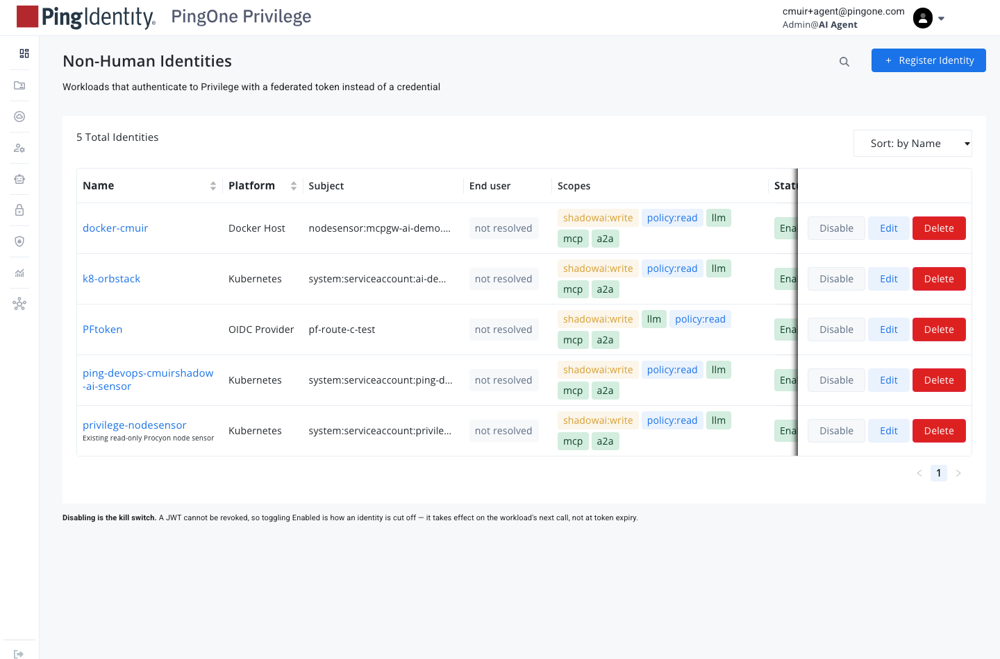
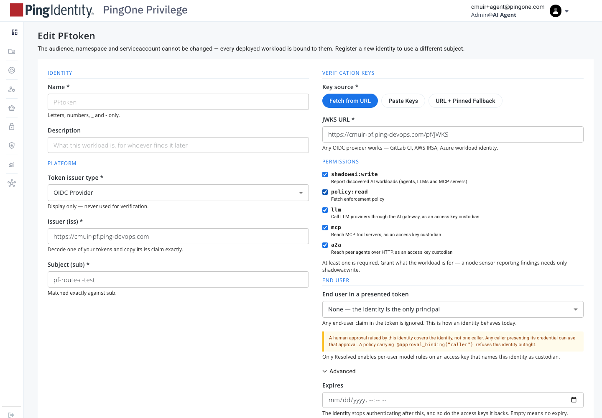
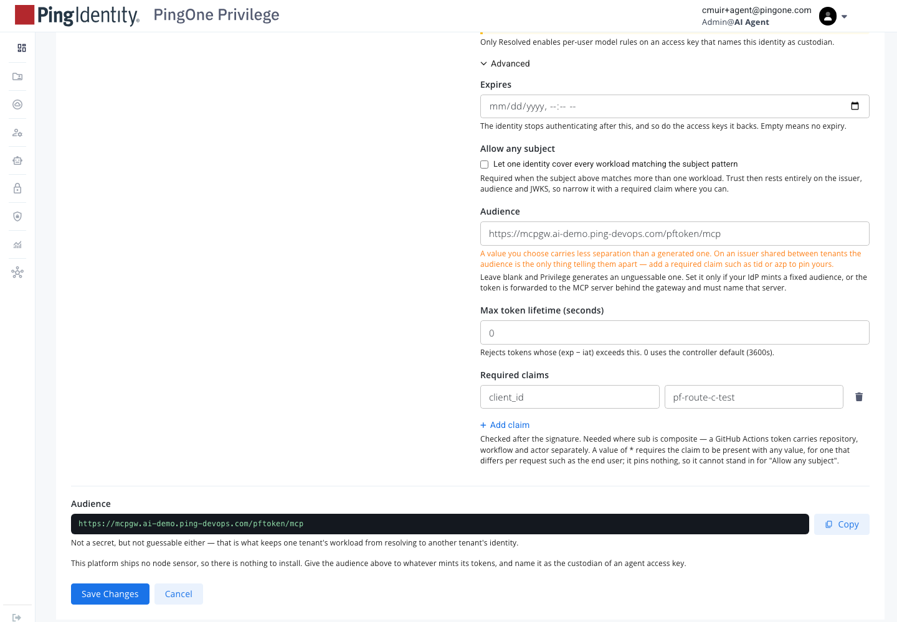
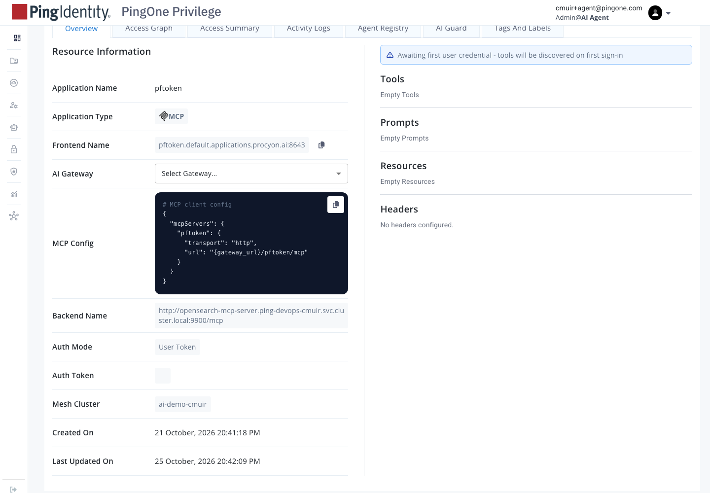
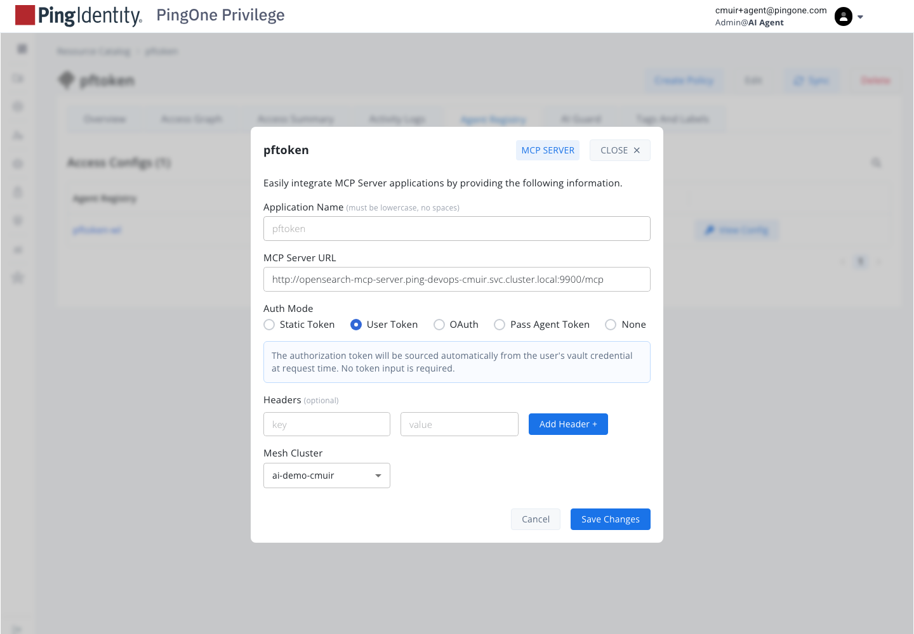
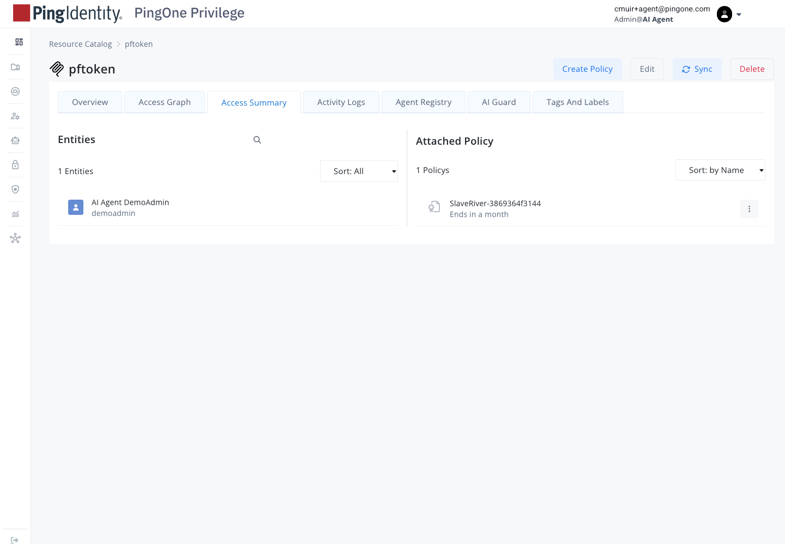
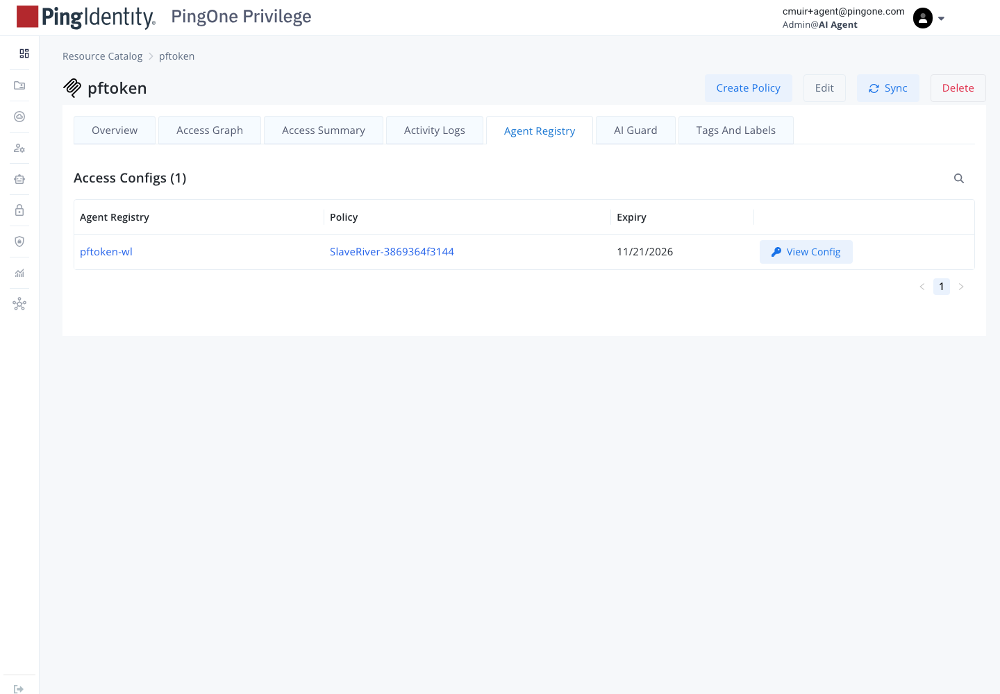
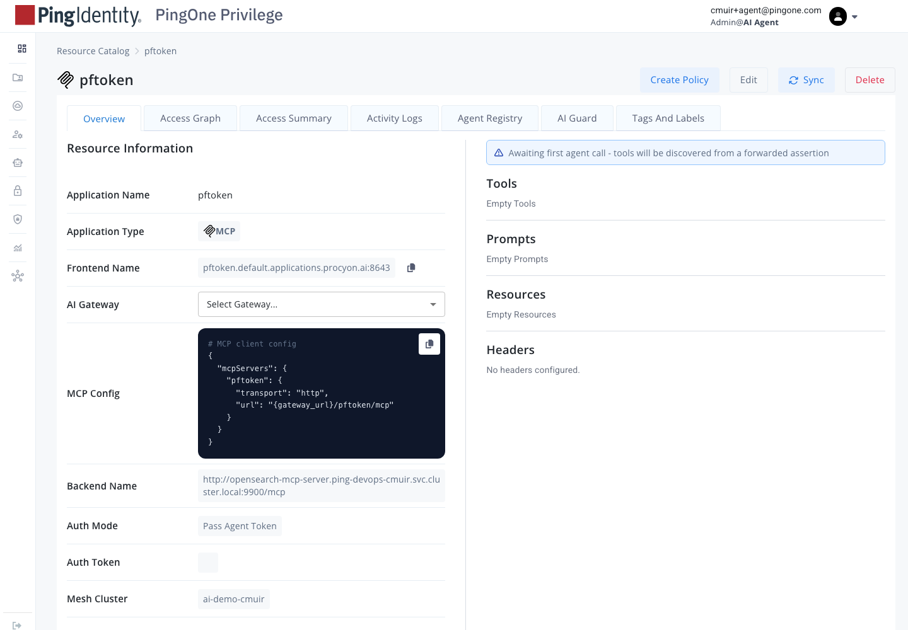
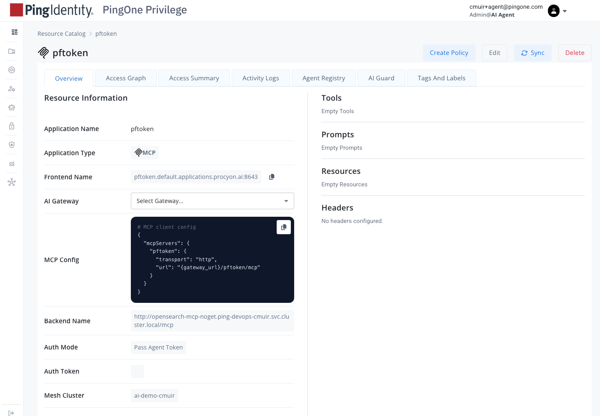
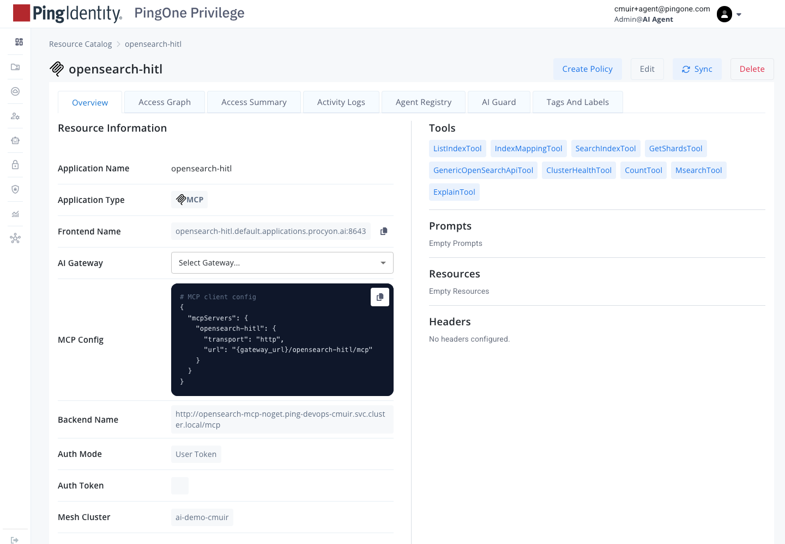

# PingFederate token exchange into Privilege, with Pass Agent Token

Set up, deploy and use the agent-presents-token path: a PingFederate token exchange produces a token that acts for an agent, the agent sends it to a Privilege MCP door, and the door forwards the verified token to the MCP server (Pass Agent Token). Expected configuration follows the recipe from the Ping thread (Federico Carbone and Suman Sharma, 2026-10-23). Status as of 2026-10-25: **not working end to end.** Each claim below is tagged:

- **[measured]**: seen on our tenant or in the gateway log, 2026-10-22.
- **[ping]**: stated by Ping engineers in the thread. Not yet verified on our tenant.
- **[expected]**: our reading of what must be true. Not tested.

Companion docs: `PF-TOKEN-ON-PRIVILEGE-STATUS.md` (where the test stands and the restart checklist) and `PF-CLAIMS-IN-CEDAR-POLICIES.md` (what Cedar can read).

## 1. What the agent presents

The token must have the user in `sub` and the agent in `act.sub`. This is the shape from the Ping thread [ping]:

```json
{
  "sub": "<user id, e.g. fcarbone>",
  "aud": "<gateway audience, see section 4>",
  "act": { "sub": "pf-route-c-test" },
  "client_id": "pf-route-c-test",
  "scope": "mcp"
}
```

Our route C token is different [measured 2026-10-22]: a client-credentials token with `sub` = `pf-route-c-test`, `client_id` = `pf-route-c-test`, and **no user and no `act`**. That is the autonomous-agent shape. It will not satisfy the recipe in section 3.

## 2. The door: `pftoken`

| Setting | Required value | Status |
|---|---|---|
| Auth Mode | **Pass Agent Token** (`token-pass`) | **Pass Agent Token, saved 2026-10-26** [measured, console] |
| MCP Server URL | `http://opensearch-mcp-noget.ping-devops-cmuir.svc.cluster.local/mcp` | Changed 2026-10-26. The old `opensearch-mcp-server…:9900` Service no longer exists; see section 14 [measured] |
| Mesh cluster | `ai-demo-cmuir` | [measured] |
| Tools | the nine HITL tools (below) | [measured]: discovery shows none under User Token, and the console can't discover under Pass Agent Token. See section 6. |

The nine tools: `ListIndexTool`, `SearchIndexTool`, `ClusterHealthTool`, `CountTool`, `MsearchTool`, `ExplainTool`, `IndexMappingTool`, `GetShardsTool`, `GenericOpenSearchApiTool`.

Pass Agent Token forwards the agent's verified token to the backend. The backend must accept it. [expected] The `opensearch-mcp-server` does not check PF tokens today; the call is refused before it reaches the backend.

## 3. The identity: NHI `PFtoken` (Suman's recipe)

Suman's configuration [ping], with our names filled in:

| Field | Value | Why |
|---|---|---|
| Issuer | `https://cmuir-pf.ping-devops.com` | the PF that signs the token [measured] |
| JWKS URI | `https://cmuir-pf.ping-devops.com/pf/JWKS` | [measured] |
| Subject | `*`, Allow any subject **on** | the user is in `sub`; a pinned subject would be the agent |
| Audience | the gateway audience, see section 4 | RFC 7519: the gateway must be in `aud` |
| Required claim | `act.sub` = `pf-route-c-test` | accept only tokens acting for this agent |
| UserClaim | `sub` | the user comes from `sub` |
| SubjectBinding | `resolved`, or `opaque` if the user is not in Privilege | shows the user in the audit log |
| Scopes | `mcp` only | least privilege |
| Max lifetime | 7200 s | [expected] |

Our current `PFtoken` values [measured 2026-10-22]:

| Field | Current |
|---|---|
| Subject | `pf-route-c-test`, any-subject off |
| Required claim | `client_id` = `pf-route-c-test` |
| Audience | `https://mcpgw.ai-demo.ping-devops.com/pftoken/mcp` |
| Scopes | `shadowai:write, llm, policy:read, mcp, a2a` |
| SubjectBinding | empty |
| UserClaim | empty |

Changing these from the pinned-agent shape to the table above is a change to a live identity. Key `pftoken-agent` depends on it.

## 4. Audience

- Suman [ping]: the gateway must be in `aud`, and the audience cannot be a wildcard. A per-MCP audience is not supported today. The intended route is OBO, which is in staging and due in the release at the end of next week.
- Suman offered an allow-list of audiences as a possible change. Not built.
- Our current test uses the door URL as the audience [measured], which is per-MCP. The gateway accepted the token on that audience. So an exact-match door URL works. Whether a per-MCP audience is allowed in production is open.

## 5. The grant

- Key `pftoken-agent` on app `pftoken`, tools = the nine tools. Create it in the console (Create Policy on the `pftoken` page). [measured] Entities on that page: the policy is attached to the custodian user, and `pftoken-agent`'s custodian is the NHI `PFtoken`, not a user. Whether the console lists NHI-custodied keys is unknown.
- Do not create it through the API. [measured] Every API-created copy was deleted by the gateway within 11 to 80 seconds. Cause unknown; see section 7.
- Do not press Sync after saving. [measured]: it did not populate the tools list, and it may reconcile policies.

## 6. Why Pass Agent Token blocks the console

- The console's "Create Policy" dialog needs discovered tools. [measured]: "No Tools, Prompts, or Resources Discovered".
- Discovery is an admin call with no agent token. Under Pass Agent Token it has nothing to forward, so it finds no tools. [expected]
- Under User Token discovery did not populate either, even after Sync. [measured] `opensearch-hitl` on the same backend and User Token does discover all nine. So `pftoken`'s own settings differ somewhere. The Activity Logs tab on `pftoken` should show the error.

**Open:** can Privilege discover tools on a Pass Agent Token door at all? If not, the grant must come from another route. Ask Privilege.

## 7. Grant deletions (unexplained)

`pftoken-agent-grant` was created through the API three times and deleted by the gateway each time [measured]:

| Created (CDT) | Deleted (CDT) |
|---|---|
| 10:24 | 10:24:21 |
| 10:43:40 (with `ObjectMeta.ID`) | 10:45:06 |
| 10:48:52 | 10:49:03 |

The log says `RDP terminate: policy deleted — policy=pftoken-agent-grant`. No requester is recorded. The `ObjectMeta.ID` made no difference. Check the Activity Logs tab on `pftoken`, and ask other sessions whether they run grant cleanup.

## 8. Deploy and use

Deploy here means the console configuration above. There is no image or container to ship.

1. **Door:** set `pftoken` to Pass Agent Token. Save. (Console, Edit.)
2. **Identity:** set NHI `PFtoken` to section 3. Read back.
3. **PF token exchange:** the exchange already exists on the shared token manager `aiDemoPfJwtAtm` [measured 2026-10-25]: token-exchange mappings `aiDemoStandardTePolicy`, `aiDemoPfStep9TePolicy` and `aiDemoSpiffeTePolicy` set `sub` = the subject token's subject, `act` = `{sub: spiffeId, act: priorAct}`, and `client_id`. It was built for the OBO demo. What is not tested is whether an exchange for our agent yields `act.sub` = `pf-route-c-test`, and with the audience in section 4. Next step: run one exchange with a user subject token and read the claims.
4. **Discovery:** make one agent call with the token (step 7 works for this even before the grant exists; it is refused on policy but triggers discovery). Then confirm the nine tools on `pftoken` (Overview tab). Needs gateway v1.261024 or later and a backend URL that resolves (section 14).
5. **Grant:** create the policy for `pftoken-agent` with the nine tools. Save. Do not sync.
6. **Check persistence:** the grant must still exist 90 seconds later. If not, stop and find the deleter.
7. **Use:** the agent calls `https://mcpgw.ai-demo.ping-devops.com/pftoken/mcp` with the exchanged token as the bearer, and calls `tools/list` then one tool.

## 9. Test

Expected results when everything is in place:

| Call | Expected |
|---|---|
| exchanged token, `tools/list` | 200 with the nine tools |
| exchanged token, tool call | 200 (a `SearchIndexTool` call is HELD by the HITL rule until approved) |
| garbage bearer | 401 `Bearer token required` |
| exchanged token with no `act.sub` | refused at the NHI required claim, not on policy |
| a client-credentials token (route C shape) | refused at the NHI required claim (`act.sub` missing) |

The gateway log should show, in order: `workload token accepted for key pftoken-agent`, then no `policy denied`. Refusals show as `policy denied PFtoken access to pftoken` (policy) or `auth rejected` (sign-in).

Our current test [measured 2026-10-22] reached the policy step and was refused, because the grant is missing.

## 10. Open questions

1. ~~Can Privilege discover tools on a Pass Agent Token door?~~ **Answered (gateway v1.261024):** yes, from the first accepted agent call. It needs a backend URL that resolves (section 14).
2. Does the console list NHI-custodied keys in Create Policy? (blocks step 5)
3. What deletes `pftoken-agent-grant`? (blocks step 6)
4. Is a per-MCP audience acceptable in production, or must it be the gateway? (Suman says gateway)
5. Does PF issue the exchanged token with `act.sub` and `sub` as section 1 needs? (exchange exists for OBO; the claims for our agent are untested)
6. When does `context.token.claims["act.sub"]` reach Cedar? (Suman: next release)

## 11. Ping thread, summarized

- Federico (2026-10-23): the agent's token has user in `sub` and agent in `act.sub`; Privilege expects the agent id in `sub`. The attributes are inverted for OBO. Audience should live with the MCP, not the agent. The logs and policies should resolve both attributes.
- Suman (2026-10-23): the subject config is the issue. Use Subject `*` (or AllowAnySubject), `RequiredClaims["act.sub"]` = the agent, `UserClaim` = `sub`, `SubjectBinding` = `resolved` (or `opaque`). The audience must include the gateway; OBO is the intended route. Cedar `context.token.claims` checks are coming in the next release.

## 12. Test results, 2026-10-25

What was checked, and what could not be checked.

| Check | Result | Tag |
|---|---|---|
| Shared manager `aiDemoPfJwtAtm`: Option A `CLIENT_CREDENTIALS` mapping (`sub` = client id, plus `act`, `Username`, `spiffeId`) | **Gone.** Removed. The cleanup item is done. | [measured] |
| Shared manager: token-exchange mappings | Present. Fill `sub`, `act`, `client_id`, `scope`, `spiffeId`. Built for the OBO demo. | [measured] |
| Client `pf-route-c-test` | Still exists (PF admin API returns 200). Cleanup item still open. | [measured] |
| Token manager `routeCTestAtm` | Exists. Audience and resource URI = the `pftoken` door URL. | [measured] |
| Privilege console (`local.procyon.ai:8643`) | **Down** at 2026-10-25, even after reopening PingOne Privilege. Cannot read or change Privilege. Auth mode, grants and tool discovery were not re-read. | [measured] |
| Demo page `https://ai-demo.ping-devops.com/privilege-ai-policies`, hold scenario | **Not run.** The browser extension was not connected, so the page could not be opened from here. | not tested |
| Demo user's access to `opensearch-hitl` | **Not settled.** `opensearch-hitl` is on User Token, which should remove the 403 that the demo user saw, but nobody has run it. | not tested |
| `pftoken` auth mode | **User Token** (saved). The Pass Agent Token seen in a 2026-10-25 dialog was not saved. The target for this guide is Pass Agent Token; switching back is still to do. | [measured, console screenshot] |
| `pftoken` tool discovery | Overview says "Awaiting first user credential - tools will be discovered on first sign-in". Under User Token, discovery waits for a person to sign in to the door once. Nobody has, so Tools is empty. | [measured, console screenshot] |
| `pftoken` Activity Logs, 2026-10-18 to 2026-10-25 | **No data.** The grant deletions are not recorded on this tab. | [measured, console screenshot] |
| `pftoken` Agent Registry tab | One access config: key `pftoken-wl`, policy `SlaveRiver-3869364f3144`, expires 2026-11-21. `pftoken-agent` has no access config on this door. | [measured, console screenshot] |

Still to run: the demo page's hold scenario in a signed-in browser.

## 13. Console walkthrough (screenshots, 2026-10-25)

Taken with Playwright against the local console (`https://local.procyon.ai:8643`, signed in as the tenant admin). Dialogs were opened and cancelled; nothing was saved.

### Non-Human Identities list



`PFtoken` is an OIDC Provider identity with subject `pf-route-c-test`. End user shows "not resolved". Scopes: `shadowai:write`, `llm`, `policy:read`, `mcp`, `a2a`.

### Edit PFtoken: identity, keys, permissions, end user



Where Suman's recipe goes in this screen:

| Recipe field | Console control | Current | Recipe |
|---|---|---|---|
| Subject | Subject (sub) | `pf-route-c-test` | `*`, with Allow any subject on (lower half) |
| UserClaim + SubjectBinding | End user → "End user in a presented token" | None — the identity is the only principal | Resolved (or Opaque if the user is not in Privilege), claim `sub` |
| Scopes | Permissions | all five ticked | `mcp` only |
| JWKS | Key source → Fetch from URL | `https://cmuir-pf.ping-devops.com/pf/JWKS` | unchanged |

The console note under End user: "Only Resolved enables per-user model rules on an access key that names this identity as custodian."

### Edit PFtoken: subject, audience, required claims



| Recipe field | Console control | Current | Recipe |
|---|---|---|---|
| Allow any subject | checkbox | off | on |
| Audience | Audience | `https://mcpgw.ai-demo.ping-devops.com/pftoken/mcp` | the gateway audience (section 4) |
| Required claims | Required claims | `client_id` = `pf-route-c-test` | `act.sub` = `pf-route-c-test` |
| Max token lifetime | Max token lifetime (seconds) | 0 (controller default, 3600) | 7200 |

The page header says the audience cannot be changed in the console ("every deployed workload is bound to them"). We changed it through the API on 2026-10-22 and the gateway honoured it. Treat a console-side audience change as "register a new identity".

### The `pftoken` door: Overview



Auth Mode is User Token. Tools, Prompts and Resources are empty, with the banner "Awaiting first user credential - tools will be discovered on first sign-in".

### The `pftoken` door: Edit (Auth Mode)



For this guide, set Auth Mode to **Pass Agent Token** and Save. Under User Token, the console says the token "will be sourced automatically from the user's vault credential at request time".

### The `pftoken` door: Access Summary and Agent Registry





The door has one entity (AI Agent DemoAdmin) and one policy (`SlaveRiver-3869364f3144`), which is the access config for key `pftoken-wl`. The key the PF token actually maps to, `pftoken-agent`, has no access config here. That is the missing grant.

## 14. Gateway v1.261024 (2026-10-26): what changed, and how to troubleshoot

The gateway was updated to `privilege-aigw:v1.261024`. With it, a Pass Agent Token door **discovers its tools from the first agent call** instead of needing a person to sign in.

### What the console shows

Before the first agent call, on Pass Agent Token:



The banner reads "Awaiting first agent call - tools will be discovered from a forwarded assertion". The equivalent banner on User Token reads "Awaiting first user credential - tools will be discovered on first sign-in" (section 13).

| Banner | Auth mode | What triggers discovery |
|---|---|---|
| Awaiting first user credential - tools will be discovered on first sign-in | User Token | A person signs in to the door once |
| Awaiting first agent call - tools will be discovered from a forwarded assertion | Pass Agent Token | The first agent call with a token the gateway accepts |

### What happened on the first agent call

The PF token call (2026-10-26 10:39 UTC) produced, in order [measured, gateway log]:

1. `mcpgw: workload token accepted for key pftoken-agent issuer=https://cmuir-pf.ping-devops.com subject=pf-route-c-test`
2. `[mcpgw] policy denied PFtoken access to pftoken (agent=true): Access Denied for` (no grant for `pftoken-agent`)
3. `[mcpgw] tool discovery for pftoken failed: calling "initialize": ... dial tcp: lookup opensearch-mcp-server.ping-devops-cmuir.svc.cluster.local on 172.20.0.10:53: no such host`

So discovery **was** triggered by the agent's call, even though the call itself was refused on policy. It failed because the door's backend URL pointed at a Kubernetes Service that no longer exists.

### The backend fix

- `opensearch-mcp-server.ping-devops-cmuir.svc.cluster.local:9900` has no Service in `ping-devops-cmuir`. The OpenSearch MCP server now runs as a container inside the gateway pod, and the in-cluster address is `opensearch-mcp-noget` (port 80, endpoint on 8080; the nginx front that refuses `GET /mcp`).
- Both `pftoken` and `opensearch-hitl` were moved to `http://opensearch-mcp-noget.ping-devops-cmuir.svc.cluster.local/mcp` on 2026-10-26. Auth modes unchanged: `pftoken` Pass Agent Token, `opensearch-hitl` User Token.
- `opensearch-hitl` is the door behind the AI Policies demo page. Its nine tools were listed from an earlier discovery, but any call forwarded to the backend (the "allow" scenario, a retry after approval) would have failed until this change.





The second PF call after the change (11:11 UTC) was accepted and refused on policy again, and logged no discovery error. Whether `pftoken` now lists its nine tools has to be read in the console (Overview, Tools). Next step after that: create the policy for `pftoken-agent` (section 5), then rerun the test (section 9).

### Finding the right gateway log

The public host `mcpgw.ai-demo.ping-devops.com` is fronted by `mcpgw-lb`, which spreads requests over **three** gateway pods in two namespaces. A request is logged only on the pod that served it, so search all three:

```bash
kubectl --context us -n ping-devops-cmuir     get pods | grep agentless-mcpgw
kubectl --context us -n ping-devops-curtismuir get pods | grep agentless-mcpgw
# then, for each pod:
kubectl --context us -n <namespace> logs <pod> --all-containers --since=5m \
  | grep -E 'workload token|policy denied|tool discovery|auth rejected' | grep -i pftoken
```

The request lines are in the log-tailer output, so `--all-containers` is needed.

| Log line | Meaning | Fix |
|---|---|---|
| `workload token accepted for key <key> issuer=… subject=…` | The NHI check passed (issuer, audience, subject, required claims, lifetime) | none |
| `policy denied <NHI> access to <app> (agent=true)` | No grant for that key on that door | create the policy for the key (section 5) |
| `tool discovery for <app> failed: … no such host` | The door's backend URL does not resolve | fix the MCP Server URL (this section) |
| `auth rejected: reason=token_not_found` | Logged after a policy denial for the same request; it is the refusal, not a second cause | as above |
| no `workload token` line at all | The token was not recognised as a workload token: check issuer, audience, subject, required claims and lifetime against the NHI | section 3 |

The client only ever sees a bare `403 Forbidden` for a policy denial, and `401 Bearer token required` for a token the gateway did not accept at all. The log is the only place that says which.

### Claims you can check today (Suman, 2026-10-23)

- Claim conditions can be set today in the **Access Policy** step of the Agent Registry creation flow, on four fixed claims only: **scopes, `client_id`, subject, issuer**.
- Cedar cannot read token claims yet. `context.token.claims` (including `act.sub`) is coming in the next release.
- The audience must contain the gateway; a wildcard is not allowed (RFC 7519 §4.1.3). OBO, in staging and due at the end of next week, is the intended route for per-MCP audiences. An allow-list of audiences is possible on request.

## Related

- `PF-TOKEN-ON-PRIVILEGE-STATUS.md`: status, object table, restart checklist.
- `PF-CLAIMS-IN-CEDAR-POLICIES.md`: what Cedar can and cannot read.
- `WORKLOAD-IDENTITY-AGENT-CALLERS.md`: the workload identity setup.
