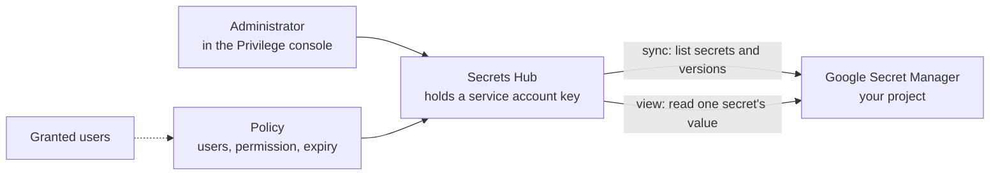

# PingOne Privilege: Secrets Hub with Google Secret Manager

Oct 4, 2026 · @Curtis Muir

## Contents

- [Overview](#overview)
- [What was tested](#what-was-tested)
- [How the hub works](#how-the-hub-works)
- [Preparing the Google project](#preparing-the-google-project)
- [Adding the hub in the console](#adding-the-hub-in-the-console)
- [Syncing](#syncing)
- [Viewing a secret](#viewing-a-secret)
- [Granting access with a policy](#granting-access-with-a-policy)
- [What the hub does not do](#what-the-hub-does-not-do)
- [The key ends up in the audit log](#the-key-ends-up-in-the-audit-log)
- [Verifying](#verifying)
- [Quick lookup](#quick-lookup)

## Overview

The Secrets Hub connects PingOne Privilege to a secret store you already run. Privilege lists the secrets in that store, lets an administrator view them, and lets you grant named users access to a secret for a limited time through a policy.

Five stores can be connected: AWS Secrets Manager, Google Cloud Secret Manager, Azure Key Vault, Delinea Secret Server and CyberArk (beta). This guide covers Google Cloud, connected at the level of one project.

Three things to know before you connect one:

- **The hub needs more rights than reading.** It asks for the Secret Manager Admin role, which can create, change and delete every secret in scope.
- **The setup form leaves out one requirement.** Syncing needs the Cloud Resource Manager API as well as the Secret Manager API.
- **The service account key you paste is written to the audit log in clear text.** Scope the key as narrowly as you can.

Ping's published Privilege documentation did not cover the Secrets Hub when this was written, so everything here comes from the console and from Google's own audit log.

Placeholders used: `<project-id>`, `<service-account>` and `<key-file>`.

## What was tested

Tested on 4 October 2026 with a Google Cloud project holding one secret. Each console action was matched against Google's audit log, with read logging turned on for Secret Manager.

| Claim | Result |
| --- | --- |
| A Project hub needs three roles: Secret Manager Admin, Viewer and Secret Accessor | Read from the console form; the hub worked with them |
| An Organization hub also asks for Browser and Folder Viewer | Read from the console form; not set up |
| The first sync fails if the Cloud Resource Manager API is off | Reproduced, with the error quoted below |
| After turning that API on, sync finds the secret | Reproduced: the count went from 0 to 1 |
| A sync reads names and versions, not values | Read from Google's audit log |
| Viewing a secret reads its value from Google at that moment | Read from Google's audit log |
| Creating a policy makes no call to Google | Read from Google's audit log |
| Viewing a secret is recorded in Privilege's own audit feed | Read from the audit record: `Secret Vault Secret value accessed`, with the result |
| A secret policy grants read and write as separate actions | Read from the audit record of the policy |
| The pasted key is stored in full in the console's audit feed | Read from the audit record |
| The hub does not supply the credential for the gateway's User Token auth mode | Reproduced: with a hub and a policy in place, User Token still forwarded nothing |

Not tested: creating, rotating or deleting a secret from the console, what a granted user sees, the Organization and Folder hub types, and the four other providers.

## How the hub works



Privilege keeps the list of secrets, not their contents. A value is fetched from Google only when someone views it.

## Preparing the Google project

You need a project with billing enabled. Secret Manager cannot be turned on without it, even to stay inside the free tier.

1. **Turn on two APIs.** The console form names only the first; sync fails without the second.

   ```bash
   gcloud services enable secretmanager.googleapis.com --project <project-id>
   gcloud services enable cloudresourcemanager.googleapis.com --project <project-id>
   ```

2. **Create a service account for the hub.**

   ```bash
   gcloud iam service-accounts create privilege-secrets-hub --project <project-id>
   ```

3. **Grant it the three roles on the project.**

   ```bash
   for role in roles/secretmanager.admin roles/secretmanager.viewer roles/secretmanager.secretAccessor; do
     gcloud projects add-iam-policy-binding <project-id> \
       --member "serviceAccount:<service-account>" --role "$role"
   done
   ```

4. **Create a key and keep it readable only by you.**

   ```bash
   gcloud iam service-accounts keys create <key-file> --iam-account <service-account>
   chmod 600 <key-file>
   ```

Grant the roles on the project, not on the organisation. The hub then reaches only that project's secrets.

If your Google account belongs to an organisation, a policy there may block key creation. The error names the policy.

## Adding the hub in the console

1. Open **Secrets Hub**, then **Add Hubs**, and click **Integrate** on the GCP card.
2. Name the hub.
3. Choose the account type: **Organization**, **Folder** or **Project**. Choose Project unless you mean to scan everything.
4. The next screen lists the roles for the type you chose. They are already granted if you followed the steps above.
5. Paste the contents of the key file into **Service Account Key JSON**. On a Mac, `pbcopy < <key-file>` puts it on the clipboard without printing it.
6. Continue to the summary and save.

The account type decides the roles:

| Type | Roles the form asks for |
| --- | --- |
| Project | Secret Manager Admin, Secret Manager Viewer, Secret Manager Secret Accessor |
| Organization | The same three, plus Browser and Folder Viewer |

## Syncing

The hub syncs once when it is created. After that, use **Resync** on the hub's page. The page shows the time of the last sync.

A sync makes three kinds of call to Google, and none of them reads a secret's contents:

| Call | What it collects |
| --- | --- |
| Search projects | The project's details |
| List secrets | The secret names |
| List secret versions | Each secret's versions |

**If the secret count stays at 0,** the sync probably failed. The hub's status carries the error. With the Cloud Resource Manager API off, it reads:

```text
syncHierarchyFlat: GetProjects failed: googleapi: Error 403: Cloud Resource Manager API
has not been used in project <number> before or it is disabled.
```

Turn the API on, wait a minute or two, and resync. Google says a newly enabled API can take a few minutes to take effect.

After a good sync, the **Secrets** tab groups secrets under their project. Selecting one shows its name, provider, path, version, last update and project.

## Viewing a secret

In the secret's details, **Secret Value** has a **View** button. Clicking it reads the value from Google at that moment, using the hub's service account. Google's log shows two calls: one to read the latest version's contents and one to fetch that version's details.

So a secret's contents do not sit in Privilege waiting to be read. Each view is a fresh read, and each one appears in Google's audit log if read logging is on.

Privilege records the view as well. Its audit feed gets an event reading `Secret Vault Secret value accessed`, with the outcome. That gives you two independent records of who looked at a secret.

The small circular arrow beside **View** was not clicked. It may rotate the secret, which would change its value in Google.

## Granting access with a policy

The **Policy** button on the hub's page starts a policy. The first step is to pick a secret. The policy then names who gets it, with what permission, until when.

The **Access Summary** tab lists the hub's policies with these columns:

| Column | Meaning |
| --- | --- |
| Policy | The policy's name |
| Secret | The secret it covers |
| Permission | What the users may do, for example Write |
| Users | How many users it grants |
| Expiry | When the grant ends |

A policy is held in Privilege. Creating one made no call to Google. Underneath, it is a policy of type `SecretResources` that grants reading and writing the secret as two separate actions, to a list of users, between two dates. The Write permission in the table above carried both.

What a granted user then sees, and where they read the secret, was not tested.

## What the hub does not do

- **It does not feed the gateway's User Token auth mode.** That mode forwards a credential from a per-user vault. With a hub connected and a policy granting the user a secret, the gateway still logged `no vault credential for user` and forwarded nothing.
- **It did not supply a secret to an app or an agent** in anything tested. The flow seen is for people: sync, grant, view.
- **It does not copy secret values into Privilege on sync.**

## The key ends up in the audit log

When you save the hub, the console's audit feed records the whole object you submitted. If that feed is sent to a SIEM, the record includes the service account key, private key and all, in clear text.

This matters more than it first appears, because the key carries the Secret Manager Admin role. Anyone who can read your SIEM index can use it to read, change or delete every secret the hub can reach.

What to do:

- **Scope the hub to one project,** not the organisation, unless you have to.
- **Restrict who can read the SIEM index** to the people you would trust with the secrets themselves.
- **After adding or editing a hub, remove that record** from the index, or replace the key.
- **Turn on read logging for Secret Manager** in the project, so every read by the hub's account is recorded on Google's side.

Later edits to the hub did not record the key again; the key field in those records was empty.

## Verifying

1. **The hub shows a recent Last Sync time and a secret count above 0.**
2. **Google saw the sync.** With read logging on, list what the hub's account did:

   ```bash
   gcloud logging read 'protoPayload.authenticationInfo.principalEmail:"<service-account>"' \
     --project <project-id> --freshness=1h --limit 20 \
     --format="table(timestamp,protoPayload.methodName,protoPayload.resourceName)"
   ```

   Expect a project search, `ListSecrets` and `ListSecretVersions`.

3. **View reads the value.** Click **View** on one secret, then run the same command. Expect `AccessSecretVersion`.

To turn on read logging, add an audit configuration for `secretmanager.googleapis.com` with the `DATA_READ` and `ADMIN_READ` log types to the project's IAM policy.

## Quick lookup

| Symptom | Most likely cause | Fix |
| --- | --- | --- |
| The hub shows 0 secrets | The sync failed | Read the hub's status error; turn on the Cloud Resource Manager API |
| `Cloud Resource Manager API has not been used` | That API is off | Enable `cloudresourcemanager.googleapis.com` and resync |
| The error persists straight after enabling | The change has not taken effect | Wait a few minutes and resync |
| `Billing must be enabled` when turning on Secret Manager | The project has no billing account | Link an open billing account |
| Key creation is refused | An organisation policy blocks service account keys | Ask the organisation's administrator, or use a project outside it |
| The hub cannot see a project | The roles were granted elsewhere, or the wrong account type was chosen | Grant the roles on that project and choose Project |
| User Token still forwards no credential | The hub does not fill the per-user vault | Use another auth mode |
| The service account key is in the SIEM index | The audit feed records the saved hub in full | Remove the record or replace the key; restrict the index |
