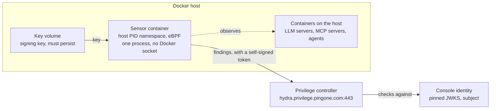

# Privilege Sensor on Docker: Guide

Oct 2, 2026 · Curtis Muir

## Contents

- [Overview](#overview)
- [Setting up the sensor on a Docker host](#setting-up-the-sensor-on-a-docker-host)
- [Topology](#topology)
- [How the sensor works](#how-the-sensor-works)
  - [What it hooks](#what-it-hooks)
  - [What it does with an event](#what-it-does-with-an-event)
  - [What the log lines mean](#what-the-log-lines-mean)
  - [It can also enforce](#it-can-also-enforce)
- [Sensor identity: where the sub comes from](#sensor-identity-where-the-sub-comes-from)
- [Getting more logging from the sensor](#getting-more-logging-from-the-sensor)
- [Verifying it works](#verifying-it-works)
- [Known failure modes](#known-failure-modes)

## Overview

The Privilege sensor is one container that watches a Docker host for AI workloads and reports them to the Privilege controller. It detects LLM servers, MCP servers and outbound connections to AI endpoints. It observes from the kernel; it is not in any request path and it starts no other containers.

This guide covers setting it up on any Docker host, how it works, how its identity is verified, and how to tell what is wrong when it fails. Values in angle brackets are placeholders for your own.

For a Kubernetes cluster, use the companion guide, *Privilege Sensor on Kubernetes: Guide*. The main difference is identity: on Docker the sensor signs its own tokens with a key it must keep, and on Kubernetes the cluster signs them.

## Setting up the sensor on a Docker host

Four things have to line up: a persistent writable key, the right key pinned in the console, the same `-cluster` value in both commands, and the audience Privilege generates. Most failures are one of these being off.

Replace `<your-cluster-label>` with any label for your host. It does not have to match anything else.

1. **Check the host can run the sensor.** Expect `bpf=true perfmon=true`.

   ```bash
   docker run --rm --pid=host --cap-add BPF --cap-add PERFMON \
     -v /sys:/sys:ro public.ecr.aws/v2s2h8i9/procyon-nodesensor -docker -probe
   ```
2. **Create a named volume for the key, and print the registration details from it.** The sensor writes its signing key to `/etc/procyon` on first use.

   ```bash
   docker volume create procyon-nodesensor-key
   docker run --rm -v procyon-nodesensor-key:/etc/procyon \
     public.ecr.aws/v2s2h8i9/procyon-nodesensor \
     -docker -cluster <your-cluster-label> -mint-jwks
   ```
3. **Register the identity in the Privilege console.** Token issuer type: Docker Host, Self-Signed Token. Key source: Paste Keys. Copy the Issuer, Subject and JWKS exactly as printed. Reporting findings needs only the `shadowai:write` permission.
4. **Copy the audience the console generates.** It looks like `priv-nhi-...` and goes into the run command as `-mint-audience`.
5. **Run the sensor on the same volume with the same `-cluster`.**

   ```bash
   docker run -d --name procyon-nodesensor --restart always --pid=host \
     --cap-add BPF --cap-add PERFMON --security-opt label=disable \
     -v /sys:/sys:ro \
     -v /var/lib/docker/containers:/var/lib/docker/containers:ro \
     -v procyon-nodesensor-key:/etc/procyon \
     public.ecr.aws/v2s2h8i9/procyon-nodesensor \
     -docker -cluster <your-cluster-label> \
     -controller hydra.privilege.pingone.com:443 \
     -mint-audience <priv-nhi-audience-from-console>
   ```
6. **Confirm it reports.** Expect `reported findings sent=N accepted=N`.

   ```bash
   docker logs --tail 20 procyon-nodesensor
   ```

Why each mount and option is there:

| Option | Purpose |
| --- | --- |
| `--pid=host` | See the processes of every container, not only its own |
| `--cap-add BPF`, `PERFMON` | Load and attach the kernel programs |
| `-v /sys:/sys:ro` | Kernel type and cgroup data |
| `-v /var/lib/docker/containers:...:ro` | Map a process to its container name |
| `-v procyon-nodesensor-key:/etc/procyon` | Keep the signing key across restarts; must be writable |
| `--restart always` | Come back after a host or Docker restart |

Add `--cap-add KILL` only if you use the memory guard's kill option. Enforcement by policy does not need it (see How the sensor works).

## Topology



The dashed arrow is observation; solid arrows are data. The controller accepts a report only if the token's signature matches the key pinned in the console identity.

## How the sensor works

The sensor attaches small programs to the Linux kernel and watches. It is one container running one process. It has no Docker socket, only a read-only view of Docker's metadata files, so it cannot create or stop containers.

### What it hooks

The sensor loads three eBPF programs:

| Kernel hook | What it sees |
| --- | --- |
| `sched_process_exec` | Every process start: command, arguments, parent, container |
| `inet_sock_set_state` | TCP connections opening, and ports being listened on |
| `tcp_sendmsg` | The first bytes sent on a connection, to read the TLS handshake and its server name |

A filter in the kernel discards events that match nothing, so only a small share reaches the sensor process. `-report-all` bypasses that filter.

### What it does with an event

1. **Inventory at start.** It scans `/proc` once and reports AI workloads that were already running.
2. **Classify.** Each event is matched against a built-in catalog. A finding has a kind (`llm` or `mcp`), a label, and the way it matched.
3. **Attribute.** A process is tied to its container through its cgroup and Docker's metadata. With `-docker`, the container name is reported as the namespace.
4. **Report.** Findings are batched and sent to the controller over gRPC about every 10 seconds, with the workload token. A failed batch is sent again on the next flush.
5. **Poll for policy.** It fetches an enforcement policy from the controller and applies it.

How a finding can match:

| Log shows | Matched on | Example |
| --- | --- | --- |
| `via comm` | Process name | `llama-server` is llama.cpp |
| `via args` | Command-line arguments | `python -m mcp_server_...` is an MCP server |
| `via host-heuristic` | Destination host name | A connection to a host named like an LLM service |

**The host-name match is coarse.** Any connection to a host whose name looks like an LLM service is flagged, including a metrics scrape or a health check. Expect such findings to outnumber real model calls.

### What the log lines mean

| Line starts with | Meaning |
| --- | --- |
| `running` | An AI workload found in the start-up inventory |
| `exec` | A process started |
| `tls` | An outbound connection classified as AI traffic, with its destination |
| `listen` | A process opened a listening port |
| `nodesensor: reported findings sent=N accepted=N` | A batch reached the controller |
| `nodesensor: report failed` | A batch was rejected or the controller was unreachable; it will be resent |
| `nodesensor: stats` | Running totals: kernel events read, findings reported, kernel drops, processes killed |

With `-json`, each event is one JSON object. Its fields include `Kind`, `PID`, `PPID`, `UID`, `Comm`, `Filename`, `Args`, `Dest` (IP, port, host, SNI), `Pod` (name, namespace, container ID and name, labels), `Finding` (kind, label, what it matched on) and `PolicyAction` with `PolicyRule`.

### It can also enforce

The sensor is not only an observer. The controller can push an enforcement policy, and the sensor applies it:

- **The policy comes from the Privilege console, not the command line.** A sensor started with enforcement off will still log `applied enforcement policy mode=enforce` when the console sends one. Check the console before assuming a sensor is observe-only.
- **Enforcing means terminating processes** that match the policy's deny rules, including ones already running when the policy arrives.
- **Whether a host can enforce is its tier,** shown by `-probe` and in the `started` log line; `tier=terminate` means it can. The tier depends on kernel support, not on the `KILL` capability: the probe reports `tier=terminate` with only `BPF` and `PERFMON` granted.
- **The `stats` line shows the effect:** `killed` counts terminations, and `would_kill` appears to count matches in audit mode.
- **On a Docker host, a policy that names namespaces would mean per-container scoping.** The sensor warns about this case.

Two optional features are off by default: a memory guard (`-memguard`) that scans for runaway processes and can terminate them with `-memguard-kill`, and `-no-destinations`, which turns off outbound endpoint reporting.

## Sensor identity: where the sub comes from

The subject is derived, not chosen: it is `nodesensor:` plus the `-cluster` value. A Docker host has no Kubernetes ServiceAccount, so the sensor signs its own workload token and Privilege verifies it against a pinned public key.

| Claim or field | Value | Comes from |
| --- | --- | --- |
| Issuer (`iss`) | `https://privilege.local/nodesensor` | Sensor default; changes only with `-mint-issuer` |
| Subject (`sub`) | `nodesensor:<your-cluster-label>` | The `-cluster` flag; overridable with `-mint-subject` |
| Key | One EC P-256 (ES256) public key | Printed by `-mint-jwks`; pasted into the console |
| Audience (`aud`) | `priv-nhi-...` | Generated by Privilege; passed as `-mint-audience` |
| Lifetime | 10 minutes | `-mint-lifetime`; must not exceed the identity's maximum |

Three rules follow:

- **Use the same `-cluster` in `-mint-jwks` and in the run command.** A different value changes the subject and the token is rejected. The value is only a label; it is also stamped on every finding.
- **The key file is the identity.** It lives at `/etc/procyon/nodesensor-signing.pem` and is created on first use. If it is lost, the sensor makes a new one with a different key ID, and every report is rejected until the new JWKS is pasted into the console.
- **Keep the key on storage that survives a restart.** Use a named Docker volume. A host path can sit on a temporary filesystem: on OrbStack, `/etc` inside the Docker virtual machine is held in memory and is discarded on restart.

To move an existing key to a volume without changing its key ID, copy the file:

```bash
docker volume create procyon-nodesensor-key
docker run --rm -v <old-key-dir>:/src:ro -v procyon-nodesensor-key:/dst alpine \
  cp -p /src/nodesensor-signing.pem /dst/
```

The key is lost again if the volume is deleted, for example by `docker volume prune` while the sensor container does not exist.

## Getting more logging from the sensor

The sensor has no log-level or verbose setting. Three flags increase what it logs; add them to the `docker run` command.

| Flag | What it does |
| --- | --- |
| `-report-all` | Reports every process exec, bypassing the in-kernel filter. A debug flag; noisy |
| `-json` | Emits events as JSON instead of one-line text; easier to query in a log store |
| `-labels <key,key>` | Label keys to copy onto each event |

`-report-all` findings also go to the controller, not only to the log. Turn it on to debug, then off again.

The sensor writes to standard output, so any collector that tails container logs picks it up with no extra setup. Useful filters: `report failed` for rejected batches, `reported findings` for accepted ones.

## Verifying it works

1. **The container is up.** The status must read `Up`, not `Restarting`. With `--restart always` a crash-looping container still appears in the list.

   ```bash
   docker ps --filter name=procyon-nodesensor --format '{{.Names}}\t{{.Status}}'
   ```
2. **It started cleanly.** Expect `signing its own tokens`, `reporting findings` and `started tier=...` near the top of the log.

   ```bash
   docker logs procyon-nodesensor 2>&1 | head -n 10
   ```
3. **The controller accepts reports.** Expect `reported findings sent=N accepted=N` and no `report failed`.

   ```bash
   docker logs --tail 50 procyon-nodesensor
   ```
4. **The key ID matches the console.** The `KeyID` printed here must equal the key pinned in the identity.

   ```bash
   docker run --rm -v procyon-nodesensor-key:/etc/procyon:ro \
     public.ecr.aws/v2s2h8i9/procyon-nodesensor \
     -docker -cluster <your-cluster-label> -mint-jwks | grep KeyID
   ```
5. **It finds something.** Start or call an LLM or MCP server on the host; a `running`, `exec` or `tls` line with a `[llm ...]` or `[mcp ...]` tag should follow.
6. **The workload appears in the Privilege console** under your cluster label.

## Known failure modes

| Symptom | Cause | Fix |
| --- | --- | --- |
| Container `Restarting`, log repeats `open /etc/procyon/nodesensor-signing.pem: read-only file system` | The key directory is mounted read-only | Recreate the container with that mount writable |
| Running, log repeats `report failed ... Unauthenticated` | The pinned key, subject or audience does not match | Re-run `-mint-jwks` on the same volume and compare each value with the console |
| Worked before, `Unauthenticated` after a restart | The key was not on persistent storage, so the sensor made a new one | Move the key to a named volume, re-run `-mint-jwks`, paste the new JWKS |
| `Unauthenticated` after changing `-cluster` | The subject changed with it | Restore the value, or register the new subject |
| Probe does not show `bpf=true perfmon=true` | Capabilities missing, or the kernel lacks BTF or ring buffers | Add `--cap-add BPF --cap-add PERFMON`; check the kernel version |
| Findings show `host` where a container name is expected | Not confirmed. The text log has shown `host` even with the metadata mount in place, while JSON events carried the container name | Check the `/var/lib/docker/containers` mount, `then read attribution from the JSON output` |
| One `report failed ... Unavailable` now and then | The controller connection dropped | None; the batch is resent on the next flush |
| Processes are being terminated | An enforce-mode policy arrived from the console | Review the policy in the console; the `stats` line counts `killed` |
| Many `tls` findings for traffic that is not model calls | The host-name match flags any connection to a host named like an LLM service | Expected; filter by source process when reading findings |

The `-mint-jwks` trap: if it was run in a throwaway container with no volume, the key that was registered no longer exists. Always run it against the volume the sensor will use.
