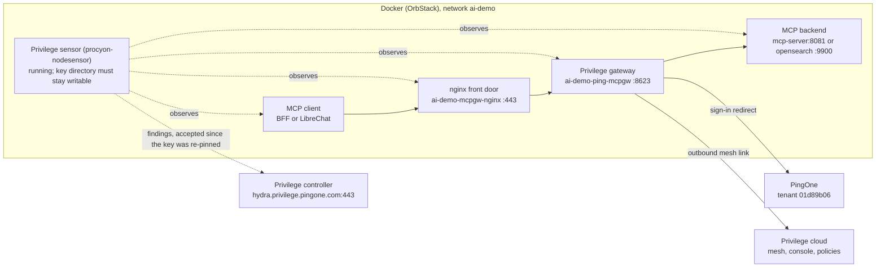

# Privilege Sensor and Gateway on Docker: Our Environment

Oct 1, 2026 · Curtis Muir

## Contents

- [Overview](#overview)
- [Topology](#topology)
- [Request path](#request-path)
- [Identity and tokens](#identity-and-tokens)
- [Configuration](#configuration)
  - [Gateway and front door (compose profile `mcpgw`)](#gateway-and-front-door-compose-profile-mcpgw)
  - [Backends in the same stack](#backends-in-the-same-stack)
  - [Privilege console](#privilege-console)
  - [Pointing the BFF at the local gateway](#pointing-the-bff-at-the-local-gateway)
  - [Sensor](#sensor)
  - [Sensor identity: where the sub comes from](#sensor-identity-where-the-sub-comes-from)
- [Verifying it works](#verifying-it-works)
- [Known failure modes](#known-failure-modes)
- [Sensor startup failure: how it was found and fixed](#sensor-startup-failure-how-it-was-found-and-fixed)
  - [Symptom](#symptom)
  - [How it was found](#how-it-was-found)
  - [Fix, part 1: writable key directory](#fix-part-1-writable-key-directory)
  - [Fix, part 2: re-pin the key](#fix-part-2-re-pin-the-key)
  - [This can happen again](#this-can-happen-again)
  - [Lasting fix: key on a named volume](#lasting-fix-key-on-a-named-volume)

## Overview

This is the record of our own setup: the local gateway loop, our values, and the 2026-10-01 sensor failure and fix. For setup steps, how the sensor works and generic troubleshooting, use *Privilege Sensor on Docker: Guide*.

The sensor watches; the gateway carries. An MCP call leaves one container in our Docker stack, passes through the Privilege gateway running in the same stack, and lands on an MCP server container beside it. The Privilege sensor sits outside that path and reports what it sees to the Privilege controller.

State measured on 2026-10-01:

| Piece | State | Evidence |
| --- | --- | --- |
| Local gateway (`ai-demo-ping-mcpgw`) | Running, enrolled, node Active in mesh cluster `ai-demo-mine` | Gateway log; tokenless `POST /MCP-aidemo/mcp` answers 401 with an OAuth challenge |
| Front door (`ai-demo-mcpgw-nginx`) | Running on host port 443 | `docker ps` |
| Sensor (`procyon-nodesensor`) | **Running and reporting since 20:39 UTC; crash-looped before that** | Log shows `reported findings sent=2 accepted=2`. Earlier: 22 restarts, every log line was `open /etc/procyon/nodesensor-signing.pem: read-only file system` |
| BFF default door | Points at the SE cluster gateway, not the local one | `PRIVILEGE_MCPGW_URL=https://mcpgw.ai-demo.ping-devops.com/opensearch22/mcp` |

Two things to carry away. The Docker-to-same-Docker loop exists but is not what the BFF calls by default. And the sensor only authenticates while its signing key file survives; the key now lives on a named volume after a startup failure traced to that file (see Sensor startup failure).

The sensor container is not defined anywhere in the repo. It was started by hand on 2026-10-01; the only sensor install in the repo is the Helm daemonset in `k8s/deploy.sh`, for the OrbStack Kubernetes copy that is currently scaled to zero.

## Topology



Solid arrows are the call path and the gateway's two outbound links; dashed lines are the sensor's observation and its report to the controller. Responses return along the same solid path.

## Request path

Every hop stays on the `ai-demo` compose network. The only traffic that leaves the machine is the gateway's outbound link to the Privilege mesh and the browser sign-in at PingOne.

1. **Client container calls the front door.** The BFF (`ai-demo-api-server`) or LibreChat sends MCP `initialize` to `https://mcpgw.local.ping-devops.com/<app>/mcp`. Inside Docker that name resolves through a network alias on the nginx container, not through `/etc/hosts`.
2. **nginx terminates TLS and forwards.** `ai-demo-mcpgw-nginx` listens on 443 with the mkcert wildcard pair and proxies to `http://ping-mcpgw:8623`, buffering off and a 3600 s read timeout for the streaming transport.
3. **The gateway challenges.** With no bearer, `ai-demo-ping-mcpgw` answers 401 with `WWW-Authenticate: Bearer realm="MCP OAuth Server"` naming its own `authorization_uri` and protected-resource metadata.
4. **The client signs in through the gateway.** It registers dynamically (RFC 7591), runs PKCE against the gateway's `/<app>/authorize`, and the gateway sends the browser to PingOne using the OIDC settings in `pingone.env`.
5. **The gateway checks policy.** It resolves the user and looks for an unexpired policy on that Agentic App. No policy, or an expired one, is a bare 403 and the backend is never dialled.
6. **The gateway dials the backend container.** It forwards the JSON-RPC call to the backend URL registered for the app in the Privilege console, another container on the same network.
7. **The response returns the same way.** The gateway records the session and streams the result back through nginx to the caller.

The sensor takes no part in steps 1 to 7. It runs in the host PID namespace with eBPF capabilities, reads `/sys` and Docker's container metadata, and is meant to report the processes and connections above to `hydra.privilege.pingone.com:443`.

The `/<app>/mcp` path form was measured today: `/mcp` alone answers a plain 404 on this gateway, while `/MCP-aidemo/mcp` answers the 401 challenge. A tokenless 401 does not prove the app name exists; the gateway checks the bearer before it checks the app.

## Identity and tokens

The gateway trusts only tokens it issued itself. A PingOne-issued token sent straight to the front door fails with `token_not_found`, whatever its signature, audience or scope.

| Hop | Credential on the wire | Who checks it |
| --- | --- | --- |
| Client to nginx to gateway | Bearer minted by the gateway's own `/token` after DCR and PKCE | Gateway, against its in-memory token registry |
| Gateway to PingOne (sign-in) | Authorization code flow with the OIDC client in `pingone.env` | PingOne, tenant `01d89b06` |
| Gateway to backend container | Depends on the app's Auth Mode: **None** sends no `Authorization` at all; **Static Token** sends the configured token | Backend |
| Sensor to controller | Workload identity minted for audience `priv-nhi-if7j67ht4l2h5bbvceax3tejiukbpus3`, signed with a key the sensor writes to `/etc/procyon` | Privilege controller |

Four rules follow from that table:

- **The backend must accept an anonymous caller.** Under Auth Mode None nothing arrives in the bearer slot. `mcp-server` exposes a separate plaintext listener on `:8081` for this hop and runs with `MCP_AUTH_DISABLED=true`; the gateway is the enforcement point.
- **Custom request headers survive the hop unchanged.** Measured 2026-09-10 on the SE gateway. This is how a user's exchanged token can ride along beside an empty bearer slot.
- **The DCR registry is in memory.** Restarting the gateway invalidates every registered client. The BFF re-registers by itself; standalone MCP clients must be removed and re-added.
- **A 403 is a valid answer.** Policies are per Agentic App and time-boxed. An expired policy and a missing one look identical.

## Configuration

Three places hold the configuration: compose (profile `mcpgw`), the gateway's own files under `ping-mcpgw/procyon/`, and the Privilege console. The sensor is a fourth, and it lives outside the repo.

### Gateway and front door (compose profile `mcpgw`)

| Setting | Value | Where |
| --- | --- | --- |
| Gateway image | `public.ecr.aws/s7q1z8z4/privilege-mcpgw`, pinned by digest | `docker-compose.yml`, service `ping-mcpgw` |
| Gateway command | `/procyon/bin/mcpgw -hostname local.ping-devops.com -mcpconfpath /var/lib/procyon/config/pingone.env` | same |
| Enrollment token | `ENV_PROXY_TOKEN` | `ping-mcpgw/procyon/config/proxy-token.env` (gitignored) |
| OIDC settings | `SERVER_URL`, `OIDC_CLIENT_ID`, `OIDC_CLIENT_SECRET`, `OIDC_AUTH_URL`, `OIDC_TOKEN_URL`, `OIDC_USER_URL`, `OIDC_SCOPES` | `ping-mcpgw/procyon/config/pingone.env` |
| Enrollment state | Named volumes `mcpgw-ssl`, `mcpgw-logs`, `mcpgw-recordings` | Losing `mcpgw-ssl` re-enrolls as a brand-new gateway |
| Gateway ports | 8623 MCP and OAuth, 8680 mesh, 8690 medusa, 8620 agentless API | Published on the host |
| Front door | nginx on host 443, upstream `http://ping-mcpgw:8623` | `demo_mcpgw_nginx/nginx.conf` |
| In-network names | `mcpgw.local.ping-devops.com`, `MCP-aidemo.mcpgw.local.ping-devops.com`, `aidemo.mcpgw.local.ping-devops.com`, `mcp-pingone-admin.mcpgw.local.ping-devops.com` | Network aliases on `mcpgw-nginx` |
| TLS | mkcert wildcard pair from `scripts/ensure-mcpgw-certs.sh` | `certs/` (gitignored) |

`SERVER_URL` must be the nginx front door, because the gateway advertises it in the 401 challenge and a browser has to reach it.

### Backends in the same stack

| Backend | URL to register in the console | Notes |
| --- | --- | --- |
| Banking MCP server | `http://mcp-server:8081/mcp` | Plaintext Privilege listener (`MCP_PRIVILEGE_PORT`); `:8080` is the mTLS gateway hop and will not work here |
| OpenSearch MCP server | `http://opensearch-mcp-server:9900/mcp` | Sample backend, profile `mcpgw` |

Both answered a tokenless `initialize` with 200 from inside the network today. Register on `/mcp`, never `/sse`: the gateway discovers by POSTing `initialize`, and it pins the client entry path to whatever the backend URL ends in.

### Privilege console

These are console objects and cannot be read or changed from the repo: the gateway registration in mesh cluster `ai-demo-mine`, one Agentic App per backend (type MCP Server, Auth Mode None, Agent Privilege selected), and a policy on each app naming the user. Policies are time-boxed.

### Pointing the BFF at the local gateway

The BFF reads `PRIVILEGE_MCPGW_URL` from `demo_api_server/.env`. Today it holds the SE cluster URL. For the same-Docker loop it needs the local front door and app, for example `https://mcpgw.local.ping-devops.com/<app>/mcp`.

### Sensor

Running container, as recreated on 2026-10-01 at 20:26 UTC:

| Setting | Value |
| --- | --- |
| Image | `public.ecr.aws/v2s2h8i9/procyon-nodesensor` (built 2026-09-27) |
| Arguments | `-docker -cluster mcpgw-ai-demo.ping-devops.com:8680 -controller hydra.privilege.pingone.com:443 -mint-audience priv-nhi-if7j67ht4l2h5bbvceax3tejiukbpus3` |
| PID namespace | host |
| Capabilities | `CAP_BPF`, `CAP_PERFMON`, `CAP_KILL` |
| Mounts | `/sys`, `/var/lib/docker/containers`, `/etc/procyon` as the named volume `procyon-nodesensor-key`; the first two read-only, `/etc/procyon` writable |
| Network | default bridge, not `ai-demo` |
| Restart policy | always |

The `-cluster` value does not need to match the gateway's mesh cluster (`ai-demo-mine`). It is only a label stamped on events, and the source of the identity's subject, as the next section shows.

**Our sensor is under an enforce-mode policy.** It was started with enforcement off, and ten seconds later logged `applied enforcement policy mode=enforce rules=2`, sent from the Privilege console. It reports `tier=terminate`, so it can terminate processes on this host that match those two rules. As of 2026-10-02 it had terminated none (`killed=0 would_kill=0`). The rules themselves are only visible in the console and were not reviewed.

Most of its connection findings here are metrics scrapes: Prometheus polling the containers named `llm-proxy` and `langchain-agent` is flagged as LLM traffic on the host name alone.

### Sensor identity: where the sub comes from

The subject is derived, not chosen: it is `nodesensor:` plus the `-cluster` value. A Docker host has no Kubernetes ServiceAccount, so the sensor signs its own workload token and Privilege verifies it against a pinned public key.

1. **Print the registration details.** Run the sensor image once with `-docker -cluster mcpgw-ai-demo.ping-devops.com:8680 -mint-jwks`. It creates a signing key at `/etc/procyon/nodesensor-signing.pem` and prints the issuer, subject and public JWKS.
2. **Register the identity in the Privilege console.** Paste the printed values rather than typing them.
3. **Copy the audience back.** Privilege generates an audience for the identity; it goes into the run command as `-mint-audience`.
4. **Run the sensor with the same `-cluster`.** A different value changes the sub and the token is rejected.

The identity as registered (console form, 2026-10-01):

| Field | Value | Comes from |
| --- | --- | --- |
| Name | `docker-cmuir` | Chosen |
| Token issuer type | Docker Host, Self-Signed Token | Display only |
| Issuer (`iss`) | `https://privilege.local/nodesensor` | Sensor default; changes only with `-mint-issuer` |
| Subject (`sub`) | `nodesensor:mcpgw-ai-demo.ping-devops.com:8680` | `nodesensor:<cluster>`; overridable with `-mint-subject` |
| Key source | Paste Keys, one EC P-256 (ES256) key; kid was `IScYr88SGP6ZTF4tqv0g1BCcz-mES6RR5IdTDe7r7_Q` | Printed by `-mint-jwks` |
| Audience (`aud`) | `priv-nhi-if7j67ht4l2h5bbvceax3tejiukbpus3` | Generated by Privilege |
| Permissions | `shadowai:write`, `policy:read`, `llm`, `mcp`, `a2a` | Chosen; reporting findings needs only `shadowai:write` |
| End user | None, the identity is the only principal | Chosen |

Tokens last 10 minutes by default (`-mint-lifetime`), which must not exceed the identity's maximum lifetime.

The Kubernetes install differs: there the sub is the projected ServiceAccount, `system:serviceaccount:ai-demo:privilege-sensor`, with its own audience, and nothing is self-signed.

**The pinned key changes whenever the key file is lost.** The kid in the table is the original one, and its key file no longer exists. The identity now pins kid `MPQNO2F1MW9snsyjXUH074TYYXXoujz-5f6ex7wvuCY`, created during the fix. Each time the key file is recreated, re-run `-mint-jwks` and paste the new JWKS into the identity, or the controller rejects every token.

## Verifying it works

Run these in order; each one isolates a single hop. Replace `<app>` with the Agentic App name from the console.

1. **Containers are up.** The sensor must read `Up`, not `Restarting`.

   ```bash
   docker ps --format '{{.Names}}\t{{.Status}}' | grep -E 'mcpgw|nodesensor|mcp-server'
   ```
2. **The gateway is enrolled.** Look for `NodeStatus:Active`. The repeating `this node and ... has same NodeURL` error is cosmetic.

   ```bash
   docker exec ai-demo-ping-mcpgw sh -c 'grep -a NodeStatus /var/log/procyon/cyonproxy.log | tail -n 1'
   ```
3. **The front door challenges.** Expect 401 and a `WWW-Authenticate: Bearer realm="MCP OAuth Server"` header. A 404 means the path is missing its app segment.

   ```bash
   curl -sk -i -X POST https://mcpgw.local.ping-devops.com/<app>/mcp \
     --resolve mcpgw.local.ping-devops.com:443:127.0.0.1 \
     -H 'content-type: application/json' \
     -d '{"jsonrpc":"2.0","id":1,"method":"initialize","params":{"protocolVersion":"2025-03-26","capabilities":{},"clientInfo":{"name":"probe","version":"0"}}}'
   ```
4. **The BFF container can reach the front door by name.** Expect an address on the compose network.

   ```bash
   docker exec ai-demo-api-server getent hosts mcpgw.local.ping-devops.com
   ```
5. **The backend answers from inside the network.** Expect `HTTP/1.1 200 OK`.

   ```bash
   docker exec ai-demo-mcpgw-nginx wget -q -S -O /dev/null \
     --header='content-type: application/json' \
     --header='accept: application/json, text/event-stream' \
     --post-data='{"jsonrpc":"2.0","id":1,"method":"initialize","params":{"protocolVersion":"2025-03-26","capabilities":{},"clientInfo":{"name":"probe","version":"0"}}}' \
     http://mcp-server:8081/mcp
   ```
6. **A signed-in call completes.** Open `/privilege-mcp-client` on `https://local.ping-devops.com:4000`, point it at the local front door, sign in, and run `tools/list` then one tool. Sign-in only works on that host.
7. **The gateway logged the call.** Expect `has policy based capabilities` for a permit, or `policy denied` for a 403.

   ```bash
   docker exec ai-demo-ping-mcpgw sh -c 'grep -a -E "\[mcpgw\]|policy" /var/log/procyon/cyonproxy.log | tail -n 20'
   ```
8. **The sensor reported it.** Its log should show findings accepted by the controller, and the workload should appear in the Privilege console.

   ```bash
   docker logs --tail 50 procyon-nodesensor
   ```

Measured 2026-10-01: steps 1 to 5 pass for the gateway, front door and both backends. Steps 1 and 8 pass for the sensor since the fix at 20:39 UTC. Steps 6 and 7 were not run against the local gateway.

## Known failure modes

| Symptom | Cause | What to do |
| --- | --- | --- |
| Sensor `Restarting`, log repeats `open /etc/procyon/nodesensor-signing.pem: read-only file system` | `/etc/procyon` is bind-mounted read-only, and the sensor needs to write its signing key there | Recreate the container with that mount writable. Then re-pin the JWKS (see Sensor identity). **Fixed 2026-10-01; see Sensor startup failure.** |
| Front door answers `404 page not found` | Path has no app segment; this build serves `/<app>/mcp`, not `/mcp` | Add the app name to the path |
| Bare 404 with a valid token | Path is outside the app's pinned entry path, for example an app registered on `/sse` | Re-register the backend on `/mcp`; the log line is `rejecting /mcp on app <app>: outside entry path` |
| 403 in under 100 ms, no backend hop | Policy missing or its time-box expired | Renew the policy in the console. Not a code fault |
| Console shows `Gateway Unreachable` or `Unauthorized` on discovery | Usually the same expired policy, reported misleadingly | Check the policy time-box first |
| 401 `token_not_found` with a PingOne token | The gateway accepts only tokens it minted | Let the client run the gateway's own DCR and PKCE flow |
| Every client fails after a gateway restart | DCR registry is in memory | BFF recovers by itself; remove and re-add other clients |
| Backend answers 401 `Bearer token required` | Auth Mode None forwards no bearer and the backend demands one | Use the `:8081` listener with `MCP_AUTH_DISABLED=true`, or Auth Mode Static Token |
| BFF call lands in the SE cluster instead of local Docker | `PRIVILEGE_MCPGW_URL` holds the SE URL | Set it to the local front door |
| BFF cannot resolve the front door host | Name exists only in the host's `/etc/hosts` | Add it to the `mcpgw-nginx` network aliases |
| App saved but produces no gateway log lines | Console left Agent Privilege on `Select Gateway...` | Reselect the gateway on the app |
| LibreChat doors fail with `No OAuth metadata ... localhost:3005` | `librechat` restarted without its `oauth-loopback` sidecar | Restart the sidecar after LibreChat |
| Steady 404 and 503 noise in BFF and LLM logs from the Docker gateway address | The Privilege desktop agent on the Mac scans local LLM ports about every 30 s | Ignore; it is a separate product from the sensor |

## Sensor startup failure: how it was found and fixed

The sensor would not start because its key directory was mounted read-only. Fixing the mount exposed a second failure, a key mismatch at the controller. Both are fixed; one cause can recur.

### Symptom

`docker ps` showed `procyon-nodesensor` as `Restarting (1)`, with 22 restarts. Nothing from this host appeared in Privilege.

### How it was found

1. **Read the log.** Every line was the same: `open /etc/procyon/nodesensor-signing.pem: read-only file system`.
2. **Read the sensor's help.** `-mint-key` defaults to that path and is "created on first use". The sensor has to write the file on its first start.
3. **Inspected the container.** The bind was `/etc/procyon:/etc/procyon:ro`. The same directory accepted a write when mounted without `:ro`, so the host side was not the problem.
4. **Changed one variable.** A one-off run with the same flags and a writable scratch volume created the key and printed its registration details. With `:ro` it failed the same way as the real container.
5. **Ruled out the kernel.** `-probe` reported `bpf=true perfmon=true`, with BTF and ring buffers available on the OrbStack kernel.

```bash
docker inspect procyon-nodesensor --format '{{.HostConfig.Binds}}'
docker run --rm --pid=host --cap-add BPF --cap-add PERFMON --cap-add KILL \
  -v /sys:/sys:ro -v /var/lib/docker/containers:/var/lib/docker/containers:ro \
  -v /etc/procyon:/etc/procyon \
  public.ecr.aws/v2s2h8i9/procyon-nodesensor -docker -probe
```

### Fix, part 1: writable key directory

The container was removed and recreated with identical arguments, except `/etc/procyon` is mounted writable. It started at 20:26 UTC with 0 restarts and logged its initial inventory: 201 processes, 2 findings.

```bash
docker rm -f procyon-nodesensor
docker run -d --name procyon-nodesensor --restart always --pid=host \
  --cap-add BPF --cap-add PERFMON --cap-add KILL --security-opt label=disable \
  -v /sys:/sys:ro \
  -v /var/lib/docker/containers:/var/lib/docker/containers:ro \
  -v /etc/procyon:/etc/procyon \
  public.ecr.aws/v2s2h8i9/procyon-nodesensor \
  -docker -cluster mcpgw-ai-demo.ping-devops.com:8680 \
  -controller hydra.privilege.pingone.com:443 \
  -mint-audience priv-nhi-if7j67ht4l2h5bbvceax3tejiukbpus3
```

### Fix, part 2: re-pin the key

Once running, every report failed with `rpc error: code = Unauthenticated desc = authentication failed`, 74 times in 13 minutes. The identity in the console still pinned the original key, and that key file existed nowhere on the machine, so the sensor had made a new one.

The new JWKS was printed with `-mint-jwks` against the same directory and pasted into the identity (Paste Keys). Issuer, subject and audience did not change. No restart was needed: the sensor resends findings on its next flush, and the first accepted report was logged at 20:39:15 UTC.

```bash
docker run --rm -v /etc/procyon:/etc/procyon \
  public.ecr.aws/v2s2h8i9/procyon-nodesensor \
  -docker -cluster mcpgw-ai-demo.ping-devops.com:8680 -mint-jwks
```

### This can happen again

`/etc/procyon` is a path inside the OrbStack virtual machine, not on the Mac. The machine's root filesystem is an overlay whose writable layer sits on `/run`, a tmpfs, so the key file is held in memory. An OrbStack restart would have discarded it. That is the likely reason the original key was missing. The restart itself was not tested.

What it will look like next time:

| Mount at restart | Symptom | Fix |
| --- | --- | --- |
| Writable, key lost | Sensor runs but logs `report failed ... Unauthenticated`; findings stop arriving | Re-run `-mint-jwks`, paste the new JWKS into the identity |
| Read-only | Sensor crash-loops on `read-only file system` | Recreate with the mount writable, then re-pin |

### Lasting fix: key on a named volume

Done on 2026-10-01 at 20:55 UTC. The key was copied from `/etc/procyon` into a named Docker volume, `procyon-nodesensor-key`, and the sensor was recreated with that volume mounted at `/etc/procyon`. Because the same key file was carried over, the kid did not change and no re-pin was needed. The first report after the move was accepted, with no failures.

```bash
docker volume create procyon-nodesensor-key
docker run --rm -v /etc/procyon:/src:ro -v procyon-nodesensor-key:/dst alpine \
  cp -p /src/nodesensor-signing.pem /dst/
# then recreate the sensor as in Fix, part 1, with
#   -v procyon-nodesensor-key:/etc/procyon
# in place of  -v /etc/procyon:/etc/procyon
```

Docker volumes live on OrbStack's data disk, not the in-memory layer, so the key should now survive an OrbStack restart. That restart has still not been tested. The key is lost again if the volume is deleted, for example by `docker volume prune` while the sensor container does not exist; the recovery is the re-pin above.

Two habits that hid this at first: the sensor is not in compose, so nothing in the repo shows its mounts; and a container on `--restart always` looks alive in a quick `docker ps` unless the status column is read.

Sources: `docker-compose.yml`, `demo_mcpgw_nginx/nginx.conf`, `k8s/deploy.sh`, `privilege/CURRENT-CONFIGURATION.md`, `privilege/README.md`, plus live `docker inspect`, container logs and probes taken 2026-10-01.
