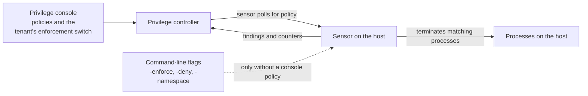

# Privilege Sensor: Enforcement Policies

Oct 3, 2026 · Curtis Muir

## Contents

- [Overview](#overview)
- [What was tested](#what-was-tested)
- [How a policy reaches the sensor](#how-a-policy-reaches-the-sensor)
- [The three modes](#the-three-modes)
- [What a policy rule contains](#what-a-policy-rule-contains)
- [Scope: which workloads a rule applies to](#scope-which-workloads-a-rule-applies-to)
- [What termination looks like](#what-termination-looks-like)
- [Whether a host can enforce](#whether-a-host-can-enforce)
- [Trying it safely](#trying-it-safely)
- [Verifying](#verifying)
- [Quick lookup](#quick-lookup)

## Overview

The Privilege sensor does more than report the AI workloads it finds. It can also **terminate processes** that a policy denies. The policy normally comes from the Privilege console, so a sensor that was started as an observer can begin enforcing without anyone touching the host.

Four things to know before you rely on it or worry about it:

- **Enforcement means killing a process.** The sensor does not block a process from starting. It lets it start and terminates it straight away.
- **It also kills what is already running.** When an enforcing policy arrives, matching processes that were started earlier are terminated too.
- **The console decides, not the command line.** A sensor started with enforcement off will apply an enforcing policy the console sends.
- **Try audit mode first.** It counts what would have been terminated and terminates nothing.

For installing the sensor and reading its findings, see the sensor guides for Docker and Kubernetes. This guide covers enforcement only.

Placeholders used: `<sensor-container>` and `<process-name>`.

## What was tested

Tested on 3 October 2026 on one Docker host. The enforcement tests used a second, throwaway sensor with no controller, driven by its own command-line flags, and a harmless test program. The console-side facts were read from the running sensor's log and from the audit record of saved policies.

| Claim | Result |
| --- | --- |
| A sensor started with enforcement off applies a policy from the console | Seen in the log: `enforce=off` at start, then `applied enforcement policy mode=enforce rules=2` ten seconds later |
| With enforcement off, a denied process runs normally | Reproduced: exit code 0, counters at zero |
| In audit mode a denied process runs and is counted | Reproduced: exit code 0, `would_kill=1` |
| In enforce mode a denied process is terminated | Reproduced: exit code 137, `killed` counted |
| A denied process already running when the sensor starts is terminated | Reproduced: `terminated processes already running when policy applied count=1` |
| A process with a different name is untouched | Reproduced |
| Terminating does not need the `KILL` capability | Reproduced with only `BPF` and `PERFMON` |
| The sensor refuses to start in enforce mode with no scope | Reproduced, with the message quoted below |
| On Docker, scoping enforcement to one container by name did not act | Reproduced: nothing was terminated in that container or any other |
| The fields of a console policy, and its four actions | Read from the audit record of 21 saved policies |
| The two policies live on the tested tenant contain no deny rule, and the sensor has terminated nothing | Read from the audit record and from `killed=0 would_kill=0` |

Not tested: a deny rule sent from the console, the Warn and Monitor actions, rules that match on path, host or tool, a policy change arriving while the sensor runs, and anything on Kubernetes.

## How a policy reaches the sensor



A sensor with a controller address fetches its policy shortly after it starts. On the tested host that took ten seconds:

```text
msg="nodesensor: started" tier=terminate ... enforce=off
msg="nodesensor: applied enforcement policy" mode=enforce rules=2 rev=<hash>
```

Read those two lines together. The first shows what the command line asked for. The second shows what the sensor is now doing. If they differ, the console won.

- `mode` is the mode now in force.
- `rules` is how many rules the sensor received.
- `rev` is a hash of the policy. It stays the same while the policy is unchanged, so a new value means a new policy arrived.

On the tested tenant, the tenant's settings had Shadow AI enforcement turned on, and the sensor reported `mode=enforce`. That switch is the likely source of the mode, but turning it off was not tested.

A sensor with no controller address uses its command-line flags only.

## The three modes

| Mode | What happens to a denied process | Counter that rises |
| --- | --- | --- |
| `off` | Nothing. It runs. | Neither |
| `audit` | It runs. The sensor counts it. | `would_kill` |
| `enforce` | It is terminated. | `killed` |

The counters appear in the sensor's `stats` line, written every 30 seconds:

```text
msg="nodesensor: stats" read=152 reported=2 kernel_drops=0 pods=1 tracked=11 killed=0 would_kill=1
```

Audit mode is the safe way to learn what a policy would do. Run it for as long as it takes to see a normal working day, and check that `would_kill` counts only what you expect.

On the command line the mode is `-enforce off`, `-enforce audit` or `-enforce enforce`. The default is `off`.

## What a policy rule contains

A policy in the console is a **Shadow AI policy**. Each one has an action and a description of what it matches.

| Field | What it holds | Examples seen |
| --- | --- | --- |
| Action | What to do on a match | Allow, Deny, Monitor, Warn |
| Kinds | The kind of workload | `agent`, `llm`, `mcp` |
| Names | Workload or process names. `*` is a wildcard. | `python`, `llama-server`, `claude*`, `*` |
| Process paths | The full path of a program | The path to a desktop application |
| Hosts | Destination hosts | Not seen in use |
| Tools | Tool names | Not seen in use |
| Namespaces, or all namespaces | Where the rule applies | All namespaces |
| Users, groups, workload identities | Who the rule applies to | One group |
| Disabled | Switches the rule off without deleting it | |

Only Deny leads to termination. On the tested tenant the two live policies were one Allow and one Monitor, both for all namespaces. The sensor had received both (`rules=2`), was in enforce mode, and had terminated nothing, because neither rule denies.

That combination is easy to misread. `mode=enforce` in the log does not mean anything is being terminated. It means a deny rule would be acted on if one existed.

**Be careful with wildcards.** Among the deleted policies on the tested tenant were two Deny rules with the name `*`. A rule like that, scoped to all namespaces and sent to a sensor in enforce mode, would match every workload of that kind on the host.

## Scope: which workloads a rule applies to

A rule acts only inside its scope: a list of namespaces, or all of them. On Kubernetes a namespace is a Kubernetes namespace. On Docker the sensor treats each container's name as its namespace.

On the command line the scope is `-namespace <name,name>` or `-all-namespaces`.

**The sensor will not enforce with no scope.** Started in enforce mode with neither flag, it exits with:

```text
enforce: mode "enforce" with no namespaces and AllNamespaces unset would never act
```

**On Docker, scoping to one container did not work in the test.** A sensor in enforce mode, scoped to one container's name, terminated nothing, in that container or any other. The same sensor with all namespaces terminated the process in every container. The sensor's events showed the test process with no container attached, so the scope had nothing to match.

Until container attribution is reliable on your host, treat Docker enforcement as all or nothing: a deny rule either applies to every container on the host or to none.

## What termination looks like

**To the process.** It starts, then is killed. The parent sees exit code 137, the code for a process ended by a kill signal. A shell prints `Killed`.

This is termination after start, not prevention. The program does run for a moment. Do not rely on enforcement to stop something that does its damage in its first few milliseconds.

**In the sensor's log.** The text log does not say "killed" for each process. A terminated process appears as an ordinary start:

```text
2026-10-04T01:04:24Z exec    pid=1736196 denyme           host
```

Three places do show it:

- **The `killed` counter** in the next `stats` line.
- **This line, once, when a policy first applies** and finds matching processes already running:

  ```text
  msg="nodesensor: terminated processes already running when policy applied" count=1
  ```

- **The JSON event,** if the sensor runs with `-json`. It carries `"PolicyAction":"deny"`. `PolicyRule` names the rule; it was empty for a rule given on the command line.

To know which process was terminated and why, run the sensor with `-json` and search for `PolicyAction`. With the text log you only get a count.

## Whether a host can enforce

The sensor reports what the host supports as a **tier**. `tier=terminate` means it can terminate processes. The tier is in the `started` line and in the output of the probe:

```bash
docker run --rm --pid=host --cap-add BPF --cap-add PERFMON \
  -v /sys:/sys:ro public.ecr.aws/v2s2h8i9/procyon-nodesensor -docker -probe
```

```text
tier=terminate kernel=<version> cgroup=v2
btf=true ringbuf=true raw_tp_btf=true send_signal=true
caps: bpf=true perfmon=true sys_admin=false mac_admin=false sys_resource=false
```

The tier comes from the kernel's features, not from extra privileges. The tested sensor reached `tier=terminate` and terminated processes with only the `BPF` and `PERFMON` capabilities. It did not have `KILL`.

So you cannot make a sensor harmless by withholding the `KILL` capability. If the host reports `tier=terminate` and a deny rule in enforce mode reaches it, it will terminate processes. Lower tiers were not seen on the tested host.

## Trying it safely

You can test enforcement on a host without touching the console or the real sensor. Run a second sensor with no controller, so it takes its policy from flags and reports nothing, and deny a program name that exists only in your test.

1. **Start a test container with a harmless program under a unique name.**

   ```bash
   docker run -d --name enf-target debian:stable-slim \
     sh -c 'cp /bin/sleep /tmp/denyme; sleep 3600'
   ```

2. **Start the test sensor in audit mode.** The empty `-controller` value turns reporting off.

   ```bash
   docker run -d --name enf-sensor --pid=host --cap-add BPF --cap-add PERFMON \
     --security-opt label=disable -v /sys:/sys:ro \
     -v /var/lib/docker/containers:/var/lib/docker/containers:ro \
     public.ecr.aws/v2s2h8i9/procyon-nodesensor \
     -docker -cluster enforce-test -controller "" \
     -enforce audit -deny denyme -all-namespaces
   ```

3. **Run the program and read the counter.** Expect `exit=0`, then `would_kill=1` within 30 seconds.

   ```bash
   docker exec enf-target sh -c '/tmp/denyme 2; echo exit=$?'
   docker logs enf-sensor 2>&1 | grep "nodesensor: stats" | tail -n 1
   ```

4. **Repeat with `-enforce enforce`.** Remove the test sensor, start it again with the mode changed, and run the program. Expect `Killed`, `exit=137` and `killed=1`.
5. **Clean up.**

   ```bash
   docker rm -f enf-sensor enf-target
   ```

Choose the denied name with care. `-all-namespaces` applies to every container on the host, so a name like `python` would terminate real workloads. Use a name nothing else has.

## Verifying

On a sensor you already run:

1. **See what mode it is in.** The last `applied enforcement policy` line is the truth, not the `enforce=` value in the `started` line.

   ```bash
   docker logs <sensor-container> 2>&1 | grep -E "nodesensor: started|applied enforcement policy" | tail -n 4
   ```

2. **See whether it has terminated anything.**

   ```bash
   docker logs <sensor-container> 2>&1 | grep "nodesensor: stats" | tail -n 1
   ```

3. **Check the tier.** `tier=terminate` in the `started` line means it can.
4. **Read the policies in the console** and look for any with the Deny action. With none, an enforcing sensor terminates nothing.

## Quick lookup

| Symptom | Most likely cause | Fix |
| --- | --- | --- |
| A sensor started as an observer logs `mode=enforce` | The console sent an enforcing policy | Check the tenant's enforcement setting and its policies |
| `mode=enforce` but nothing is terminated | No rule has the Deny action, or no rule's scope matches | Expected; check the policies before assuming it is safe |
| Processes die with exit code 137 or print `Killed` | A deny rule in enforce mode matched them | Find the rule; run the sensor with `-json` and search for `PolicyAction` |
| A long-running process died when the sensor started | Matching processes already running are terminated when a policy applies | Use audit mode before enforce |
| The log shows no sign of a termination | The text log only counts them | Read `killed` in the `stats` line, or use `-json` |
| The sensor exits at once in enforce mode | No scope was given | Add `-namespace` or `-all-namespaces` |
| Scoping to one container on Docker terminates nothing | The process was not attributed to its container | Treat Docker enforcement as all or nothing for now |
| Removing the `KILL` capability did not stop terminations | Termination does not use it | Change the policy or the mode instead |
| `would_kill` is rising | Audit mode is counting matches | Review them before switching to enforce |
