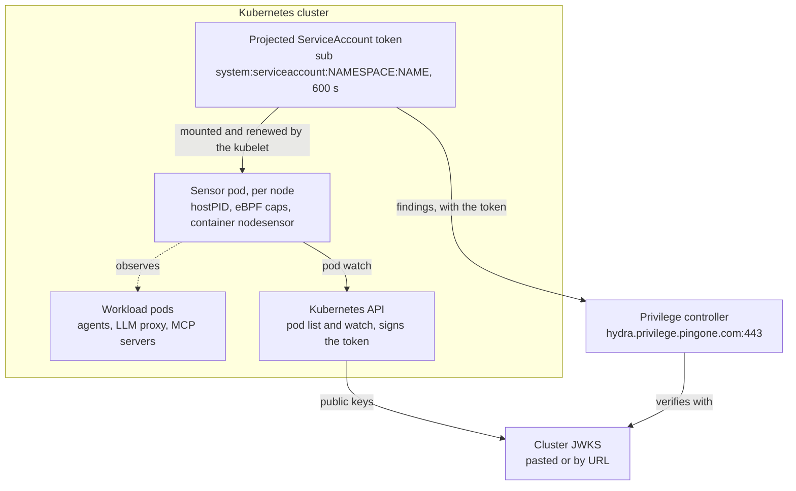

# Privilege Sensor on Kubernetes: Guide

Oct 1, 2026 · Curtis Muir

## Contents

- [Overview](#overview)
- [Setting up the sensor on your own cluster](#setting-up-the-sensor-on-your-own-cluster)
- [How the sensor works](#how-the-sensor-works)
  - [What it hooks](#what-it-hooks)
  - [What it does with an event](#what-it-does-with-an-event)
  - [What the log lines mean](#what-the-log-lines-mean)
  - [It can also enforce](#it-can-also-enforce)
- [Topology](#topology)
- [Sensor identity: where the sub comes from](#sensor-identity-where-the-sub-comes-from)
- [Configuration](#configuration)
  - [Values you must set](#values-you-must-set)
  - [Chart defaults that matter](#chart-defaults-that-matter)
- [Getting more logging from the sensor](#getting-more-logging-from-the-sensor)
  - [Shipping the logs](#shipping-the-logs)
- [Verifying it works](#verifying-it-works)
- [Known failure modes](#known-failure-modes)

## Overview

On Kubernetes the Privilege sensor is a Helm-installed daemonset, one pod per node, that watches workloads and reports AI activity to the Privilege controller. It observes from the kernel; it is not in any request path. This guide covers setting it up on any cluster, how it works, how its identity is verified, and how to tell what is wrong when it fails. Values in angle brackets are placeholders for your own.

For a plain Docker host, use the companion guide, *Privilege Sensor on Docker: Guide*.

The biggest difference is identity. On Docker the sensor creates and keeps its own signing key. On Kubernetes the cluster signs a short-lived ServiceAccount token for it, so there is no key file to lose and nothing to re-pin after a restart.

|  | Docker | Kubernetes |
| --- | --- | --- |
| Install | `docker run` | `helm upgrade --install` |
| Shape | One container on the host | Daemonset, one pod per node |
| Subject (`sub`) | `nodesensor:<cluster>` | `system:serviceaccount:<namespace>:<serviceaccount>` |
| Signing key | Sensor's own file in `/etc/procyon` | The cluster's ServiceAccount signing key |
| Key source in the console | Paste Keys, from `-mint-jwks` | The cluster's JWKS |
| Persistent storage needed | Yes, a volume for the key | No |
| Workload attribution | Container name becomes the namespace | Real pod, namespace and labels |
| Extra permissions | None | Cluster-wide read on pods |
| Flags | Typed on the command line | Helm values under `flags.*` |

**Basis for this guide.** The install and configuration sections come from the chart itself (`procyon-nodesensor-chart` 0.1.11). The behaviour in How the sensor works was observed on a Docker host running the same sensor binary. The steps were not exercised end to end on a live cluster.

## Setting up the sensor on your own cluster

Three things have to line up: the subject registered in Privilege, the audience Privilege generates, and a way for Privilege to get the cluster's signing keys.

1. **Decide the namespace and ServiceAccount name.** Together they are the subject, so fix them before registering. The chart's default ServiceAccount name is `procyon-nodesensor`.
2. **Register the identity in the Privilege console.** Subject: `system:serviceaccount:<namespace>:<serviceaccount>`. Issuer: your cluster's ServiceAccount issuer. Keys: the cluster's JWKS (see Sensor identity for how to get both). Reporting findings needs only the `shadowai:write` permission.
3. **Copy the audience the console generates.** It looks like `priv-nhi-...`.
4. **Install the chart.**

   ```bash
   helm upgrade --install procyon-nodesensor \
     oci://public.ecr.aws/v2s2h8i9/procyon-nodesensor-chart \
     --version 0.1.11 \
     --namespace <namespace> \
     --set-string clusterID=<your-cluster-label> \
     --set-string auth.audience=<priv-nhi-audience-from-console> \
     --set controller.enabled=true \
     --set-string serviceAccount.name=<serviceaccount> \
     --set-string controller.endpoint=hydra.privilege.pingone.com:443
   ```
5. **Wait for the rollout.**

   ```bash
   kubectl -n <namespace> rollout status \
     daemonset/procyon-nodesensor-procyon-nodesensor-chart --timeout=180s
   ```
6. **Confirm it reports.** Expect `reported findings sent=N accepted=N`.

   ```bash
   kubectl -n <namespace> logs -l app.kubernetes.io/instance=procyon-nodesensor --tail=20
   ```

`controller.enabled` defaults to `false` in the chart. Without it the sensor runs and logs findings locally but reports nothing.

The sensor does not generate traffic. To give it something to find, run a real inference request through a workload in the cluster.

## How the sensor works

The sensor attaches small programs to the Linux kernel and watches; it does not sit in the network path and it does not start other pods. The daemonset runs one pod per node, each with one container and one process. Its only Kubernetes permission is to read pods.

Each pod runs with `hostPID`, so it sees the processes of every pod on its node, not only its own.

The sensor binary and its behaviour are the same as on Docker. What follows was observed on a Docker host; only the attribution step differs on a cluster.

### What it hooks

The sensor loads three eBPF programs:

| Kernel hook | What it sees |
| --- | --- |
| `sched_process_exec` | Every process start: command, arguments, parent, cgroup |
| `inet_sock_set_state` | TCP connections opening, and ports being listened on |
| `tcp_sendmsg` | The first bytes sent on a connection, to read the TLS handshake and its server name |

A filter in the kernel discards events that match nothing, so only a small share reaches the sensor process. `flags.reportAll=true` bypasses that filter.

### What it does with an event

1. **Inventory at start.** It scans `/proc` once and reports AI workloads that were already running.
2. **Classify.** Each event is matched against a built-in catalog. A finding has a kind (`llm` or `mcp`), a label, and the way it matched.
3. **Attribute.** A process is tied to its pod through its cgroup and a watch on the Kubernetes API. Findings carry the pod, namespace, node, cluster ID and the label keys listed in `flags.labels`.
4. **Report.** Findings are batched and sent to the controller over gRPC about every 10 seconds, with the ServiceAccount token. A failed batch is sent again on the next flush.
5. **Poll for policy.** It fetches an enforcement policy from the controller and applies it.

How a finding can match:

| Log shows | Matched on | Example |
| --- | --- | --- |
| `via comm` | Process name | `llama-server` is llama.cpp |
| `via args` | Command-line arguments | `python -m mcp_server_...` is an MCP server |
| `via host-heuristic` | Destination host name | A connection to a Service named like an LLM service |

**The host-name match is coarse.** Any connection to a host whose name looks like an LLM service is flagged, including a metrics scrape or a health check. Expect such findings to outnumber real model calls.

### What the log lines mean

| Line starts with | Meaning |
| --- | --- |
| `running` | An AI workload found in the start-up inventory |
| `exec` | A process started |
| `tls` | An outbound connection classified as AI traffic, with its destination |
| `listen` | A process opened a listening port |
| `nodesensor: reported findings sent=N accepted=N` | A batch reached the controller |
| `nodesensor: report failed` | A batch was rejected or the controller was unreachable; it will be resent |
| `nodesensor: stats` | Running totals: kernel events read, findings reported, kernel drops, pods, processes killed |

With `flags.json=true`, each event is one JSON object. Its fields include `Kind`, `PID`, `PPID`, `UID`, `Comm`, `Filename`, `Args`, `Dest` (IP, port, host, SNI), `Pod` (UID, name, namespace, container ID and name, labels, node, cluster ID), `Finding` (kind, label, what it matched on) and `PolicyAction` with `PolicyRule`.

### It can also enforce

The sensor is not only an observer. The controller can push an enforcement policy, and the sensor applies it:

- **The policy comes from the Privilege console.** On Docker, a sensor started with enforcement off still logged `applied enforcement policy mode=enforce` when the console sent one. Do not assume `flags.enforce=off` keeps a sensor observe-only; check the console. How the chart's `flags.enforce`, `flags.namespaces` and `flags.allNamespaces` interact with a console policy was not tested.
- **Enforcing means terminating processes** that match the policy's deny rules, including ones already running when the policy arrives. The chart's own notes say to verify pod attribution before enabling audit or enforcement.
- **Whether a node can enforce is its tier,** shown by `-probe` and in the `started` log line; `tier=terminate` means it can. The tier depends on kernel support. It does not need the `KILL` capability, which the chart leaves out by default.
- **The `stats` line shows the effect:** `killed` counts terminations, and `would_kill` appears to count matches in audit mode.
- **Scope is by namespace.** `flags.namespaces` opts namespaces into enforcement and `flags.allNamespaces` applies it to all of them.

The memory guard is separate and off by default: `flags.memguard` sets a scan interval for runaway processes, and `flags.memguardKill` lets it terminate them, which is the one case where the chart adds `KILL`.

## Topology



The dashed arrow is observation; solid arrows are calls and data. The sensor sends findings with the cluster-signed token, and the controller checks that token against the cluster's public keys.

## Sensor identity: where the sub comes from

The subject is the pod's ServiceAccount: `system:serviceaccount:<namespace>:<serviceaccount>`. The chart prints the exact value in its install notes.

The kubelet projects a ServiceAccount token into the pod at `/var/run/secrets/procyon/token`, with the Privilege audience and a 600-second lifetime, and renews it. The sensor re-reads the file before every report. Nothing is self-signed and the sensor holds no key.

| Claim | Value | Comes from |
| --- | --- | --- |
| `sub` | `system:serviceaccount:<namespace>:<serviceaccount>` | Release namespace plus `serviceAccount.name` |
| `aud` | `priv-nhi-...` | Generated by Privilege; passed as `auth.audience` |
| `iss` | The cluster's ServiceAccount issuer | The cluster |
| Signature | The cluster's ServiceAccount signing key | The cluster |

Read the issuer and keys from the cluster:

```bash
kubectl get --raw /.well-known/openid-configuration
kubectl get --raw /openid/v1/jwks
```

**Privilege has to be able to verify the token.** A cloud cluster with a public OIDC issuer can be fetched by URL. A local or private cluster has an issuer Privilege cannot reach, so its JWKS has to be pasted into the identity or published at a URL Privilege can fetch.

Two rules the chart states:

- **Keep `auth.audience` unchanged on upgrades.** To rotate it, register the new audience in Privilege first, then `helm upgrade` with the new value.
- **Changing the namespace or the ServiceAccount name changes the subject.** Re-register the identity if either moves.

If the cluster rotates its ServiceAccount signing key, a pasted JWKS goes stale and has to be pasted again. This is the Kubernetes counterpart of the lost key file on Docker.

The chart also supports SPIRE (`auth.mode=spire`), where the subject becomes `spiffe://<trust-domain>/ns/<namespace>/sa/<serviceaccount>`.

## Configuration

Five values have to be set for the sensor to report; the rest can stay at chart defaults.

### Values you must set

| Helm value | Set it to | Note |
| --- | --- | --- |
| `clusterID` | A label for your cluster | Stamped on every finding; unlike on Docker it plays no part in the subject |
| `auth.audience` | The `priv-nhi-...` audience from the console | An identifier, not a secret |
| `serviceAccount.name` | The name used in the registered subject | Default `procyon-nodesensor` |
| `controller.enabled` | `true` | Default `false`; without it nothing is reported |
| `controller.endpoint` | `hydra.privilege.pingone.com:443` | The Privilege controller |

Pin the chart with `--version`; this guide was written against 0.1.11.

### Chart defaults that matter

| Setting | Default | Why it matters |
| --- | --- | --- |
| `image.tag` | `latest`, pull policy `Always` | The sensor version can change on any pod restart; pin `image.digest` to hold it |
| `pod.hostPID` | `true` | Needed to see processes outside the pod |
| Capabilities | drop `ALL`, add `BPF`, `PERFMON` | `KILL` is added only when `flags.memguard` and `flags.memguardKill` are both set |
| `securityContext.readOnlyRootFilesystem` | `true` | Safe here, because the sensor writes no key file on Kubernetes |
| `/sys` | host path, mounted read-only | eBPF and cgroup data |
| `pod.tolerations` | tolerate everything | Runs on every node, including tainted ones |
| `pod.priorityClassName` | `system-node-critical` | Scheduled ahead of ordinary workloads |
| Resources | requests 50m CPU, 128Mi; limits 300m CPU, 256Mi | An exceeded memory limit shows as restarts |
| `flags.enforce` | `off` | Detection only; the chart says to verify pod attribution before enabling audit or enforcement |
| `flags.labels` | `app`, `team`, `app-id` | Pod labels copied onto each finding |
| RBAC | ClusterRole: get, list, watch on pods | Used to attribute a process to its pod |

The daemonset is named `<release>-procyon-nodesensor-chart`, so with the release name `procyon-nodesensor` it is `procyon-nodesensor-procyon-nodesensor-chart`. The container is named `nodesensor`.

## Getting more logging from the sensor

The sensor has no log-level setting. Three Helm values increase what it logs; add them to the `helm upgrade --install` command.

| What it does | Helm value |
| --- | --- |
| Reports every process exec, bypassing the in-kernel filter. A debug flag; noisy | `--set flags.reportAll=true` |
| Emits events as JSON instead of one-line text | `--set flags.json=true` |
| Copies more pod label keys onto each event | `--set "flags.labels={app,team,app-id,<your-label>}"` |

For a sensor flag the chart does not map, `--set "extraArgs={-flag=value}"` appends raw flags.

Three cautions:

- **`reportAll` findings also go to the controller,** not only to the log. Turn it on to debug, then off again.
- **Leave `flags.noDestinations` at `false`.** It turns off outbound AI-endpoint reporting.
- **`flags.probe=true` is a one-shot diagnostic.** The sensor prints its capability check and exits, so the daemonset does not stay up with it set. Run the probe with `kubectl exec` instead (see Verifying it works).

### Shipping the logs

The sensor writes to standard output, so any collector that tails pod logs picks it up. Select it by the container name `nodesensor` or the label `app.kubernetes.io/name=procyon-nodesensor-chart`. Useful filters: `report failed` for rejected batches, `reported findings` for accepted ones.

## Verifying it works

Run these in order. They assume the release name `procyon-nodesensor`.

1. **The daemonset is rolled out.** Expect one ready pod per node.

   ```bash
   kubectl -n <namespace> get ds,pods -l app.kubernetes.io/name=procyon-nodesensor-chart -o wide
   ```
2. **The node supports the sensor.** Expect `bpf=true perfmon=true`.

   ```bash
   kubectl -n <namespace> exec ds/procyon-nodesensor-procyon-nodesensor-chart -- \
     /usr/local/bin/nodesensor -probe
   ```
3. **The token carries the right subject and audience.** Decode the payload and compare `sub`, `aud` and `iss` with the identity in the console. Do not paste the token anywhere.

   ```bash
   kubectl -n <namespace> exec ds/procyon-nodesensor-procyon-nodesensor-chart -- \
     cat /var/run/secrets/procyon/token | cut -d. -f2 | base64 -d 2>/dev/null
   ```
4. **The controller accepts reports.** Expect `reported findings sent=N accepted=N` and no `report failed`.

   ```bash
   kubectl -n <namespace> logs -l app.kubernetes.io/instance=procyon-nodesensor --tail=50
   ```
5. **Findings carry pod names.** Detection lines should name a pod and namespace, not `host`. Generate traffic first with a real inference request.
6. **The workload appears in the Privilege console** under the cluster ID.

## Known failure modes

| Symptom | Cause | What to do |
| --- | --- | --- |
| Log repeats `report failed ... Unauthenticated` | Subject, audience or keys in the console do not match the token | Decode the token (Verifying, step 3) and compare each claim with the identity |
| Worked, then `Unauthenticated` after an upgrade | `auth.audience` changed, or the namespace or ServiceAccount name changed | Restore the value, or re-register the identity with the new one |
| `Unauthenticated` from the first report on a local or private cluster | Privilege cannot fetch the cluster's JWKS from its issuer URL | Paste the JWKS into the identity, or publish it at a reachable URL |
| Worked, then `Unauthenticated` with nothing changed in Helm | The cluster rotated its ServiceAccount signing key and the pasted JWKS is stale | Paste the current JWKS |
| Sensor runs and logs findings, nothing reaches Privilege | `controller.enabled` left at its default, `false` | Set `controller.enabled=true` and `controller.endpoint` |
| Rollout does not finish | Pods are not becoming ready | `kubectl get pods -n <namespace> -l app.kubernetes.io/name=procyon-nodesensor-chart`, then read the pod's events and log |
| Findings say `host` instead of a pod | The sensor's pod watch is failing, for example because pods cannot reach the Kubernetes API | Check the sensor log for watch errors and the ClusterRole binding |
| Pods restart under load | The 256Mi memory limit was exceeded | Raise `resources.limits.memory` |
| Two sensors on one node, or the wrong subject | A second install under another release or namespace | `helm list -A` and remove the one that is not registered |
| Processes are being terminated | An enforce-mode policy arrived from the console | Review the policy in the console; the `stats` line counts `killed` |

Two differences from Docker worth remembering when debugging:

- **Scaling deployments to zero does not stop the sensor.** It is a daemonset; it keeps running until the release is uninstalled.
- **There is no key file to lose.** The read-only mount and lost-key failures of the Docker setup cannot happen here; the root filesystem is read-only on purpose.

Sources: chart `procyon-nodesensor-chart` 0.1.11 (`values.yaml`, `templates/daemonset.yaml`, `templates/rbac.yaml`, `templates/NOTES.txt`) and the sensor's own help text and log output.
