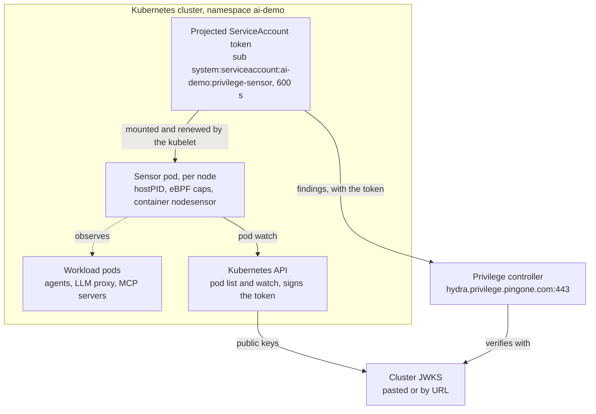

# Privilege Sensor on Kubernetes

Oct 1, 2026 · Curtis Muir

## Contents

- [Overview](#overview)
- [Setting up the sensor on your own cluster](#setting-up-the-sensor-on-your-own-cluster)
- [Topology](#topology)
- [Sensor identity: where the sub comes from](#sensor-identity-where-the-sub-comes-from)
- [Configuration](#configuration)
  - [What the repo sets](#what-the-repo-sets)
  - [Chart defaults that matter](#chart-defaults-that-matter)
- [Getting more logging from the sensor](#getting-more-logging-from-the-sensor)
  - [Logs in Loki and Grafana](#logs-in-loki-and-grafana)
- [Verifying it works](#verifying-it-works)
- [Known failure modes](#known-failure-modes)

## Overview

On Kubernetes the sensor is a Helm-installed daemonset, one pod per node, that watches workloads and reports AI activity to the Privilege controller. It observes only; it is not in any request path. This document covers what differs from the Docker setup in the companion doc, *Privilege Sensor: Docker to Docker through the Privilege Gateway*.

The biggest difference is identity. On Docker the sensor creates and keeps its own signing key. On Kubernetes the cluster signs a short-lived ServiceAccount token for it, so there is no key file to lose and nothing to re-pin after a restart.

|  | Docker | Kubernetes |
| --- | --- | --- |
| Install | `docker run`, by hand, not in the repo | `helm upgrade --install`, run by `k8s/deploy.sh` |
| Shape | One container on the host | Daemonset, one pod per node |
| Token issuer type in the console | Docker Host, Self-Signed Token | The Kubernetes option (exact label not checked) |
| Subject (`sub`) | `nodesensor:<cluster>` | `system:serviceaccount:<namespace>:<serviceaccount>` |
| Signing key | Sensor's own file in `/etc/procyon` | The cluster's ServiceAccount signing key |
| Key source in the console | Paste Keys, from `-mint-jwks` | The cluster's JWKS |
| Persistent storage needed | Yes, a volume for the key | No |
| Workload attribution | Container name becomes the namespace | Real pod, namespace and labels |
| Extra permissions | None | Cluster-wide read on pods |
| Capabilities | `BPF`, `PERFMON`, `KILL` | `BPF`, `PERFMON` (all others dropped) |
| Flags | Typed on the command line | Helm values under `flags.*` |
| Logs to Loki | Alloy tails the Docker socket | Alloy tails pod logs |

**State on 2026-10-01: not measured.** OrbStack's Kubernetes API was not reachable when this was written (connection refused on its port, no Kubernetes containers running), so nothing below was re-run against a live cluster today. The content comes from `k8s/deploy.sh`, `k8s/README.md` and the chart (version 0.1.11) itself.

## Setting up the sensor on your own cluster

Three things have to line up: the subject registered in Privilege, the audience Privilege generates, and a way for Privilege to get the cluster's signing keys.

1. **Decide the namespace and ServiceAccount name.** Together they are the subject, so fix them before registering. The repo uses namespace `ai-demo` and ServiceAccount `privilege-sensor`; the chart's own default name is `procyon-nodesensor`.
2. **Register the identity in the Privilege console.** Subject: `system:serviceaccount:<namespace>:<serviceaccount>`. Issuer: your cluster's ServiceAccount issuer. Keys: the cluster's JWKS (see Sensor identity for how to get both). Reporting findings needs only the `shadowai:write` permission.
3. **Copy the audience the console generates.** It looks like `priv-nhi-...`.
4. **Install the chart.**

   ```bash
   helm upgrade --install procyon-nodesensor \
     oci://public.ecr.aws/v2s2h8i9/procyon-nodesensor-chart \
     --version 0.1.11 \
     --namespace <namespace> \
     --set-string clusterID=<your-cluster-label> \
     --set-string auth.audience=<priv-nhi-audience-from-console> \
     --set controller.enabled=true \
     --set-string serviceAccount.name=<serviceaccount> \
     --set-string controller.endpoint=hydra.privilege.pingone.com:443
   ```
5. **Wait for the rollout.**

   ```bash
   kubectl -n <namespace> rollout status \
     daemonset/procyon-nodesensor-procyon-nodesensor-chart --timeout=180s
   ```
6. **Confirm it reports.** Expect `reported findings sent=N accepted=N`.

   ```bash
   kubectl -n <namespace> logs -l app.kubernetes.io/instance=procyon-nodesensor --tail=20
   ```

In this repo, steps 4 and 5 are `install_procyon_nodesensor` in `k8s/deploy.sh`. It runs as part of a full `./k8s/deploy.sh`, only when the namespace is `ai-demo` and the current context is `orbstack`. Skip it for one deploy with `PROCYON_NODESENSOR_ENABLED=0 ./k8s/deploy.sh`.

`controller.enabled` defaults to `false` in the chart. Without it the sensor runs and logs findings locally but reports nothing.

The sensor does not generate traffic. To give it something to find, send a real inference request through an agent that uses the in-cluster LLM proxy.

## Topology



The dashed arrow is observation; solid arrows are calls and data. The sensor sends findings with the cluster-signed token, and the controller checks that token against the cluster's public keys.

## Sensor identity: where the sub comes from

The subject is the pod's ServiceAccount: `system:serviceaccount:<namespace>:<serviceaccount>`. For this repo that is `system:serviceaccount:ai-demo:privilege-sensor`. The chart prints the exact value in its install notes.

The kubelet projects a ServiceAccount token into the pod at `/var/run/secrets/procyon/token`, with the Privilege audience and a 600-second lifetime, and renews it. The sensor re-reads the file before every report. Nothing is self-signed and the sensor holds no key.

| Claim | Value | Comes from |
| --- | --- | --- |
| `sub` | `system:serviceaccount:ai-demo:privilege-sensor` | Release namespace plus `serviceAccount.name` |
| `aud` | `priv-nhi-ov4dgloai7iwbgu4heeonwn2763trc3x` | Generated by Privilege; passed as `auth.audience` |
| `iss` | The cluster's ServiceAccount issuer | The cluster |
| Signature | The cluster's ServiceAccount signing key | The cluster |

Read the issuer and keys from the cluster:

```bash
kubectl get --raw /.well-known/openid-configuration
kubectl get --raw /openid/v1/jwks
```

**Privilege has to be able to verify the token.** A cloud cluster with a public OIDC issuer can be fetched by URL. A local cluster such as OrbStack has an issuer Privilege cannot reach, so its JWKS has to be pasted into the identity or published at a URL Privilege can fetch. How this machine's identity is configured in the console was not checked.

Two rules the chart states:

- **Keep `auth.audience` unchanged on upgrades.** To rotate it, register the new audience in Privilege first, then `helm upgrade` with the new value.
- **Changing the namespace or the ServiceAccount name changes the subject.** Re-register the identity if either moves.

If the cluster rotates its ServiceAccount signing key, a pasted JWKS goes stale and has to be pasted again. This is the Kubernetes counterpart of the lost key file on Docker.

The chart also supports SPIRE (`auth.mode=spire`), where the subject becomes `spiffe://<trust-domain>/ns/<namespace>/sa/<serviceaccount>`. The repo does not use it.

## Configuration

The repo sets six values and leaves the rest at chart defaults. Each repo value can be overridden by exporting its environment variable before `./k8s/deploy.sh`.

### What the repo sets

| Helm value | Repo value | Environment variable |
| --- | --- | --- |
| Chart version | `0.1.11` | `PROCYON_NODESENSOR_CHART_VERSION` |
| `clusterID` | `k8-orbstack` | `PROCYON_NODESENSOR_CLUSTER_ID` |
| `auth.audience` | `priv-nhi-ov4dgloai7iwbgu4heeonwn2763trc3x` | `PROCYON_NODESENSOR_AUDIENCE` |
| `serviceAccount.name` | `privilege-sensor` | `PROCYON_NODESENSOR_SERVICE_ACCOUNT` |
| `controller.endpoint` | `hydra.privilege.pingone.com:443` | `PROCYON_NODESENSOR_CONTROLLER_ENDPOINT` |
| `controller.enabled` | `true` | none; fixed in the script |

The audience is an identifier, not a secret. `clusterID` is stamped on every finding; unlike on Docker it plays no part in the subject.

### Chart defaults that matter

| Setting | Default | Why it matters |
| --- | --- | --- |
| `image.tag` | `latest`, pull policy `Always` | The sensor version can change on any pod restart; pin `image.digest` to hold it |
| `pod.hostPID` | `true` | Needed to see processes outside the pod |
| Capabilities | drop `ALL`, add `BPF`, `PERFMON` | `KILL` is added only when `flags.memguard` and `flags.memguardKill` are both set |
| `securityContext.readOnlyRootFilesystem` | `true` | Safe here, because the sensor writes no key file on Kubernetes |
| `/sys` | host path, mounted read-only | eBPF and cgroup data |
| `pod.tolerations` | tolerate everything | Runs on every node, including tainted ones |
| `pod.priorityClassName` | `system-node-critical` | Scheduled ahead of ordinary workloads |
| Resources | requests 50m CPU, 128Mi; limits 300m CPU, 256Mi | An exceeded memory limit shows as restarts |
| `flags.enforce` | `off` | Detection only; the chart says to verify pod attribution before enabling audit or enforcement |
| `flags.labels` | `app`, `team`, `app-id` | Pod labels copied onto each finding |
| RBAC | ClusterRole: get, list, watch on pods | Used to attribute a process to its pod |

The daemonset is named `<release>-procyon-nodesensor-chart`, so with the repo's release name it is `procyon-nodesensor-procyon-nodesensor-chart`. The container is named `nodesensor`.

## Getting more logging from the sensor

The sensor has no log-level setting. Three Helm values increase what it logs; add them to the `helm upgrade --install` command.

| What it does | Helm value |
| --- | --- |
| Reports every process exec, bypassing the in-kernel filter. A debug flag; noisy | `--set flags.reportAll=true` |
| Emits events as JSON instead of one-line text | `--set flags.json=true` |
| Copies more pod label keys onto each event | `--set "flags.labels={app,team,app-id,<your-label>}"` |

For a sensor flag the chart does not map, `--set "extraArgs={-flag=value}"` appends raw flags.

Three cautions:

- **`reportAll` findings also go to the controller,** not only to the log. Turn it on to debug, then off again.
- **Leave `flags.noDestinations` at `false`.** It turns off outbound AI-endpoint reporting.
- **`flags.probe=true` is a one-shot diagnostic.** The sensor prints its capability check and exits, so the daemonset does not stay up with it set. Run the probe with `kubectl exec` instead (see Verifying it works).

`install_procyon_nodesensor` passes none of these, so add them by hand or edit that function.

### Logs in Loki and Grafana

Alloy ships pod logs to Loki and tags the sensor's stream `component="privilege-sensor"`, matching on the container name `nodesensor`. The "Privilege Sensor" Grafana dashboard queries that label, so the same dashboard serves Docker and Kubernetes. Both were merged on 2026-10-01 and verified on Docker only.

## Verifying it works

Run these in order. They use the repo's namespace and release name; substitute your own.

1. **The daemonset is rolled out.** Expect one ready pod per node.

   ```bash
   kubectl -n ai-demo get ds,pods -l app.kubernetes.io/name=procyon-nodesensor-chart -o wide
   ```
2. **The node supports the sensor.** Expect `bpf=true perfmon=true`.

   ```bash
   kubectl -n ai-demo exec ds/procyon-nodesensor-procyon-nodesensor-chart -- \
     /usr/local/bin/nodesensor -probe
   ```
3. **The token carries the right subject and audience.** Decode the payload and compare `sub`, `aud` and `iss` with the identity in the console. Do not paste the token anywhere.

   ```bash
   kubectl -n ai-demo exec ds/procyon-nodesensor-procyon-nodesensor-chart -- \
     cat /var/run/secrets/procyon/token | cut -d. -f2 | base64 -d 2>/dev/null
   ```
4. **The controller accepts reports.** Expect `reported findings sent=N accepted=N` and no `report failed`.

   ```bash
   kubectl -n ai-demo logs -l app.kubernetes.io/instance=procyon-nodesensor --tail=50
   ```
5. **Findings carry pod names.** Detection lines should name a pod and namespace, not `host`. Generate traffic first with a real inference request.
6. **The workload appears in the Privilege console** under the cluster ID.

None of these were run today; the cluster was not reachable.

## Known failure modes

The first five rows follow from the chart and `k8s/deploy.sh`. The last three are things to check on this machine; none was observed failing.

| Symptom | Cause | What to do |
| --- | --- | --- |
| Log repeats `report failed ... Unauthenticated` | Subject, audience or keys in the console do not match the token | Decode the token (Verifying, step 3) and compare each claim with the identity |
| Worked, then `Unauthenticated` after an upgrade | `auth.audience` changed, or the namespace or ServiceAccount name changed | Restore the value, or re-register the identity with the new one |
| Sensor runs and logs findings, nothing reaches Privilege | `controller.enabled` left at its default, `false` | Set `controller.enabled=true` and `controller.endpoint` |
| `./k8s/deploy.sh` finishes and no sensor exists | The install is skipped unless the namespace is `ai-demo` and the context is `orbstack`, or `PROCYON_NODESENSOR_ENABLED=0` | Run the Helm command by hand for other clusters |
| Deploy stops with `Procyon Node Sensor failed to become ready` | Rollout did not finish in 180 s | `kubectl get pods -n ai-demo -l app.kubernetes.io/name=procyon-nodesensor-chart`, then read the pod's events and log |
| `Unauthenticated` on a local cluster from the first report | Privilege cannot fetch the cluster's JWKS from its issuer URL | Paste the JWKS into the identity, or publish it at a reachable URL |
| Findings say `host` instead of a pod | The sensor's pod watch is failing. `k8s/README.md` notes that pods cannot reach OrbStack's Kubernetes API, which the watch needs | Check the sensor log for watch errors; not confirmed either way |
| Two sensors on one node, or the wrong subject | A second install under another release or namespace. Shell history on this machine shows sensor commands against a `privilege` namespace, which `k8s/deploy.sh` does not use | `helm list -A` and remove the one that is not registered |

Two differences from Docker worth remembering when debugging:

- **Scaling deployments to zero does not stop the sensor.** It is a daemonset. On 2026-10-01 every deployment in `ai-demo` was scaled to 0 and the daemonset was left in place.
- **There is no key file to lose.** The read-only mount and lost-key failures in the Docker doc cannot happen here; the root filesystem is read-only on purpose.

Sources: `k8s/deploy.sh`, `k8s/README.md`, `monitoring/alloy/config.k8s.alloy`, and chart `procyon-nodesensor-chart` 0.1.11 (`values.yaml`, `templates/daemonset.yaml`, `templates/rbac.yaml`, `templates/NOTES.txt`).
