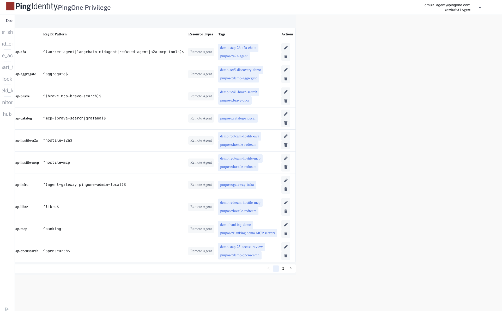
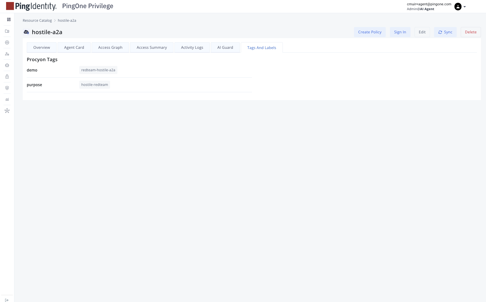

# Tag policies in depth

What tag policies are, what they are not, and how tags actually get onto
resources in the PingOne Privilege console. Everything below was probed live
on our tenant (2026-10-11) — the console UI and the swagger both leave this
partly undocumented, and one behavior is the opposite of what the feature
name implies.

Tested live 2026-10-11. Companion docs: [CURRENT-CONFIGURATION.md](CURRENT-CONFIGURATION.md)
("Tag map" section) for the live per-resource tag assignments;
[.claude/skills/privilege-console-api/](../.claude/skills/privilege-console-api/SKILL.md)
for the API recipe itself.

## Two different things: tag policies vs tags

| | Tag **policies** (`tagpolicys`) | **Tags** (`ObjectMeta.CTags`) |
|---|---|---|
| What it is | A name-regex → tag-set rule, scoped by resource type (`KindMap`) | Key/value pairs on a resource object |
| Where it lives | Its own `tagpolicys` collection | On each application / agent key / PAC policy object |
| What it does at runtime | **Nothing.** No reconciler, no apply endpoint (see below) | Shows in the console "Tags And Labels" panel; readable via API |
| How to create | API `POST /api/{tenant}/v1/tagpolicys` (the Create-Tag wizard UI is undrivable by automation) | API PUT with `CTags: {Map:{k:v}}` on the object |

The console's tags page (Admin → Tags) lists tag policies — it is the
*policy* inventory, not the per-resource tags:



Per-resource tags live on each object's detail page under the **Tags And
Labels** tab (Remote Agent apps):



## What tag policies are

A tag policy is a declarative rule: *objects whose name matches this regex
SHOULD carry these tags*. The `Spec` shape (from the imodel swagger and
verified live):

```json
{
  "RegExPattern": "^hostile-mcp",
  "KindMap": { "Map": { "Application": "true" } },
  "Tags": { "Map": { "demo": "redteam-hostile-mcp", "purpose": "hostile-redteam" } },
  "FixedPatterns": { "Elems": [] },
  "PolicyOrigin": "Default"
}
```

- `KindMap` values are **strings** (`"true"`), not booleans — a real boolean
  unmarshals as a 400. `Application` is the resource type we use; `PolicyOrigin`
  is an enum: `Default` | `Approver`.
- `FixedPatterns` exists but we have not found a use for it; it stays empty.
- Regexes are anchored name patterns, so one policy covers a whole app family
  (e.g. `^banking-`).

## What they don't do (measured, not assumed)

**Tag policies do not auto-tag anything.** A probe app created with a
policy-matching name (`hostile-mcp-tagprobe` against `^hostile-mcp`) got:

- zero `CTags` at create,
- still zero on a touch PUT afterwards,
- still zero after 5+ minutes.

There is no apply/evaluate endpoint in the swagger — CRUD only. There is no
reconciler. The wizard's "Apply Tags" step was never drivable (its
Resource-Types combobox ignores synthetic *and* CDP clicks), so its semantics
were never learned.

**Treat tag policies as documentation the console keeps about the intended
mapping** — a self-describing record of "objects named like this should carry
these tags" — not as an automation. The actual tags are set by hand via the
CTags PUT below.

## How tags actually get on (the CTags PUT)

Read-modify-write the whole object with `ObjectMeta.CTags` set:

```
GET  /api/{tenant}/v1/applications/default/{name}
     → add/replace ObjectMeta.CTags: {Map: {"demo": "...", "purpose": "..."}}
PUT  /api/{tenant}/v1/applications/default/{name}
```

Per-resource quirks, all measured:

- **Applications** — PUT works plain (`applications/default/{name}`), 200 and
  persists. MCP Server apps hold tags correctly in the API but the console's
  Tags And Labels panel shows "No Procyon tags" for them anyway (display bug,
  API state is correct — verify by GET, not by staring at the UI).
- **Agent access keys** — only the **namespaced** PUT route works:
  `/api/{tenant}/v1/agentaccesskeys/default/{name}`. PUT by bare name, UUID,
  base64 ID, or on the collection all 401 (RBAC) even with an admin session.
  The console UI has zero CTags code for keys — keys were never taggable from
  the UI.
- **PAC policies** — taggable via the same read-modify-write PUT.
- **User vaults / cloud agents** — PUT returns 200 but the server **strips
  CTags**; not taggable. Not a miss — a platform limit.
- Full-console result: 21/21 applications, 8/8 agent keys, 10/10 policies
  tagged; uservaults/cloudagents excluded by the platform.

The console UI path is a dead end for writes: the Create-Tag wizard fights
synthetic clicks, per-row edit/delete is all the tags list offers, and there
is no create button on the admin tags page. Do CRUD via the API; use the UI
only for reading (and only for Remote Agent apps — see the display bug above).

## Our live policy set

10 `demo-map-*` policies, one per app family, all created via the API
(2026-10-11). The regexes below are the *authoritative* patterns; the full
per-resource tag assignments live in
[CURRENT-CONFIGURATION.md](CURRENT-CONFIGURATION.md) ("Tag map").

| Policy | Regex | Tags |
|---|---|---|
| `demo-map-a2a` | `^(worker-agent\|langchain-midagent\|refused-agent\|a2a-mcp-tools)$` | `demo=step-26-a2a-chain` / `step-25-26-a2a`, `purpose=a2a-agent` |
| `demo-map-aggregate` | `^aggregate$` | `demo=act5-discovery-demo`, `purpose=demo-aggregate` |
| `demo-map-brave` | `^(brave\|mcp-brave-search)$` | `demo=uc41-brave-search`, `purpose=brave-door` |
| `demo-map-catalog` | `^mcp-(brave-search\|grafana)$` | `purpose=catalog-sidecar` |
| `demo-map-hostile-a2a` | `^hostile-a2a$` | `demo=redteam-hostile-a2a`, `purpose=hostile-redteam` |
| `demo-map-hostile-mcp` | `^hostile-mcp` | `demo=redteam-hostile-mcp`, `purpose=hostile-redteam` |
| `demo-map-infra` | `^(agent-gateway\|pingone-admin-local)$` | `purpose=gateway-infra` |
| `demo-map-libre` | `^libre$` | `demo=redteam-hostile-mcp`, `purpose=hostile-redteam` |
| `demo-map-mcp` | `^banking-` | `demo=banking-demo`, `purpose=banking-demo` |
| `demo-map-opensearch` | `^opensearch$` | `demo=step-25-access-review`, `purpose=demo-opensearch` |

## Maintenance rule

**Rename or add an app → update its `demo-map-*` pattern in the same change.**
A policy whose regex matches only dead names silently stops matching anything
and nothing complains — this already happened once (demo-map-a2a matched the
four pre-rename names until it was fixed 2026-10-11). Because policies never
apply tags themselves, a stale policy costs nothing at runtime and everything
at read time: the next person who trusts the console's record of the intended
mapping gets lied to.

## Why tag at all

Tags are how the console answers "what is this for" when the name alone
doesn't: every app, key, and policy in our tenant carries `demo` (which demo
act uses it) and `purpose` (what it is there for). The map from tag value to
demo step is the index into the whole tenant — see the "Tag map" section of
[CURRENT-CONFIGURATION.md](CURRENT-CONFIGURATION.md).
